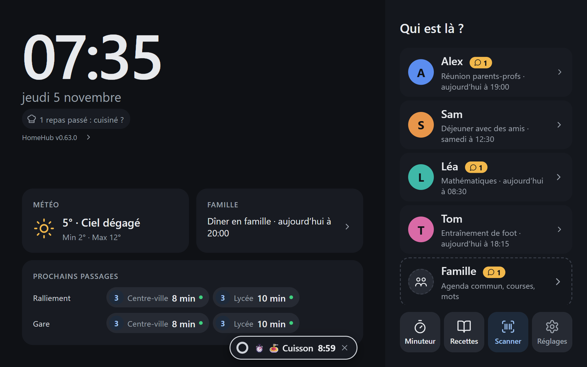

# HomeHub

Tableau de bord familial affiché en plein écran sur la tablette (Fully Kiosk).
Hébergé sur le NAS TrueNAS, derrière Nginx Proxy Manager (accès LAN + VPN uniquement).

Captures, diagrammes d'architecture et design : [docs/](docs/README.md).



- **Accueil** : grande horloge, météo, prochain événement de la famille, et « Qui est là ? » pour choisir son profil.
- **Dashboard par profil** (`/p/<id>`) : prochaine activité, tâches à cocher, semaine, mot de la famille.
  Un rail à gauche ramène à l'accueil ou passe directement à un autre profil.
- **Famille** : un profil commun (`/p/famille`) pour l'agenda partagé et la liste de courses.
- **Semaine détaillée** (`/semaine`) : ouverte depuis « Prochaine activité », « Cette semaine », les frises du jour et le
  bloc famille de l'accueil. Grille des 7 jours, agendas dans la couleur de chaque profil, cours un par un (salle,
  annulations) ; on choisit qui afficher, et on avance jusqu'à 2 semaines. Retour vers la page d'origine, comme la météo.
- **Météo détaillée** (`/meteo`) : ouverte en touchant n'importe quel affichage météo ; conditions actuelles
  (ressenti, vent, humidité, soleil), courbe des 24 prochaines heures avec la pluie, et 4 jours. Le bouton retour
  ramène à la page d'origine (`/meteo/p/<id>` quand elle est ouverte depuis un profil).
- **Scanner** (`/scanner`, bouton Scanner de l'accueil et du rail ; téléphone : bouton code-barres de l'onglet
  Courses, `/m/scanner`) : deux modes, **Ranger les courses** (entrées) et **Jeté / épuisé** (sorties). Le code-barres
  est lu par le navigateur (`BarcodeDetector`, caméra avant de la tablette, arrière du téléphone) ou tapé à la main.
  À chaque lecture : un **bip** (aigu : code lu ; puis deux notes s'il y a une question, une note grave en cas d'erreur), une vibration sur le
  téléphone, un éclair et une **bordure qui pulse** avec le bandeau « **Retire le produit** » : le scanner ne relit
  rien tant qu'un code reste devant la caméra (0,9 s sans code), si bien qu'un produit laissé devant n'est pas compté
  deux fois ; le représenter après l'avoir retiré compte un de plus. Chaque passage est listé avec **Annuler** (le
  dernier mouvement du produit), « Ce n'est pas ça ? » (fiche du produit) et, pour une sortie, « Recharge ? ». La
  reconnaissance des visages et la veille sont coupées pendant le scan ; sans activité, la tablette revient à la page
  d'origine au bout de 3 min.
  - **Qui et quand** : chaque entrée et sortie garde son heure et qui a scanné : le profil du téléphone, ou sur la
    tablette la personne reconnue en ouvrant le scanner (« Scans au nom de Léa », « Pas moi » pour scanner
    anonymement) ; personne de reconnu : anonyme. Chaque passage montre l'heure et le nom.
  - Produit **inconnu** de la base : on le décrit (nom, marque, contenance, rayon), il est gardé.
  - **Épuisé** (dernier exemplaire sorti) : « L'ajouter à la liste de courses ? » Oui / Oui, et toujours d'office /
    Non ; réglage par produit, et par défaut sur la page Stock. Un article ajouté d'office repart si on annule.
  - Sortie d'un produit **pas en stock** (entrée oubliée) : « Il en reste ? » (0 par défaut), ou « C'était une
    recharge ».
  - **Recharges** : un emballage transvasé dans un contenant de la maison (bocal à café, bidon de lessive…) sort,
    le produit reste dans le contenant ; le choix est retenu par produit (« Transvasé dans Bocal à café » proposé
    d'office, « Épuisé » toujours possible). L'étiquette du contenant (code-barres interne, préfixe 29), scannée en
    mode « Jeté / épuisé », le déclare vide.
- **Stock** (`/stock`, depuis le scanner ou la page Listes ; `/m/stock` sur le téléphone, depuis l'onglet Courses, pour
  voir au magasin ce qu'il reste, contenants en lecture seule) : produits en stock, épuisés ou tous, recherche ; ± 1 et
  « Épuisé » à la main (pour le stock déjà là ou un oubli) ; sous chaque produit, la dernière entrée et la dernière
  sortie (« Rangé hier à 18:20 (Léa) · sorti aujourd'hui à 07:30 (anonyme) »), et pour un produit épuisé seulement
  quand et par qui (« Épuisé aujourd'hui à 07:30 (anonyme) ») ; fiche de chaque produit : historique
  des entrées et sorties (date, heure, qui, tablette ou téléphone), provenance (base et date, ou
  corrigé à la main), **Revérifier** (relecture immédiate de la base, différences montrées, à prendre ou non),
  **Corriger** (notre version l'emporte ; versions datées), liste de courses d'office ou non, contenant habituel.
  Contenants de la maison : ajout, renommage, retrait, « Vide », **étiquette à imprimer**. Écriture depuis la tablette
  (sans reconnaissance du visage : la caméra sert au scan ; au nom de la personne reconnue s'il y en a une) ou un
  téléphone relié. Prix : facultatifs, pas encore saisis (lecture des tickets à venir).
- **Le NAS** (`/nas`) : ouvert par la roue dentée ou en touchant la version de HomeHub sur l'accueil ; état général, processeur,
  mémoire, données et batterie, points à surveiller (contrôles de santé du NAS, sources de HomeHub en erreur,
  points faibles du matériel), services et événements récents (sauvegarde, vérification des données, démarrages).
- **Listes** (`/listes`) : courses et tâches de la famille, ouvertes depuis « Mes tâches » ou « Liste de courses ».
  Courses : saisie rapide, articles fréquents en un geste, articles cochés « dans le panier » jusqu'à « Vider ».
  Tâches : pour qui, échéance (en retard en rouge), répétition (la suivante est créée quand on coche), filtre par
  personne ; une tâche faite reste visible jusqu'à minuit. Les tâches d'un membre apparaissent sur son dashboard, les
  courses sur celui de la famille. Sur la tablette, ce qui est coché ou ajouté l'est au nom de la personne reconnue.
- **Mots** : envoyés depuis un profil à un autre, ou à toute la famille (200 caractères) : depuis son téléphone
  (onglet Mots) ou la tablette (bloc « Mots » d'un dashboard, envoyé depuis ce profil ; on choisit seulement à qui). Le
  destinataire le voit sur son dashboard et son téléphone, touche « Vu » et il disparaît ; sinon il s'efface au bout
  de 7 jours (`notes.json`).
- **Téléphones** (`/telephones`, par la roue dentée de la tablette) : on choisit le profil, le téléphone scanne le QR code
  (valable 5 min, une seule fois) et devient l'appli de ce profil : `/m` (courses), `/m/taches` (avec, en tête, la
  routine du moment à cocher ; pastille sur l'onglet : étapes restantes), `/m/agenda`
  (7 prochains jours, soi et la famille), `/m/mots`. Installable sur l'écran d'accueil (PWA) ; « Partager » depuis une autre appli
  ouvre l'ajout prérempli (`/partager`). Un téléphone retiré depuis la tablette perd l'accès aussitôt.
  La tablette affiche le modèle annoncé par le téléphone, rendu lisible (« SM-S918B » → « Samsung Galaxy S23 Ultra »),
  et son système ; on le renomme en touchant son nom.
  Un profil peut avoir un **code PIN**, demandé par la tablette avant d'afficher son QR code et avant de retirer un
  de ses téléphones (5 erreurs : bloqué 15 min). Un **code parent** retire n'importe quel téléphone. On les définit
  sur le serveur : `node scripts/set-pin.ts <profil>` ou `--parent` (dans le conteneur :
  `docker exec -it homehub node scripts/set-pin.ts <profil>`, `--supprimer` pour l'enlever, sans argument : la liste).
  Sans aucun code défini, le retrait se confirme d'un second geste.
- **Qui écrit** (tablette) : tout le monde lit tous les profils. La caméra reconnaît en continu, sans rien demander,
  la personne devant la tablette (environ une analyse par seconde tant que l'écran est allumé ; deux analyses de
  suite sur la même personne pour la retenir ; oubliée après 10 s sans être vue). Elle s'affiche en bas du rail des
  dashboards et à côté de la roue dentée de l'accueil (« Personne » si la caméra tourne sans reconnaître personne), et
  son profil ressort sur l'accueil. Un geste qui modifie (cocher, ajouter, laisser un mot, « Vu », relier, renommer ou
  retirer un téléphone) passe tout de suite si elle en a le droit ; si personne n'est encore reconnu, une petite bulle
  « Regarde la tablette » l'attend quelques secondes. Un **parent** (`parent: true` dans la configuration) modifie
  tous les profils, famille comprise ; un enfant, seulement le sien (ni la liste de courses, ni le profil de la
  famille, ni « Vu » sur un mot à toute la famille) : sinon, « Lecture seule : profil de … ». Même règle pour les
  téléphones, chacun au nom de son profil. Les visages s'enregistrent par la roue dentée (**Visages**, `/visages`) :
  10 prises guidées (« approche-toi », « recule un peu »), à faire à sa place habituelle, puis le code parent
  (obligatoire). La tablette ne calcule qu'une empreinte du visage (bibliothèque
  [Human](https://github.com/vladmandic/human), modèles servis par HomeHub) ; le serveur la compare aux empreintes
  enregistrées (`faces.json`) et ouvre une session courte. Aucune image ne quitte la tablette. Lors d'une
  reconnaissance sûre et assez différente des empreintes connues, le serveur en **apprend** une (au plus une par
  personne toutes les 30 min, `faces.learnMinutes` ; 10 gardées, en plus des 20 enregistrées au plus) : la
  reconnaissance suit les changements de coiffure, de lunettes ou de lumière. Le **diagnostic** (page Visages) montre
  en direct la confiance de détection, la taille du visage, les scores « photo » et « écran », la ressemblance avec
  chaque personne et le verdict, avec les seuils en vigueur, puis un bilan des dernières analyses et une piste de
  réglage. Limites : la tablette
  est de confiance (sa clé suffit à se faire passer pour elle) ; les contrôles « photo » et « écran » réduisent, sans
  l'exclure, la ruse d'une photo ; la caméra reste allumée tant que l'écran l'est (éteinte sur la page Visages, et
  quand la page est masquée). Fully Kiosk : activer *Web Content Settings › Enable Webcam Access* et autoriser la
  caméra à Fully dans Android ; la détection de mouvement de Fully se sert aussi de la caméra et peut l'empêcher.
- **Veille** (tablette) : après 5 min sans contact ni visage devant la caméra (`ui.screensaverMinutes`, 0 : jamais),
  écran noir où seuls restent l'horloge, la date et la météo du moment (température, ciel, min et max ou pluie à
  venir ; le lendemain en soirée), déplacés au hasard toutes les 12 s (pour ne pas marquer l'écran) ; avec
  l'interface JavaScript de Fully Kiosk, la luminosité baisse aussi. Un visage devant la caméra ou un contact la
  réveille ; le contact qui réveille n'ouvre ni ne coche rien.
- **Accueil personnalisé** (tablette) : la personne reconnue a sa carte sur l'accueil (« Bonsoir Léa ! ») : ses mots
  pas encore vus (en évidence, qui clignotent doucement), sa routine du moment, ses devoirs du prochain jour
  (« 3 devoirs pour demain »), ses premières tâches et son prochain rendez-vous ; la toucher ouvre son dashboard. Chaque profil de « Qui est là ? » montre aussi le nombre de ses mots
  pas encore vus, et l'indicateur de la personne reconnue (accueil et rail) le sien, à toucher pour ouvrir son
  dashboard.
- **Routines** du matin et du soir : étapes propres à chaque membre, affichées sur son dashboard à leurs heures (5 h–11 h
  et 17 h–23 h par défaut, d'autres possibles le week-end) à la place de « À venir ». Une étape peut ne valoir que
  certains jours ; un jour sans étape prévue n'affiche pas de routine et ne casse pas la série. Elles sont cochées
  comme ses tâches (mêmes droits) et remises à zéro chaque jour (`routines.json`). Avancement sur l'accueil ;
  « Bravo, c'est fini ! » et le nombre de jours de suite où la routine a été faite en entier.
- **Page Routines** (roue dentée de la tablette) : les étapes de chacun et les heures, réglées au doigt : un membre à
  la fois, matin et soir côte à côte ; pour chaque étape, son nom, ses jours (L M M J V S D, tous allumés : tous les
  jours), monter ou descendre, supprimer ; « Nouvelle étape » ; heures en semaine et, au besoin, le week-end. Tout le
  monde peut regarder ; seul un parent reconnu (ou un téléphone de parent) enregistre (`routine-plans.json`). Chaque
  étape garde un identifiant : la renommer ou la déplacer ne perd ni ses cases du jour ni les jours de suite.
- **Dashboard « focus »** d'un élève (essai, à activer sur la tablette : roue dentée › Dashboard élève) : une seule
  frise avec la bascule « Aujourd'hui | Demain » (demain d'office une fois la journée de cours finie), la carte du
  moment en grand (routine du matin ; après l'école, les devoirs qui restent jusqu'à 19 h ; puis la routine du soir ;
  sinon les rendez-vous), et le reste en tuiles (devoirs, routine, tâches, mots, prochain rendez-vous) : un chiffre
  et un mot, bordées de la couleur du profil quand il y a du nouveau (mot, devoirs pour demain). Une tuile ouvre sa
  carte complète dans un panneau, refermé d'un toucher à côté ou seul après 30 s. Le choix est gardé par l'appareil ;
  le dashboard classique reste celui par défaut.
- **Devoirs** (élève avec ÉcoleDirecte ou Pronote) : carte « Devoirs » sur son dashboard, à la place de « À venir » :
  par jour (« Pour demain », « Pour lundi » ; ceux du jour le matin seulement), matière, consigne (toucher pour la
  lire en entier), « Contrôle » quand ÉcoleDirecte l'annonce, pièces jointes et durée prévue s'il y en a. Aussi dans
  l'onglet Tâches de son téléphone. **Lecture seule** : un devoir se coche dans l'appli de l'école ; HomeHub montre
  « ✓ fait » au rafraîchissement suivant.
- **Bus et tram Irigo** (Angers) : sur l'accueil, les prochains passages aux arrêts suivis (`transit.stops`), deux
  par ligne et direction, avec une antenne verte quand l'heure vient du temps réel, et les perturbations de ces
  lignes ; sous l'horloge de la veille, ceux du premier arrêt. Trajet du matin d'un membre (`commute`) : à ses heures
  et ses jours, un bandeau en haut de son dashboard dit quand partir de la maison, marche comprise (« Pars dans
  6 min pour le bus 3 de 07:42 », orange la dernière minute, puis le suivant ou « Trop tard »).
- **Page « Transports »** (roue dentée de la tablette ; un parent enregistre) : les lieux de la famille (maison,
  école, club…), situés par leur adresse ; le trajet de chacun, avec les lignes directes entre les deux lieux trouvées
  dans les horaires Irigo (marche estimée aux deux bouts, modifiable) ; les arrêts de l'accueil (par nom ou près d'un
  lieu). Un trajet **selon l'emploi du temps** prend chaque jour la dernière course qui fait arriver avant le premier
  cours non annulé (marge réglable), affiche le bandeau un moment avant l'heure de partir et reconnaît cette course
  dans le temps réel (« annoncé à 07:53 », supprimée, manquée) ; rien les jours sans cours. Sinon, plage horaire
  fixe. Tant que la page n'a pas été enregistrée, `transit.stops` et `commute` du YAML s'appliquent.
- **Minuteurs** (tablette) : bouton minuteur sur l'accueil et dans le rail. La durée se choisit sur une roue (glisser
  le doigt autour du cadran : un tour, une heure, autant de tours qu'on veut jusqu'à 24 h ; − 1, + 1, + 5, + 1 h ;
  raccourcis jusqu'à 2 h qui font tourner la roue) qui montre l'heure de
  fin ; l'activité, facultative (🍝 Cuisson, 📺 Écrans, 📚 Devoirs, 🦷 Dents, 🚿 Douche, 🎲 Jeux), donne son emoji et
  sa couleur à la roue, aux pastilles et à l'alerte ; puis « Lancer ». En cours, ils restent en bas de l'écran, avec un
  anneau qui se vide (et sous l'horloge de la veille) ; à la fin, ils
  prennent tout l'écran, réveillent la tablette et sonnent (trois bips répétés, 2 min au plus) jusqu'à « Arrêter ».
  Lancer ou annuler un minuteur demande quelqu'un de reconnu (n'importe qui, enfant compris) ; arrêter celui qui
  sonne, non. Enregistrés (`timers.json`) : une mise à jour ou un redémarrage du serveur ne les perd pas ; celui qui
  s'est terminé entre-temps sonne au retour.
- Retour automatique à l'accueil après un délai sans contact ; rechargement automatique après un déploiement
  ou une modification de la configuration. La version chargée est affichée sous l'horloge de l'accueil.

La **météo** vient d'[Open-Meteo](https://open-meteo.com) avec les modèles de Météo-France (AROME 1,3 km, ARPEGE) :
gratuit, sans clé, mis en cache 15 min ; en cas de panne, la dernière prévision reste affichée jusqu'à 6 h, puis le
bloc est masqué.

L'**agenda** vient des adresses secrètes iCal (Google Agenda ou autre), téléchargées toutes les 10 min ; les
récurrences, exceptions, fuseaux horaires et événements sur la journée sont gérés (`ical.js`). Les adresses sont des
secrets : le YAML ne contient que le nom de la variable d'environnement qui les porte. Tant qu'aucun agenda n'est
configuré, l'agenda affiche des exemples.

L'**emploi du temps** vient d'ÉcoleDirecte (API privée du site, non officielle : elle peut changer), rafraîchi
toutes les 60 min. Un profil avec `ecoledirecte: <prénom de l'élève>` affiche une frise du jour (cours en gris,
agenda à sa couleur) et une carte « Demain ». La connexion demande, la première fois, de répondre à une question
de sécurité : `node scripts/ecoledirecte-pair.ts [prénom]` le fait sur un PC et affiche les variables
`ECOLEDIRECTE_IDENTIFIANT`, `ECOLEDIRECTE_MOTDEPASSE`, `ECOLEDIRECTE_CN`, `ECOLEDIRECTE_CV` à mettre dans
l'environnement.

Les **devoirs** viennent de la même connexion (cahier de texte ÉcoleDirecte, devoirs Pronote), sur la même fenêtre
de trois semaines et au même rythme. Si l'établissement n'ouvre pas le cahier de texte au compte Famille, les cours
restent affichés, sans carte « Devoirs », et l'erreur est notée dans les journaux.

Il peut aussi venir de **Pronote** (compte parent), avec `pronote: <prénom de l'enfant>` sur le profil, par
[Pawnote](https://github.com/LiterateInk/Pawnote), bibliothèque non officielle qui imite l'application mobile.
Pawnote 1.6.2 ne suit pas Pronote 2026 : `scripts/patch-pawnote.ts` le corrige à chaque `npm install` et fait
échouer l'installation si la version change. La connexion se fait par jeton, comme l'application :
1. dans Pronote, bouton « QR code de l'application » en haut de la page, choisir un code PIN, faire une capture
   d'écran du QR code (valable 10 min) ;
2. sur un PC : `node scripts/pronote-pair.ts <capture.png> [prénom]` (demande le PIN, vérifie l'emploi du temps,
   écrit `~/.homehub-pronote.json`) ;
3. copier ce fichier sous le nom `pronote.json` dans le dossier d'état (`HOMEHUB_STATE_DIR`), inscriptible par
   l'app.

Pronote donne un nouveau jeton à chaque connexion : HomeHub le réenregistre aussitôt dans `pronote.json`. Le
fichier copié ne sert donc qu'une fois ; s'il est perdu ou refusé, refaire l'appairage. L'appareil apparaît dans
la liste des appareils connectés du compte Pronote, d'où il peut être révoqué.

Les **bus et trams** viennent de l'open data d'Angers Loire Métropole (licence ODbL, sans compte ni clé) : prochains
passages par l'API SIRI d'Ara (`StopMonitoring`, en tant que `opendata`), au plus une fois par minute et par arrêt,
et seulement quand un écran les demande ; perturbations par le flux GTFS-RT d'alertes, toutes les 10 min. SIRI ne
connaît que les courses de l'heure qui vient : la nuit, un arrêt n'affiche aucun passage. Pour trouver
l'identifiant d'un arrêt (un par sens) : `node scripts/irigo-stops.ts <nom>`, puis
`node scripts/irigo-stops.ts --passages <id>` pour voir ses destinations.

La page « Transports » s'appuie aussi sur les **horaires théoriques** (GTFS du même jeu, sur transport.data.gouv.fr) :
position des arrêts, lignes, courses de chaque jour. L'archive (5 Mo) est téléchargée au plus une fois par semaine et
gardée dans `HOMEHUB_STATE_DIR/irigo-gtfs.zip` (lien data.gouv.fr, redirigé vers `chouette.enroute.mobi`). Les adresses
sont cherchées sur la Géoplateforme de l'IGN (`data.geopf.fr`, successeur de l'API Adresse) : seule l'adresse tapée
lui est envoyée. Lieux et trajets sont enregistrés dans `HOMEHUB_STATE_DIR/transit-settings.json`, jamais dans le
dépôt. Pas de correspondance : seules les lignes directes sont proposées (arrêts à moins de 800 m de chaque lieu ;
marche estimée : ligne droite + 30 %, à 4,5 km/h).

Les **produits** viennent des bases libres [Open Food Facts](https://world.openfoodfacts.org), puis Open Beauty Facts
(hygiène) et Open Products Facts (lessive, entretien…) : sans compte, avec un User-Agent qui nomme HomeHub ; seul le
code-barres leur est envoyé. Chaque produit trouvé est copié dans `stock.json` : la base n'est relue qu'au scan d'un
produit lu il y a plus de 180 jours, ou sur « Revérifier ». Ce qui a été corrigé à la main l'emporte : une relecture
qui le contredit est signalée sur la fiche (garder la nôtre ou prendre la base), jamais appliquée d'office.

Sans agenda configuré, l'agenda est d'exemple (`server/sources/sample.ts`) ; les tâches et les mots sont toujours
réels.

## Configuration

Un fichier YAML validé, **rechargé à chaud** : le serveur le surveille et l'applique en quelques secondes, puis la
tablette se recharge (au plus 30 s). Au démarrage, un fichier invalide empêche l'app de démarrer ; ensuite, la
configuration précédente est conservée et l'erreur est journalisée.
Modèle commenté : [`config/homehub.example.yaml`](config/homehub.example.yaml).

```yaml
members:
  - id: lea          # minuscules, chiffres, tirets ; utilisé dans l'URL /p/lea
    name: Léa
    color: "#3fb8a8"
    calendars: [CAL_LEA]   # variable d'environnement : CAL_LEA=https://calendar.google.com/…/basic.ics
family:
  name: Famille
  calendars: [CAL_FAMILLE]
ui:
  idleTimeoutSeconds: 180
kiosk:
  addresses: [192.168.1.50]   # facultatif : adresse fixe de la tablette (sinon, sa clé HOMEHUB_KIOSK_KEY)
weather:             # facultatif : sans cette section, pas de météo
  label: Paris
  latitude: 48.85    # deux décimales (~1 km) suffisent
  longitude: 2.35
```

| Variable | Défaut | Rôle |
|---|---|---|
| `PORT` | `3000` | Port d'écoute |
| `HOMEHUB_CONFIG` | `config/homehub.yaml` (image Docker : `/data/homehub.yaml`) | Fichier de configuration |
| `HOMEHUB_STATIC_ROOT` | `./web/dist` | Front compilé |
| `CAL_…` (noms libres) | — | Adresses secrètes iCal référencées par `calendars` |
| `ECOLEDIRECTE_IDENTIFIANT`, `_MOTDEPASSE`, `_CN`, `_CV` | — | Compte Famille ÉcoleDirecte et jetons de confiance (script d'appairage) |
| `HOMEHUB_STATE_DIR` | `state` (image Docker : `/state`) | Dossier inscriptible : jeton Pronote (`pronote.json`), listes (`lists.json`), mots (`notes.json`), téléphones reliés (`devices.json`), PIN des profils (`pins.json`), visages (`faces.json`), routines cochées (`routines.json`) et leurs réglages (`routine-plans.json`), minuteurs (`timers.json`), stock, produits et contenants (`stock.json`) |
| `HOMEHUB_KIOSK_KEY` | — | Clé secrète de la tablette (20 caractères au moins, ex. `openssl rand -base64 24`), donnée une fois dans son adresse de démarrage : `https://…/#key=<clé>` |
| `HOMEHUB_NAS_STATUS` | `nas-status.json` à côté de la configuration | Relevé du NAS lu par la page NAS (écrit par `scripts/nas-status.sh` de nas-config) |

## Architecture

```
shared/types.ts            contrat de l'API (types partagés serveur / front)
server/
  index.ts                 racine de composition : env, config, sources, service, serveur
  config.ts                schéma zod + chargement du YAML
  config-store.ts          configuration courante, révision, rechargement à chaud du fichier
  app.ts                   routes HTTP (fines : validation → service → JSON)
  services/dashboard.ts    logique métier, sans HTTP ni implémentation de source
  sources/types.ts         interfaces des sources (agenda, tâches, mots, météo) + horloge
  sources/sample.ts        implémentations d'exemple, en mémoire
  sources/open-meteo.ts    météo Open-Meteo
  sources/ical.ts          agendas iCal (adresses secrètes Google Agenda)
  sources/ecoledirecte.ts  emploi du temps et devoirs ÉcoleDirecte (client de l'API privée + source)
  sources/pronote.ts       emploi du temps et devoirs Pronote (Pawnote, jeton enregistré à chaque connexion)
  sources/homework.ts      devoirs : consigne HTML → texte, tri, fenêtre
  sources/irigo.ts         bus et tram Irigo : passages (SIRI), perturbations, cache
  sources/gtfs-rt.ts       lecture minimale d'un flux d'alertes GTFS-RT (protobuf)
  sources/gtfs.ts          horaires théoriques Irigo (GTFS) : arrêts proches, lignes directes, courses du jour
  sources/geocode.ts       recherche d'adresse (Géoplateforme de l'IGN)
  sources/transit-settings.ts  réglages de la page « Transports » (lieux, trajets, arrêts de l'accueil)
  sources/refreshing-cache.ts  cache des données distantes (rafraîchissement, repli en cas de panne)
  sources/source-status.ts dernier résultat de chaque source (page NAS)
  sources/nas-status.ts    relevé du NAS (nas-status.json, écrit par une tâche cron du NAS)
  services/nas.ts          page NAS : relevé, état des sources, version
  sources/lists.ts         courses et tâches (lists.json), tâches qui reviennent, articles fréquents
  sources/routines.ts      routines du matin et du soir cochées (routines.json), jours de suite
  sources/routine-plans.ts réglages des routines modifiés sur la tablette (routine-plans.json)
  sources/timers.ts        minuteurs (timers.json)
  sources/notes.ts         mots de la famille (notes.json), effacés une fois vus ou au bout de 7 jours
  sources/devices.ts       téléphones reliés (devices.json, empreinte du jeton seulement), codes d'appairage
  sources/stock.ts         stock (stock.json) : produits et leurs versions, mouvements annulables, contenants
  sources/open-food-facts.ts  bases de produits (Open Food Facts, Open Beauty Facts, Open Products Facts)
  access.ts                qui écrit : la tablette (kiosk.addresses), un téléphone relié (jeton), sinon personne
  lists-api.ts             routes des listes, de l'appairage et des téléphones
  stock-api.ts             routes du stock et du scanner
shared/barcode.ts          codes-barres : clé de contrôle, forme sur 13 chiffres, étiquettes des contenants
web/src/
  main.ts                  racine de composition du front : API, routeur, horloge → contexte Svelte
  App.svelte               choix de l'écran, retour à l'accueil, surveillance de version
  screens/                 écrans (chargent leurs données via l'API du contexte)
  components/              composants d'affichage ; widgets/ = purement présentationnels
  lib/                     API, routeur, formats, couleurs, minuteries (logique testable sans DOM)
```

- **Injection de dépendances** : le service reçoit la config, les sources et l'horloge ; l'app HTTP reçoit le
  service. Côté front, `main.ts` fournit l'API, la config, le routeur et l'horloge par le contexte Svelte.
- **Ajouter une vraie source** (ex. Google Agenda) : implémenter `AgendaSource` dans `server/sources/`,
  puis la brancher dans `server/index.ts`. Ni le service, ni les routes, ni le front ne changent.

### API

| Route | Réponse |
|---|---|
| `GET /api/health` | `{ status, version, configRevision, time }` (healthcheck Docker ; le front se recharge si la version ou la révision change) |
| `GET /api/config` | membres, nom de la famille, réglages d'interface, révision |
| `GET /api/home` | météo, résumé de chaque profil, prochain événement familial |
| `GET /api/dashboard/:id` | dashboard d'un membre ou de `famille` (404 si inconnu) |
| `GET /api/nas` | relevé du NAS (`null` s'il est absent), état des sources, version et démarrage de HomeHub |
| `PUT /api/dashboard/:id/tasks/:taskId` | `{ "done": true }` → la tâche mise à jour (écriture) |
| `GET /api/dashboard/:id/routine` | `{ routine }` : la routine du moment seule (appli du téléphone), `null` hors de ses heures |
| `GET /api/transit` | `{ stops, alerts }` : prochains passages Irigo aux arrêts suivis, perturbations de leurs lignes |
| `GET /api/dashboard/:id/homework` | `{ homework }` : les devoirs à faire seuls (appli du téléphone), `null` sans cahier de texte |
| `PUT /api/dashboard/:id/routine/:itemId` | `{ "done": true }` → l'étape de la routine du jour (`morning-0`, `evening-2`…) (écriture) |
| `GET /api/transit/settings`, `PUT /api/transit/settings` | réglages de la page « Transports » `{ places, commutes, stops }` (tablette ou téléphone appairé ; enregistrer : un parent) |
| `GET /api/transit/addresses?q=` | `{ addresses }` : adresses correspondantes (tablette ou téléphone appairé) |
| `GET /api/transit/stops?q=` ou `?near=lat,lon` | `{ stops }` : arrêts par nom ou proches d'un point, avec lignes et destinations |
| `GET /api/transit/routes?from=lat,lon&to=lat,lon` | `{ routes }` : lignes directes entre deux points, de la plus rapide à la plus lente |
| `GET /api/routines`, `PUT /api/routines` | réglages des routines `{ windows, members }` ; enregistrer : `{ windows, members }`, un parent |
| `GET /api/timers`, `POST /api/timers`, `DELETE /api/timers/:id` | minuteurs : liste ; lancer (`{ label, seconds }`, quelqu'un de reconnu) ; arrêter (en cours : quelqu'un de reconnu ; qui sonne : la tablette) |
| `GET /api/me` | `{ kiosk, device }` : l'appareil qui appelle (401 pour un téléphone retiré) |
| `GET /api/lists` | `{ shopping, tasks, frequent }` |
| `GET /api/notes`, `POST /api/notes` | mots des 7 derniers jours ; ajout : `{ to, text, from? }` (sur la tablette, `from` : profil ouvert ; `to` ≠ `from`) |
| `PUT /api/notes/:id/seen` | marque un mot vu (droit d'écriture sur son destinataire ; un mot à la famille : un parent) |
| `POST /api/lists/shopping`, `PUT`/`DELETE …/shopping/:id`, `POST …/shopping/clear` | courses (écriture) |
| `POST /api/lists/tasks`, `PUT`/`DELETE …/tasks/:id` | tâches (écriture) |
| `GET /api/pairing/pins` | `{ protected, parent }` : profils qui ont un PIN, code parent défini (tablette seulement) |
| `POST /api/pairing` | `{ ownerId, pin? }` → code d'appairage (tablette, personne reconnue qui peut écrire sur ce profil ; 403 si le PIN manque ou est faux, 429 si bloqué) |
| `POST /api/pairing/claim` | `{ code, name, system? }` → `{ token, device }` (410 si le code a expiré ou a servi) |
| `GET /api/devices`, `DELETE /api/devices/:id` | téléphones reliés (tablette seulement) ; retrait : personne reconnue qui peut écrire sur ce profil, et `{ pin }`, PIN du propriétaire ou code parent s'il en existe un |
| `PATCH /api/devices/:id` | `{ name }` : renomme un téléphone (tablette, personne reconnue qui peut écrire sur ce profil) |
| `GET /api/faces` | `{ enrolled, samples }` : profils dont le visage est enregistré, et nombre d'empreintes enregistrées et apprises (tablette seulement) |
| `POST /api/faces/identify` | `{ embedding, real, live }` → `{ ownerId, token }` (même session prolongée pour la même personne ; 401 : non reconnu ; tablette seulement) |
| `POST /api/faces/diagnose` | `{ embedding, real, live }` → `{ verdict, scores, rules }` : verdict détaillé, sans session ni apprentissage (tablette seulement) |
| `DELETE /api/faces/session` | termine la session de l'en-tête `X-Actor-Session` |
| `POST /api/faces/:id`, `DELETE /api/faces/:id` | enregistre (`{ embeddings, pin }`) ou efface (`{ pin }`) un visage : code parent obligatoire |
| `GET /api/stock` | `{ items, containers, settings }` : produits avec leur quantité, contenants, réglage par défaut |
| `GET /api/stock/scan/:code` | ce qu'est un code (13 chiffres) : `product` (avec quantité ; base lue si besoin), `container` ou `unknown` |
| `PUT /api/stock/products/:code` | `{ name, brand, quantity, category }` : produit inconnu décrit, ou corrigé (notre version l'emporte) |
| `GET /api/stock/products/:code/movements` | historique d'un produit, du plus récent : `{ at, by, kind, count, price, forgotten, undone }` |
| `POST /api/stock/products/:code/recheck`, `…/accept-base`, `…/conflict` | relit la base (différences) ; prend sa version ; tranche un désaccord (`{ take: "mine" \| "base" }`) |
| `PATCH /api/stock/products/:code` | `{ autoShop, refill }` : liste de courses d'office (`null` : réglage par défaut), contenant habituel |
| `POST /api/stock/in`, `/out`, `/quantity` | entrée (`{ code, count?, price? }`) ; sortie (`{ code, all?, refill?, remaining? }`, avec la proposition de liste de courses) ; quantité comptée ; la réponse donne `at` et `by` (qui a scanné) |
| `POST /api/stock/undo` | `{ movementId }` : annule le dernier mouvement d'un produit ou d'un contenant (409 sinon) |
| `POST /api/stock/shopping` | `{ code, always? }` : sur la liste de courses ; `always` : d'office la prochaine fois |
| `POST /api/stock/containers`, `PATCH`/`DELETE …/:id`, `POST …/:id/empty` | contenants : ajout, renommage, retrait, déclaré vide |
| `PUT /api/stock/settings` | `{ autoShop }` : réglage par défaut des produits épuisés |

Toutes les écritures du stock : tablette ou téléphone relié.

**Écriture** : la tablette est reconnue à sa clé (`HOMEHUB_KIOSK_KEY`, lue une fois dans `#key=…` puis envoyée dans
l'en-tête `X-Kiosk-Key` ; placée après `#`, elle n'apparaît jamais dans les journaux du proxy) ou à son adresse
(`kiosk.addresses`, lue dans `X-Real-IP` posé par le proxy ; `127.0.0.1` compte toujours comme tablette, pour le
développement), un téléphone relié à son jeton
(`Authorization: Bearer`). Tout autre appareil lit sans écrire (403). La tablette agit au nom de la personne reconnue
(en-tête `X-Actor-Session` ; sans elle : 403 avec `identify: true`), un téléphone au nom de son profil ; un parent
écrit partout, un enfant sur son profil seulement (`shared/rights.ts`). Les icônes de la PWA se régénèrent avec
`node scripts/make-icons.ts`.

## Développement

```bash
npm install
cp config/homehub.example.yaml config/homehub.yaml
cp server/sources/fixtures/nas-status.json config/nas-status.json   # facultatif : page NAS (relevé ancien)
npm run dev       # back sur :3000 + Vite sur :5173 (proxy /api → :3000)
npm test          # tests (vitest) : config, service, routes, utilitaires du front
npm run check     # vérification des types (server + web)
npm run build     # compile le front dans web/dist
npm start         # sert l'app compilée sur :3000
npm run docs:captures   # refait les captures de docs/images (données fictives, Chrome sans fenêtre)
```

Pour tester sur la tablette en dev : `http://<ip-du-pc>:5173`.

## Release et déploiement

1. Mettre à jour `version` dans `package.json`, commit.
2. `git tag vX.Y.Z && git push --follow-tags` → GitHub Actions vérifie (types, tests), construit et publie
   `ghcr.io/deaflight/homehub:X.Y.Z`.
3. Dans `nas-config`, passer le service `homehub` au tag `X.Y.Z`, commit + push.
4. Sur le NAS : `git pull --ff-only` puis `sudo scripts/update-apps.sh homehub`.

Sur le NAS, la configuration est `/mnt/X/docker/data/homehub/homehub.yaml`, montée en lecture seule sur `/data`.
