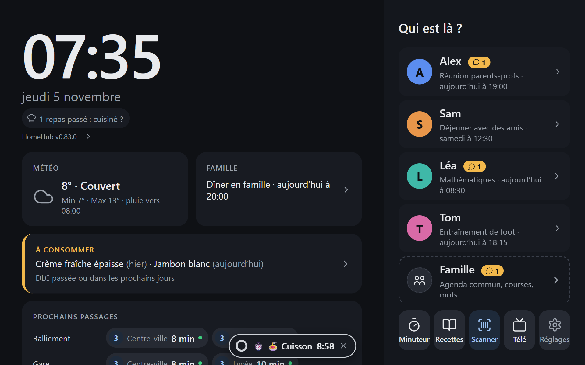
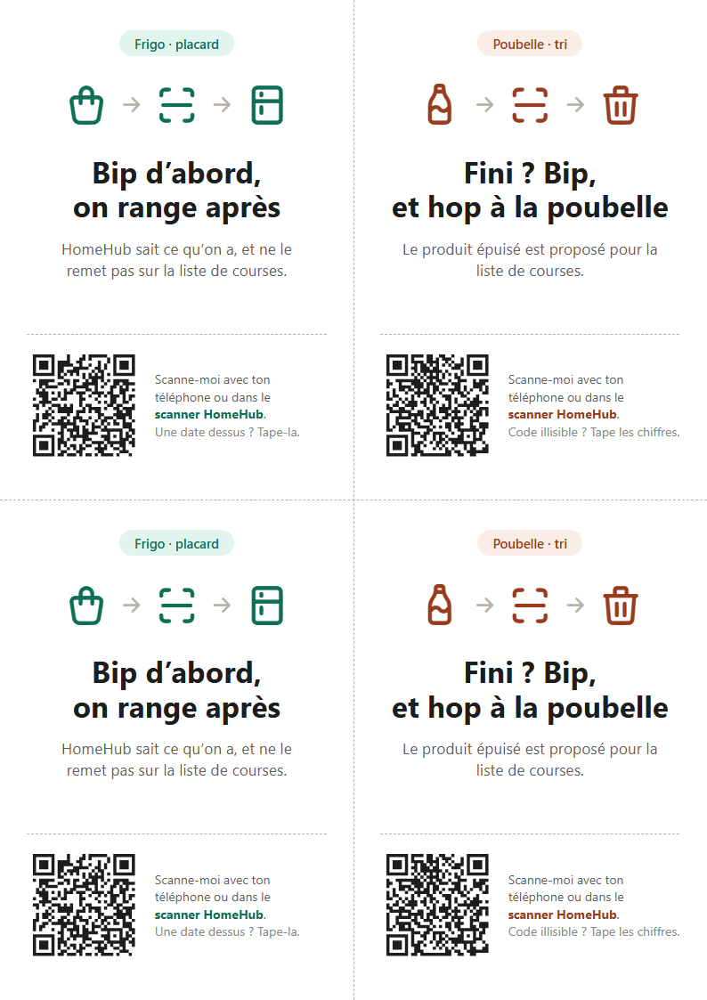

# HomeHub

Tableau de bord familial affiché en plein écran sur la tablette (Fully Kiosk).
Hébergé sur le NAS TrueNAS, derrière Nginx Proxy Manager (accès LAN + VPN uniquement).

Captures, diagrammes d'architecture et design : [docs/](docs/README.md).



- **Accueil** : grande horloge, météo, prochain événement de la famille, et « Qui est là ? » pour choisir son profil ;
  carte **« À consommer »** quand une DLC du stock est passée ou urgente (voir Stock). Quand les cartes dépassent
  la hauteur de l'écran, elles défilent au doigt sous l'horloge, qui reste fixe en haut (0.96.1, 0.96.3).
- **Dashboard par profil** (`/p/<id>`) : prochaine activité, tâches à cocher, semaine, mot de la famille (et, pour un
  parent, la carte « À consommer »).
  Un rail à gauche ramène à l'accueil ou passe directement à un autre profil.
- **Famille** : un profil commun (`/p/famille`) pour l'agenda partagé et la liste de courses.
- **Semaine détaillée** (`/semaine`) : ouverte depuis « Prochaine activité », « Cette semaine », les frises du jour et le
  bloc famille de l'accueil. Grille des 7 jours, agendas dans la couleur de chaque profil, cours un par un (salle,
  annulations) ; on choisit qui afficher, et on avance jusqu'à 2 semaines. Retour vers la page d'origine, comme la météo.
- **Météo détaillée** (`/meteo`) : ouverte en touchant n'importe quel affichage météo ; conditions actuelles
  (ressenti, vent, humidité, soleil), courbe des 24 prochaines heures avec la pluie, et 4 jours. Le bouton retour
  ramène à la page d'origine (`/meteo/p/<id>` quand elle est ouverte depuis un profil).
- **Scanner** (`/scanner`, bouton Scanner de l'accueil et du rail ; téléphone : bouton code-barres de l'onglet
  Courses, `/m/scanner`) : deux modes, **Ranger les courses** (entrées) et **Jeté / épuisé** (sorties). Le code-barres
  est lu par le navigateur (`BarcodeDetector`, caméra avant de la tablette, arrière du téléphone) ou tapé à la main.
  À chaque lecture : un **bip** (aigu : code lu ; puis deux notes s'il y a une question, une note grave en cas d'erreur), une vibration sur le
  téléphone, un éclair et une **bordure qui pulse** avec le bandeau « **Retire le produit** » : le scanner ne relit
  rien tant qu'un code reste devant la caméra (0,9 s sans code), si bien qu'un produit laissé devant n'est pas compté
  deux fois ; le représenter après l'avoir retiré compte un de plus. Chaque passage est listé avec **Annuler** (le
  dernier mouvement du produit), « Ce n'est pas ça ? » (fiche du produit) et, pour une sortie, « Recharge ? ». La
  reconnaissance des visages et la veille sont coupées pendant le scan ; sans activité, la tablette revient à la page
  d'origine au bout de 3 min.
  - **Sur le téléphone** : l'aperçu tient en un **bandeau** en haut (« Retire-le »), le champ du code à la main se
    déplie depuis l'icône du **clavier** (toujours là sans caméra ni lecteur), et le passage prend le reste de l'écran :
    une ligne courte par produit (« Rangé · 5 en stock »), sa pastille de date (un calendrier pour un produit sans date
    d'habitude), et les corrections (fiche, recharge, annuler) derrière **⋮**.
  - **Qui et quand** : chaque entrée et sortie garde son heure et qui a scanné : le profil du téléphone, ou sur la
    tablette la personne reconnue en ouvrant le scanner (« Scans au nom de Léa », « Pas moi » pour scanner
    anonymement) ; personne de reconnu : anonyme. Sur la tablette, chaque passage montre l'heure et le nom.
  - **Mode par l'adresse ou par QR** : `/m/scanner?mode=ranger` ouvre le scanner en mode Ranger, `?mode=jete` en
    mode Jeté / épuisé (sans paramètre ou valeur inconnue : comme d'habitude ; suivi même scanner déjà ouvert). La
    caméra du scanner lit aussi les QR codes (format `qr_code` du `BarcodeDetector`) : présenter le QR d'une affichette
    fait basculer dans son mode, avec un bip et le bandeau « Mode Jeté / épuisé ». Seule une adresse de la même
    origine que la page et du chemin `/m/scanner` compte ; tout autre QR est ignoré, jamais ouvert ni suivi.
  - Produit **inconnu** de la base : on le décrit (nom, marque, contenance, rayon), il est gardé.
  - **Affichettes** à scotcher sur le frigo et la poubelle (« scanne avant de ranger / jeter »), avec un QR code qui
    ouvre le scanner du téléphone dans le bon mode : `npm run affichettes`, voir [Affichettes du scanner](#affichettes-du-scanner).
  - **Épuisé** (dernier exemplaire sorti) : « L'ajouter à la liste de courses ? » Oui / Oui, et toujours d'office /
    Non ; réglage par produit, et par défaut sur la page Stock. Un article ajouté d'office repart si on annule.
  - Sortie d'un produit **pas en stock** (entrée oubliée) : « Il en reste ? » (0 par défaut), ou « C'était une
    recharge ».
  - **Recharges** : un emballage transvasé dans un contenant de la maison (bocal à café, bidon de lessive…) sort,
    le produit reste dans le contenant ; le choix est retenu par produit (« Transvasé dans Bocal à café » proposé
    d'office, « Épuisé » toujours possible). L'étiquette du contenant (code-barres interne, préfixe 29), scannée en
    mode « Jeté / épuisé », le déclare vide.
  - **Dates de péremption** : une entrée porte une pastille de date, sans jamais arrêter le scan. « **Date ?** » pour
    les rayons frais (frais, crèmerie, boucherie, poissonnerie, boulangerie, fruits et légumes) et les produits déjà
    datés une fois ; « pas de date » (discret) pour les autres. La toucher ouvre un **pavé** : DLC (« À consommer
    jusqu'au ») ou DDM (« De préférence avant »), jour puis mois sur un clavier 3 × 4 (l'année se devine : la prochaine
    fois que ce jour arrive ; touche « Mois / an » pour une DDM, touche d'effacement), « Même date : 12/11 » (la
    dernière donnée) ; sous « **Plus** », les options rares : une partie à une autre date, retirer la date, « Ne plus
    demander » pour ce produit. **Passer** et **Enregistrer** restent fixés en bas, même sur un petit téléphone. En sortie, le lot à la date la plus proche part d'office (FEFO) ; s'il y a un lot
    passé, « Lequel ? » (le périmé est compté « jeté (périmé) »).
- **Stock** (`/stock`, depuis le scanner ou la page Listes ; `/m/stock` sur le téléphone, depuis l'onglet Courses, pour
  voir au magasin ce qu'il reste, avec les dates de péremption mais sans historique ni auteur, contenants en lecture seule) : produits en stock, épuisés ou tous, recherche ; ± 1 et
  « Épuisé » à la main sur chaque produit, même s'il n'en reste qu'un (pour le stock déjà là ou un oubli) ; sous chaque produit, la dernière entrée et la dernière
  sortie (« Rangé hier à 18:20 (Léa) · sorti aujourd'hui à 07:30 (anonyme) »), et pour un produit épuisé seulement
  quand et par qui (« Épuisé aujourd'hui à 07:30 (anonyme) ») ; fiche de chaque produit : historique
  des entrées et sorties (date, heure, qui, tablette ou téléphone), provenance (base et date, ou
  corrigé à la main), **Revérifier** (relecture immédiate de la base, différences montrées, à prendre ou non),
  **Corriger** (notre version l'emporte ; versions datées), liste de courses d'office ou non, contenant habituel.
  **Sans code-barres** (marché, vrac, fait maison ; tablette et téléphone) : nom, rayon, quantité avec son unité
  (1,2 kg de pommes, 6 œufs, 1 botte de radis). Identifiant interne (préfixe 28), jamais envoyé à une base de
  produits. Ce qui se compte (pièces, bottes, bouquets, barquettes) entre pièce par pièce (± 1 comme un paquet) ; ce
  qui se pèse ou se mesure (kg, g, l, cl) entre en une fois, contenance = la quantité. Ensuite comme les autres : relié
  aux ingrédients du menu par sa contenance (jamais « peut-être entamé » : c'est ce qui reste), « Épuisé », liste de courses ; sa fiche a **Modifier la quantité**
  (« il reste 800 g », racheté) et « Nom et rayon », sans Revérifier.
  Contenants de la maison : ajout, renommage, retrait, « Vide », **étiquette à imprimer**. Écriture depuis la tablette
  (sans reconnaissance du visage : la caméra sert au scan ; au nom de la personne reconnue s'il y en a une) ou un
  téléphone relié. Prix : facultatifs, pas encore saisis (lecture des tickets à venir).
  **Dates de péremption** : le stock d'un produit est fait de **lots** (une date et son type, DLC ou DDM, ou pas de
  date) ; une pastille dit la plus proche (« DLC lundi 9 · dans 4 j » : orange bientôt ou urgente, rouge passée, gris
  pour une DDM passée ou une date estimée « ≈ »). Filtre **« À consommer »** : une ligne par lot qui arrive à date, la
  plus proche d'abord, avec « Jeté » (compté périmé) et « Encore bon » (une DLC demande confirmation) ; « 3 produits
  jetés (périmés) ce mois-ci ». Sans date imprimée, une **date estimée** d'après le rayon (boulangerie et poissonnerie
  2 j, boucherie 3 j, frais et fruits et légumes 5 j, crèmerie 7 j), corrigeable par produit sur sa fiche (« Se garde
  … jours ») ; jamais rouge ni sur l'accueil. Réglage des seuils (DLC urgente 2 j, bientôt 5 j, DDM bientôt 30 j) et
  des durées par rayon sur la page Stock de la tablette, enregistré à chaque changement, réservé aux parents. La
  carte « À consommer » de l'accueil et du dashboard d'un parent montre les DLC passées ou urgentes (deux noms au
  plus) et ouvre ce filtre. Pas de notification pour l'instant.
- **Recettes** (`/recettes` sur la tablette, par le bouton de l'accueil ou du bandeau des profils ; onglet Recettes
  du téléphone, `/m/recettes`) : le carnet de la famille. On partage une recette depuis son téléphone (Marmiton, Jow,
  Cookeo, ou tout site qui publie ses recettes au format schema.org) : HomeHub lit la page (titre, portions,
  ingrédients et quantités, étapes, photo, temps, mode Cookeo) et la range avec son origine ; des étapes absentes des
  données structurées sont lues dans la page (titres « Étape 1 », « Étape 2 »…) ; une page illisible propose la
  saisie à la main, lien gardé. Quand un site **refuse la lecture** par HomeHub (HTTP 403…), HomeHub ne contourne
  pas le refus : il propose de passer par le navigateur. **Coller le texte** (« Tout sélectionner », « Copier » sur
  la page, puis « Coller » dans l'import, ou partager le texte sélectionné vers HomeHub) : le menu, les publicités, les
  commentaires et « Vous aimerez aussi » sont ignorés, le titre, les portions, les temps, les ingrédients et les étapes
  sont repérés. **Page enregistrée** (Chrome : ⋮ → ⬇, puis partager le fichier `.mhtml` vers HomeHub, ou le choisir
  dans l'import) : l'archive est lue sur le serveur comme une page, photo comprise, sans aucune requête vers le site.
  Les deux donnent un **aperçu** à corriger avant d'enregistrer ; la source garde le lien s'il est connu et l'origine
  (« texte collé », « page enregistrée »). **Relire la page** reprend ce que la page donne de nouveau (des étapes manquées à
  l'import) sans écraser ce que notre version a modifié. **Notre version** se modifie (portions par défaut, ingrédients, quantités,
  étapes, astuces) et c'est elle qui sert ; la source reste visible telle que lue. Ingrédients et étapes s'y rangent en
  **groupes** (« Pour la pâte », « Cuisson ») : créer, renommer, monter ou retirer un groupe (ses lignes rejoignent le
  groupe d'avant), y ranger une ligne ou l'en sortir ; l'ordre est gardé, et menus, courses et notes suivent. Chaque
  ingrédient est analysé (quantité, unité, nom ; « 2 à 3 », « ½ », « une pincée de », « facultatif ») : les quantités
  suivent les portions choisies, la ligne d'origine est toujours gardée, et une correction à la main (**Ajuster**)
  l'emporte. Fiche : photo, temps, portions ±, ingrédients, étapes numérotées avec le mode Cookeo et un minuteur en
  un geste pour chaque durée (« 15 minutes », « 1 h 30 »). **Mode cuisine** (tablette) : une étape à la fois en grand, l'écran reste allumé, pas
  de retour à l'accueil. Ajouter : quelqu'un de reconnu sur la tablette, ou un téléphone relié ; modifier : un parent
  ou qui a ajouté la recette ; retirer : un parent. **Notes de la famille** sur la fiche (tablette et téléphone, sous
  les ingrédients) : chacun laisse une note signée et datée (« moins salé la prochaine fois », « Tom n'aime pas les
  champignons ») ; une note se marque **résolue** (repliée, toujours consultable) et se rouvre ; son auteur ou un
  parent la modifie ou la retire. Les notes ouvertes font une pastille sur les cartes du carnet et en tête de fiche, et
  s'ouvrent d'elles-mêmes dans le mode cuisine. Elles partent avec la recette quand elle est retirée.
  **Sur la télé** (fiche, tablette et téléphone, si une télé a l'appli HomeHub TV) : le mode cuisine passe sur la
  télé, l'étape en cours en grand (avec son mode Cookeo), les boutons de ses durées (« Lancer 15 min ») et les
  minuteurs de la maison qui tournent ; la télé allume son écran et le garde allumé. On avance à la télécommande de la
  télé (flèches gauche/droite ; OK lance le minuteur choisi ou arrête celui qui sonne ; Retour quitte et rend la télé à
  ce qui passait) ou depuis la fiche, qui devient la barre de pilotage (« Télé du salon · étape 4 / 5 », précédente,
  suivante, **Arrêter**). Les minuteurs restent ceux de HomeHub : lancés depuis la télé, ils ont le nom de l'étape et
  s'affichent aussi sur la tablette.
- **Menu de la semaine** (`/menu` sur la tablette, depuis Recettes ou Listes ; `/m/menu` sur le téléphone, depuis les
  onglets Courses et Recettes) : des recettes du carnet (notre version), chacune pour un nombre de personnes (par défaut
  ses portions) et un jour, ou « dans la semaine » ; une recette peut revenir plusieurs fois. Semaines suivantes
  préparées à l'avance (4 au plus), semaines passées en lecture (12 gardées). Modifier : un parent ; les enfants le
  voient. La croix d'une ligne retire le repas, « Annuler » le rend pendant 6 secondes. **Courses du menu** : les
  ingrédients mis à l'échelle des personnes, regroupés par ingrédient (unités converties : g / kg, ml / cl / l, c. à c.
  / c. à s., pièces ; des unités qui ne se comparent pas restent côte à côte, « 2 + 100 g »), rangés par rayon, avec les
  recettes d'où ils viennent. Ils rejoignent la liste de courses, marqués d'un livre : une ligne du menu suit le menu
  (mise à jour, retirée quand il n'y a plus rien à acheter), une ligne cochée ou vidée compte comme achetée et n'est
  jamais touchée (seul le complément revient, sur une nouvelle ligne), une ligne ajoutée à la main pour le même
  ingrédient l'emporte, et retirer une ligne du menu vaut « j'en ai déjà » pour la semaine. **J'en ai déjà** : les
  placards (sel, poivre, huile, eau ; liste modifiable) ne sont jamais demandés ; « J'en ai déjà » se coche par
  ingrédient et par semaine ; d'après le **stock**, un produit relié à un ingrédient (deviné par les mots du nom, les
  catégories Open Food Facts copiées au scan et la contenance, toujours une proposition, confirmée une fois puis
  retenue par produit, « Changer », « Pas un ingrédient ») retire la ligne quand il y
  en a assez (« en stock (1 kg) »), ne demande que la différence sinon, et le signale sans trancher quand les unités ne
  se comparent pas (« 1 oignon » contre « 1 kg »). Un produit qui **s'utilise en plusieurs fois** (gruyère, farine,
  beurre : deviné quand un paquet couvre plus que le plus grand besoin d'une recette du carnet, réglable dans « Stock
  et ingrédients ») a peut-être un paquet entamé : seuls les autres paquets comptent sûrs. S'ils ne suffisent pas mais
  que le paquet entamé, plein, comblerait le manque, l'ingrédient est **« À vérifier au placard »** : « J'en ai assez »
  le retire des courses pour la semaine, « Il en faut » l'y garde ; sans décision, il reste sur la liste de courses,
  marqué « à vérifier : paquet peut-être entamé » (en cas de doute, on achète). **Arrondi au paquet** : quand un
  produit est relié et que les unités se comparent, la ligne dit combien de paquets acheter (« 250 g (2 × 200 g) »),
  dans les courses du menu comme sur la liste.
  **J'ai cuisiné** (toute la famille, jamais d'office) : « Terminé » à la fin du mode cuisine, « J'ai cuisiné » sur la
  fiche du téléphone, ou « Cuisiné ? » sous un repas du menu ouvrent un panneau qui propose, ingrédient par ingrédient,
  quoi retirer du stock : « Retirer N » paquets (compteur), « Paquet fini », « Il en reste » avec une estimation (à peu
  près ¼ · ½ · ¾, proposée d'après la quantité de la recette), « Vide » ou « Il en reste » pour un contenant, « Pas utilisé ». Une ligne sans
  réponse ne retire rien ; « Tout comme proposé » choisit d'un geste la réponse proposée de chaque ligne ; « Ne rien
  retirer » note le repas cuisiné sans toucher au stock (ses ingrédients sans réponse comptent encore dans les courses).
  Le nombre de personnes se change dans le panneau ; une recette hors menu se décompte aussi (« Hors menu »). Le repas
  est marqué « Cuisiné · Alex, 19 h 40 », annulable (« Annuler » du bandeau ou du repas, tout le décompte revient), et
  se note jusqu'à deux jours après la fin de sa semaine. Le stock garde la part restante du paquet entamé
  (« entamé, il en reste ½ ») et le calcul du menu s'en sert ; « Paquet fini » ou le scan du paquet vide l'efface.
  Historique du produit : « Cuisiné : Pâtes au thon (− 1) ». Un paquet fini retire le « j'en ai déjà » d'un ingrédient
  qu'un autre repas demande encore, et le « J'en ai assez » du placard ; les produits épuisés sont proposés, ensemble,
  pour la liste de courses. Repas passés pas encore notés : une ligne discrète sur l'accueil (« 1 repas passé :
  cuisiné ? », un nombre, rien de personnel) et dans le menu.
  **Dates de péremption** : le décompte prend les lots les plus proches (sans les compter « jetés ») ; « **À cuisiner
  d'abord** » propose les recettes du carnet (pas encore au menu) qui utilisent un produit relié dont la date arrive
  (urgente ou bientôt), avec « Ce soir », « Demain » ou « Ajouter » ; un ingrédient dont le stock finit (DLC) avant le
  repas porte « Le stock finit samedi (DLC) », et « Avancer le repas à samedi » quand ce jour est dans la semaine
  affichée ; la ligne n'est pas rachetée pour autant.
  **Frais à acheter plus tard** : les produits frais (fruits et légumes, boucherie, poissonnerie, crèmerie,
  boulangerie, sauf ce qui se garde bien : oignon, ail, pomme de terre, carotte, citron, beurre, œufs, fromages à
  pâte dure…) d'un repas prévu plus de 3 jours après aujourd'hui ne vont pas tout de suite sur la liste : ils
  attendent dans **« À acheter plus tard »** (menu et liste de courses, tablette et téléphone), avec le jour où les
  acheter (3 jours avant le repas), puis rejoignent la liste d'eux-mêmes ce jour-là. Un repas sans jour : tout de
  suite. Un même ingrédient d'un repas tôt et d'un repas tard : seule la part du repas tardif attend (ce qu'on a déjà
  couvre d'abord les premiers repas). **Acheter maintenant** (un parent) l'avance pour la semaine, « Plus tard » le
  remet en attente. Le drive (« Remplir le panier ») ne prend que ce qui est sur la liste.

- **Le NAS** (`/nas`) : ouvert par la roue dentée ou en touchant la version de HomeHub sur l'accueil ; état général, processeur,
  mémoire, données et batterie, points à surveiller (contrôles de santé du NAS, sources de HomeHub en erreur,
  points faibles du matériel), services et événements récents (sauvegarde, vérification des données, démarrages,
  dernier chargement de la page de la tablette : « Page de la tablette rechargée la nuit » ou « chargée », avec
  l'heure) ; si la page n'a pas été rechargée la nuit passée (`ui.nightlyReload`), un point à surveiller le dit ;
  une liste plus longue que sa carte défile au doigt.
- **Listes** (`/listes`) : courses et tâches de la famille, ouvertes depuis « Mes tâches » ou « Liste de courses ».
  Courses : saisie rapide, articles fréquents en un geste, articles cochés « dans le panier » jusqu'à « Vider » ;
  à acheter rangé par rayon, les lignes du menu de la semaine marquées avec leurs recettes.
  **Drive** (bouton « Drive » des courses, tablette et téléphone) : un parent choisit l'enseigne (Courses U pour
  l'instant) et le magasin de retrait (un nom, et si on veut le lien de sa page). Ensuite, le chariot de chaque article
  ouvre « Produit chez Courses U » : on colle le lien de la fiche du produit, ou on la **partage** depuis le site ou
  l'appli de l'enseigne vers HomeHub (« Relier à un article de la liste »). L'identifiant vient du lien ; la fiche est
  lue **une fois, quand on touche « Lire la fiche »** (JSON-LD `Product` : nom, contenance, code-barres), à corriger
  avant de retenir. Si le site refuse la lecture (anti-robots), rien n'est contourné : on saisit le nom et la contenance,
  ou on les reprend d'un produit du stock (« Au stock : … », avec son code-barres) ; un code-barres connu au stock est
  comparé à celui de la fiche. Le choix est **retenu** par article et par enseigne (« gruyère » → tel paquet), avec des
  produits de secours (trois au plus) qui ne sont jamais pris d'office ; tout se change ou se retire. Sous l'article,
  le produit retenu et, pour une ligne du menu dont la contenance est connue, le nombre de paquets (même arrondi que la
  liste : « 1 × 200 g pour 160 g »). HomeHub ne cherche jamais dans le catalogue de l'enseigne, ne voit ni compte, ni
  créneau, ni paiement : le panier se remplit dans l'appli de l'enseigne, à la main ou avec l'extension (`drive.json`).
  **Remplir le panier** (bouton des courses, ou des réglages du drive) : les articles à acheter dans l'ordre des rayons,
  chacun avec son produit retenu, le **nombre de paquets** et un bouton « Fiche » qui ouvre le produit chez l'enseigne ;
  on remplit le panier dans l'appli de l'enseigne et on **coche** ici (panier en cours gardé par le serveur, partagé
  entre la tablette et les téléphones ; « Nouveau panier » retire toutes les coches). Article compté en pièces et
  paquet d'une autre contenance (« 5 oignons » contre un filet de 1 kg) : HomeHub demande une fois **« Combien de
  pièces dans ce paquet ? »**, le retient sur le produit et calcule les paquets ; contenance inconnue, produit au poids
  ou autre grandeur : 1 paquet, signalé « à vérifier ». **Récapitulatif** : ce qui part au drive (produits et
  paquets), ce qui reste à mettre au panier, ce qui s'achète ailleurs (aucun produit retenu, ou seulement des
  secours), avec les prix vus par l'extension et leur **total indicatif**. Un article coché passe dans le groupe
  **« Au drive »** de la liste de courses, sans être coché comme acheté ; « Reçu : tout cocher » le fait une fois le
  panier retiré, et le décocher dans « Remplir le panier » le remet dans les rayons. Un article qui quitte la liste
  quitte aussi le panier.
  **Extension « Remplir le panier »** (Courses U, sur ordinateur ; voir la section « Extension » plus bas) :
  l'onglet « Extension » de Remplir le panier **copie le panier** (« Copier pour l'extension » : les articles qui ont
  un produit retenu et ne sont pas encore cochés, en petit JSON) ; dans le navigateur, sur le site de l'enseigne
  ouvert et connecté au compte de la personne, l'extension ajoute ces produits **un par un, en cliquant le bouton
  « Ajouter » de chaque fiche**, à rythme humain, et **s'arrête au premier captcha, refus ou page inattendue**. Son
  **compte rendu**, recollé dans le même onglet, coche les articles partis « au drive » et note sur chaque produit
  le prix et le code-barres lus dans la page.
  **Introuvable ou en rupture** : un produit que l'extension trouve indisponible ou dont la fiche a disparu (ligne
  passée de son compte rendu), ou qu'on signale à la main (« Introuvable ? » dans Remplir le panier), ne part plus au
  panier ; l'article **reste dans la liste classique, signalé** (« à remplacer »). On propose de le **remplacer pour ce
  panier** par un de ses secours (« Remplacer par… », paquets recalculés) ou par un autre produit lu par sa fiche (il
  devient un secours), **jamais choisi d'office** ; « Le retenir à la place » en fait le produit retenu, « De retour en
  rayon » retire le signalement. Le produit garde la trace de sa rupture (« Introuvable ou en rupture le 12/11 ») pour
  la prochaine fois, effacée quand il repart au panier ; « Nouveau panier » efface les signalements.
  Tâches : pour qui, échéance (en retard en rouge), répétition (la suivante est créée quand on coche), filtre par
  personne ; une tâche faite reste visible jusqu'à minuit. Le filtre s'ouvre sur la personne du téléphone (ou du
  dashboard d'où l'on vient) si elle a quelque chose à faire, sinon sur « Tous » ; son bouton reste toujours là, même
  à 0, les autres personnes n'en ont un que si elles ont une tâche. Les tâches d'un membre apparaissent sur son dashboard, les
  courses sur celui de la famille. Sur la tablette, ce qui est coché ou ajouté l'est au nom de la personne reconnue.
- **Mots** : envoyés depuis un profil à un autre, ou à toute la famille (200 caractères) : depuis son téléphone
  (onglet Mots) ou la tablette (bloc « Mots » d'un dashboard, envoyé depuis ce profil ; on choisit seulement à qui). Le
  destinataire le voit sur son dashboard et son téléphone, touche « Vu » et il disparaît du dashboard ; sur le
  téléphone il reste en grisé, avec une **croix** qui le supprime tout de suite (mêmes droits que « Vu », un mot pas
  encore vu ne se supprime pas) ; sinon il s'efface au bout de 7 jours (`notes.json`).
- **Téléphones** (`/telephones`, par la roue dentée de la tablette) : on choisit le profil, le téléphone scanne le QR code
  (valable 5 min, une seule fois) et devient l'appli de ce profil : `/m` (courses), `/m/taches` (avec, en tête, la
  routine du moment à cocher ; pastille sur l'onglet : étapes restantes), `/m/agenda`
  (7 prochains jours, soi et la famille), `/m/mots`, `/m/recettes`, `/m/menu`, `/m/camera` (parents). Installable sur l'écran d'accueil (PWA) ; « Partager » depuis une autre appli
  ouvre l'ajout prérempli (`/partager`) ; un lien partagé ouvre l'import de recette (ou, au choix, l'ajout à une liste) ;
  un texte copié d'une recette ou une page enregistrée (`.mhtml`), l'aperçu de l'import ; le lien d'une fiche produit
  du drive (Courses U), le choix de l’article de la liste auquel le relier ; une photo ou une vidéo, « Montrer sur la
  télé ». Un téléphone retiré depuis la tablette perd l'accès aussitôt.
  La tablette affiche le modèle annoncé par le téléphone, rendu lisible (« SM-S918B » → « Samsung Galaxy S23 Ultra »),
  et son système ; on le renomme en touchant son nom.
  Un profil peut avoir un **code PIN**, demandé par la tablette avant d'afficher son QR code et avant de retirer un
  de ses téléphones (5 erreurs : bloqué 15 min). Un **code parent** retire n'importe quel téléphone. On les définit
  sur le serveur : `node scripts/set-pin.ts <profil>` ou `--parent` (dans le conteneur :
  `docker exec -it homehub node scripts/set-pin.ts <profil>`, `--supprimer` pour l'enlever, sans argument : la liste).
  Sans aucun code défini, le retrait se confirme d'un second geste.
- **Qui écrit** (tablette) : tout le monde lit tous les profils. La caméra reconnaît en continu, sans rien demander,
  la personne devant la tablette (environ une analyse par seconde tant que l'écran est allumé ; deux analyses de
  suite sur la même personne pour la retenir ; oubliée après 10 s sans être vue). Elle s'affiche en bas du rail des
  dashboards et à côté de la roue dentée de l'accueil (« Personne » si la caméra tourne sans reconnaître personne), et
  son profil ressort sur l'accueil. Un geste qui modifie (cocher, ajouter, laisser un mot, « Vu », relier, renommer ou
  retirer un téléphone) passe tout de suite si elle en a le droit ; si personne n'est encore reconnu, une petite bulle
  « Regarde la tablette » l'attend quelques secondes. Un **parent** (`parent: true` dans la configuration) modifie
  tous les profils, famille comprise ; un enfant, seulement le sien (ni la liste de courses, ni le profil de la
  famille, ni « Vu » sur un mot à toute la famille) : sinon, « Lecture seule : profil de … ». Même règle pour les
  téléphones, chacun au nom de son profil. Les visages s'enregistrent par la roue dentée (**Visages**, `/visages`) :
  10 prises guidées (« approche-toi », « recule un peu »), à faire à sa place habituelle, puis le code parent
  (obligatoire). La tablette ne calcule qu'une empreinte du visage (bibliothèque
  [Human](https://github.com/vladmandic/human), modèles servis par HomeHub) ; le serveur la compare aux empreintes
  enregistrées (`faces.json`) et ouvre une session courte. Aucune image ne quitte la tablette. Lors d'une
  reconnaissance sûre et assez différente des empreintes connues, le serveur en **apprend** une (au plus une par
  personne toutes les 30 min, `faces.learnMinutes` ; 10 gardées, en plus des 20 enregistrées au plus) : la
  reconnaissance suit les changements de coiffure, de lunettes ou de lumière. Le **diagnostic** (page Visages) montre
  en direct la confiance de détection, la taille du visage, les scores « photo » et « écran », la ressemblance avec
  chaque personne et le verdict, avec les seuils en vigueur et le moteur de calcul, puis un bilan des dernières analyses
  et une piste de réglage. Des prises presque identiques entre elles (tablette qui donne la même empreinte à tous les
  visages, vu après une mise à jour d'Android System WebView) ne sont pas enregistrées, et un profil déjà touché est
  signalé « prises anormales » : l'effacer et le refaire une fois le calcul réparé. Le calcul passe par la carte
  graphique (`faces.backend: webgl`) ; `webgl-safe` la garde sans les optimisations de TensorFlow.js qui faussent les
  résultats sur certaines tablettes, `cpu` s'en passe (plus lent, toujours juste). Limites : la tablette
  est de confiance (sa clé suffit à se faire passer pour elle) ; les contrôles « photo » et « écran » réduisent, sans
  l'exclure, la ruse d'une photo ; la caméra reste allumée tant que l'écran l'est (éteinte sur la page Visages, et
  quand la page est masquée). Fully Kiosk : activer *Web Content Settings › Enable Webcam Access* et autoriser la
  caméra à Fully dans Android ; la détection de mouvement de Fully se sert aussi de la caméra et peut l'empêcher.
- **Caméra en direct** (téléphone d'un parent, onglet Caméra, `/m/camera`) : la caméra de face de la tablette en
  direct, avec le son. La diffusion démarre à l'ouverture de l'onglet et s'arrête en le quittant, quand la page est
  masquée (écran éteint, autre appli ; elle reprend au retour), au bout de `camera.maxMinutes` (10 min par défaut,
  « Relancer »), ou si la tablette ne répond plus. Pendant ce temps, la tablette affiche en haut de tous ses écrans
  (veille comprise) un bandeau **« Caméra en direct · Alex »** ; `camera.banner: false` le retire. Réservée aux
  parents, depuis leur téléphone (ni un enfant, ni la tablette elle-même) : le serveur le vérifie à chaque échange.
  Image et son vont directement de la tablette au téléphone (WebRTC, chiffré) ; le serveur ne fait que passer les
  messages de connexion, n'en garde aucun et n'enregistre rien. La caméra est la même que celle de la reconnaissance
  faciale et du scanner : elle n'est pas ouverte deux fois. Activée par défaut (`camera.live: false` la coupe), le
  son aussi (`camera.audio`). **Hors de la maison (4G)**, il faut un relais TURN : voir
  [Caméra en direct hors de la maison](#caméra-en-direct-hors-de-la-maison). **Fully Kiosk** : activer *Enable
  Webcam Access* et *Enable Microphone Access* (*Web Content Settings*), autoriser caméra et micro à Fully dans
  Android ; écran éteint, Android coupe la caméra et la page de la tablette ne répond plus (le téléphone affiche
  « Tablette injoignable ») : garder l'écran allumé (*Keep Screen On*) pour regarder à tout moment ; la détection de
  mouvement de Fully (*Motion Detection*) se sert aussi de la caméra frontale et peut la prendre : la laisser coupée.
- **Parler à la tablette** (même onglet Caméra, en direct) : bouton **Parler** / **Arrêter de parler** (micro ouvert,
  pas besoin de rester appuyé). Le micro du téléphone n'est demandé qu'au premier appui (annulation d'écho, réduction
  du bruit) ; la tablette sonne un court carillon puis joue la voix sur ses haut-parleurs, avec en haut de l'écran le
  bandeau **« Alex parle »**, toujours affiché pendant ce temps, même avec `camera.banner: false` (on doit savoir d'où
  vient la voix). Pendant qu'on parle, le son reçu de la tablette est coupé sur le téléphone (pas d'écho ni de larsen) ;
  il revient à l'arrêt. La voix passe par la même connexion que l'image (rien n'est enregistré). Activé par défaut ;
  `camera.talk: false` le coupe : pas de bouton, et le serveur refuse l'annonce comme la tablette ignore la voix.
  **Fully Kiosk** : la tablette joue la voix sans qu'on la touche seulement si la lecture automatique est permise :
  activer *Web Content Settings › Autoplay Videos* (et *Autoplay Audio* si la version de Fully le propose ; à
  vérifier sur la tablette) ; sinon la voix démarre au premier toucher de l'écran. Garder le volume média de la
  tablette audible.
- **Message à la télé** (même onglet Caméra, parents ; dès qu'une télé est appairée avec l'appli HomeHub TV) : bouton **Message à la télé**, on écrit un court texte (140 caractères au plus, compteur),
  **Envoyer** : la télé l'affiche **en bandeau en haut de l'écran**, titré **« Message d'Alex »**, **par-dessus ce
  qu'elle diffuse** (l'image continue derrière, le son n'est pas touché), pendant 10 s (`tv.seconds`), puis le bandeau
  s'en va seul. Le téléphone rend compte : **« Affiché sur la télé pendant 10 s »** (ou « sur 2 télés (…) » s'il y en
  a plusieurs) ; une télé éteinte, sans l'appli lancée ou sans l'autorisation d'afficher par-dessus est signalée avec
  sa raison. Le serveur n'accepte que les parents (téléphone, ou reconnus à la tablette, `access.ts`), refait la
  limite et nettoie le texte (retours à la ligne aplatis, caractères invisibles, de sens d'écriture et chevrons
  retirés). La caméra en direct n'est pas nécessaire : avec `camera.live: false` et une télé, l'onglet Caméra n'a que
  ce bouton. Le message passe par l'appli HomeHub TV (télé appairée, voir plus bas) : rien d'autre à installer, ni
  port ouvert sur la télé ; chaque télé appairée et joignable reçoit le message et dit s'il s'est affiché. L'appli
  tierce *Notifications for Android TV* des premières versions a été retirée en 0.77.0 (`tv.host` et `tv.port` sont
  ignorés, avec un avertissement au démarrage).
- **Destination du micro : Google Home** (même onglet Caméra, si `cast` déclare des enceintes) : sous la vidéo,
  **Ta voix sur** propose la **Tablette** (en direct, comme ci-dessus), chaque télé avec l'appli HomeHub TV (en
  direct, voir plus bas) et chaque enceinte Google Cast du réseau local (Google Home ou Nest). Vers une enceinte,
  c'est un **message enregistré** : **Enregistrer un message**, puis **Envoyer** (ou **Annuler** ; envoi automatique au bout de 30 s) ;
  l'appareil le lit **deux à cinq secondes après l'envoi** (envoi, lancement du récepteur, chargement ; la toute
  première fois, un appareil peut mettre plus de 15 s à lancer le récepteur, HomeHub attend jusqu'à 45 s), et le
  téléphone affiche « Message lu sur Google Home du salon » dès que la lecture démarre ; en cas d'échec, le message
  dit à quelle étape. Le message lu, HomeHub **ferme le récepteur** : l'appareil revient à ce qu'il faisait. Les étapes de chaque envoi (connexion, lancement, chargement, lecture, avec leur durée) sont
  notées dans le journal du conteneur, sans le contenu ni l'expéditeur. Le serveur garde le message 5 minutes en mémoire, derrière
  une adresse tirée au hasard que l'appareil télécharge (il ne sait pas s'authentifier) ; rien n'est écrit sur le
  disque. Le protocole est Cast v2, publié et local : HomeHub lance le récepteur média par défaut de Google et lui fait
  lire cette adresse, sans compte Google ni service en ligne. Réservé au téléphone d'un parent (le serveur refuse un
  enfant, la tablette, un appareil non appairé), et à `camera.talk`. **Effet de bord** : la musique en cours
  s'arrête. Pas de voix en direct vers ces enceintes : leur récepteur garde plusieurs secondes de son en réserve, ce
  ne serait pas une conversation. **La télé n'est plus une destination des messages enregistrés depuis 0.97.0** (on
  lui parle en direct par l'appli HomeHub TV) ; une télé de `cast.devices` (`kind: tv`) ne sert plus qu'à l'allumer
  depuis la télécommande. Voir [Appareils Cast](#appareils-cast-google-home-télé).
- **Télé avec l'appli HomeHub TV** (même onglet Caméra, parents, `camera.talk`) : une télé appairée apparaît dans
  **Ta voix sur**, avant les enceintes (« Télé du salon ») ; on lui **parle en direct** (voir plus bas, « Parler en
  direct à la télé »), par-dessus ce qui passe, le son du programme baissé. Télé éteinte (écran en veille, l'appli
  annonce l'écran allumé ou éteint car la veille rapide garde le réseau) ou injoignable (plus de nouvelles depuis
  40 s) : l'onglet le dit et le bouton est grisé. Le **message enregistré vers la télé** (0.69 à 0.96), son
  **appareil de secours** quand elle était éteinte (le Google Home, réglé sur la tablette, « Si éteinte ») et son
  renvoi pendant un film ont été **retirés en 0.97.0** : le direct les remplace ; pour un message enregistré, choisir
  le Google Home. Le fichier `screen-fallbacks.json` du dossier d'état n'est plus lu (il peut être effacé).
  **Mode film** : pendant un film, la télé n'est plus interrompue : les bandeaux (message écrit, minuteur, bus,
  pluie, rappels) deviennent **discrets** : petits, en bas à
  gauche, à demi transparents, sans son ni focus de la télécommande, quelques secondes. Le mode s'allume **tout seul**
  quand une appli de films est au premier plan (Netflix, Disney+, Prime Video, Apple TV, Canal+, Max, Paramount+,
  Plex, Kodi, VLC ; pas YouTube), réglage « Mode film automatique » sur la tablette (Téléphones › Télés › Alertes),
  actif par défaut ; ou **à la main** (film à la télé en direct, sur la box) : bouton **Mode film** de la
  télécommande du téléphone d'un parent ou du panneau **Télé** de la tablette (parent reconnu ou code parent). Il
  s'arrête quand on quitte l'appli de films, quand la télé se met en veille, par le même bouton, et au plus tard
  4 h après un allumage à la main ; « éteint » à la main pendant Netflix vaut tant que Netflix reste devant. L'appli se connecte à HomeHub
  (interrogation longue, comme la tablette pour la caméra en direct) : **aucun port ouvert sur la télé**. Elle
  rend compte au serveur de chaque événement (fait, ou l'erreur, renvoyée au téléphone). Appairage : au premier
  lancement, la télé affiche un code de 6 caractères ; sur la tablette,
  **Téléphones** › **Télés**, un parent reconnu tape le code et le nom de la télé. Une télé n'appartient à personne
  et n'écrit rien : son jeton ne vaut que pour ses propres événements ; retirée depuis la tablette, elle revient au
  code. Installation par `adb`, hors du Play Store : voir [`tv-app/README.md`](tv-app/README.md) et le plan
  [`docs/appli-tele.md`](docs/appli-tele.md) (message écrit en bandeau : voir plus haut).
- **Réponses rapides depuis la télé** : sous un message écrit affiché par HomeHub TV, le bandeau propose
  **« OK », « J'arrive », « 5 minutes »** et prend la télécommande le temps de choisir (◀ ▶ puis OK ; Retour le
  masque sans répondre ; l'appli en cours continue derrière). Le message écrit reste au moins 20 s. La réponse s'affiche sur le téléphone de l'expéditeur sous le compte rendu :
  **« Réponse : J'arrive »** (avec le nom de chaque télé s'il y en a plusieurs). Seul l'expéditeur la voit, et seule une
  télé qui a affiché le message peut répondre, pendant 10 min.
- **Alerte pluie sur la télé** (appli HomeHub TV, section `rainAlert`) : le matin, de 7 h à 8 h 30 les jours d'école
  (lundi à vendredi par défaut, ni vacances scolaires ni jours fériés, comme le trajet du bus), si la météo déjà
  chargée prévoit de la pluie dans les 3 heures (au moins 0,5 mm sur une heure), chaque télé appairée affiche en haut
  à droite, par-dessus le programme, un bandeau parapluie « **Pluie vers 8 h** · Prenez un parapluie » (« **Il
  pleut** » si elle a commencé), pendant 60 s, **une fois par matin**. Le serveur vérifie toutes les 30 s : une télé
  allumée plus tard dans la plage le reçoit à son tour, une pluie annoncée en cours de plage aussi ; une télé éteinte
  toute la plage ne reçoit rien après. Plage, jours, horizon, seuil, durée et arrêt : voir [Configuration](#configuration).
  Rien de personnel : seulement la météo de la maison.
- **Rappels sur la télé** (appli HomeHub TV ; réglage sur la tablette, **Téléphones** › **Rappels sur la télé**) : à
  l'heure dite, un bandeau cloche en haut à droite des télés allumées, 20 secondes, par-dessus le programme.
  **Routine du soir** (19 h 30 par défaut) : qui a encore des étapes à cocher, et combien (« Léa : encore 2 étapes
  · Tom : encore 1 étape ») ; rien si tout est coché, ou si la routine affichée à cette heure n'est pas celle du soir
  (heures de la page Routines). **Mots à lire** (18 h 30 par défaut) : qui a des mots pas encore vus, et combien
  (« Tom : 1 mot · Toute la famille : 2 mots »), jamais leur texte. Rien de plus que ce que la tablette montre déjà.
  Chaque rappel s'active ou se coupe d'un interrupteur, et son heure se règle (parent reconnu) ; **Essayer** l'envoie
  tout de suite. Un rappel part une fois par jour ; télé en veille ou injoignable à l'heure dite : il part quand une
  télé s'allume dans la demi-heure, sinon pas du tout ce jour-là.
- **Parler en direct à la télé** (même onglet Caméra, parents, `camera.talk`, télé avec l'appli HomeHub TV) : la
  télé choisie dans **Ta voix sur**, **Parler en direct** envoie le micro au fur et à mesure ; la télé baisse le son
  du programme, diffuse la voix (environ une demi-seconde de décalage) et affiche « Alex vous parle » en haut à
  droite, jusqu'à **Arrêter de parler** (ou l'onglet quitté). Bouton grisé si la télé est éteinte (l'appli refuse
  aussi « écran éteint »). Le son de la tablette est coupé sur le téléphone pendant
  ce temps (pas d'écho). Sans WebRTC : le téléphone envoie sa voix à HomeHub par morceaux (PCM 16 kHz, un tous les
  quarts de seconde), qui la relaie à la télé par interrogation longue ; rien n'est enregistré, et cela marche aussi
  hors de la maison sans TURN. Une voix à la fois par télé (« Sam parle déjà à Télé du salon ») ; fin aussi après 6 s
  sans nouvelles du téléphone ou de la télé, ou au bout de `camera.maxMinutes`. Choix et raisons :
  [`docs/appli-tele.md`](docs/appli-tele.md), section 11.
- **Heure du coucher des enfants** (appli HomeHub TV ; réglage sur la tablette, **Téléphones** › **Coucher des
  enfants**, coupé par défaut) : une heure par soir de la semaine, en **période d'école** (20 h 30, 21 h le vendredi et
  le samedi par défaut) et les **veilles de vacances** (21 h 30) : les soirs dont le lendemain est en vacances
  scolaires ou férié ; heure effacée : pas de coucher ce soir-là. Trois temps sur les télés allumées : un **rappel**
  (bandeau lune « Coucher dans 15 min », « Léa et Tom : au lit à 20:30 », 5 à 30 min avant), la **pause** à l'heure dite
  (touche pause et bandeau « C'est l'heure d'aller au lit », comme « À table ! »), puis l'**écran de veille** HomeHub
  (la page de l'écran de veille de la télé, ouverte par-dessus le programme, de 0 à 30 min après la pause ; Retour la
  ferme). Chaque temps part une fois ; une télé allumée plus tard le reçoit dans la demi-heure (le dernier temps passé
  seulement, pas le rappel après la pause). Un parent garde la main **ce soir** depuis la télécommande de son
  téléphone (ou la tablette) : **Repousser +15 min** (une heure au plus), **Annuler ce soir**, **Rétablir l'heure
  prévue** ; la télé l'annonce en bandeau (« Coucher repoussé à 20:45, de la part d'Alex ») et quitte l'écran de veille
  du coucher s'il était ouvert. Les décisions d'un soir s'effacent le lendemain. **Essayer le rappel** (tablette)
  montre le bandeau sans rien mettre en pause. Rien de personnel : des prénoms et une heure.
- **Télécommande de la télé** (téléphone d'un parent, bouton télé en haut de l'appli, `/m/tele`) : pour une télé qui a
  l'appli HomeHub TV. En-tête : nom et état de la télé (**allumée**, **en veille**, **injoignable**) et bouton
  marche/arrêt. Onglet **Touches** : pavé de flèches avec **OK** au centre, Retour, Accueil, lecture/pause, volume −,
  muet, volume + ; **Clavier** : le texte tapé sur le téléphone remplace ce qu'il y avait dans le champ de recherche
  ouvert sur la télé (champ vidé d'abord), lettre à lettre avec une courte pause pour que la recherche n'en perde
  aucune (un mot de 6 lettres en 1,5 s environ), puis la recherche se lance (lettres accentuées écrites sans accent) ; **À table !** met en pause ce qui passe et
  affiche un bandeau « À table ! De la part d'Alex ». Onglet **Applis** : l'appli **en cours** et le tiroir des
  **applis de la télé** (bannière et nom, 3 colonnes), à ouvrir d'un geste ; la télé envoie sa liste à l'appairage et
  quand elle change. **Allumer** : une télé en veille mais joignable rallume son écran (touche de réveil) ; sinon, ou
  si elle ne répond pas, HomeHub la réveille par son **Chromecast intégré** (lance puis referme le récepteur Cast ;
  « Wake on wireless LAN » activé sur la télé) : l'appareil Cast de la télé est celui de `cast.devices` dont l'adresse
  est celle de la télé, sinon le seul de genre `tv`. **Comment** : l'appli se connecte à l'`adb` de sa propre télé
  (`127.0.0.1:5555`, débogage réseau activé, « Toujours autoriser » accepté une fois à la télécommande) et y lance un
  petit programme résident, rangé dans l'APK, qui injecte les touches et le texte (quelques millisecondes par touche) ;
  une rafale de flèches part en un seul envoi pendant que le précédent est en route. Sans `adb`, secours : Retour,
  Accueil, lecture et volume seulement, et l'écran le dit. Les ordres passent par l'interrogation longue de l'appli
  (aller-retour d'une touche d'environ 65 ms, compte rendu compris, mesuré dans le monde fictif) : pas de WebSocket.
- **À l'écran** (télécommande du téléphone, en haut des deux onglets) : ce que montre la télé, en direct. L'appli au
  premier plan et, quand elle publie sa **session média Android**, le programme : titre, épisode et saison ou chaîne,
  image, **Lecture** ou **En pause**, barre d'avancée et temps (« 15:00 / 43:00 ») qui avance seul à la seconde ;
  télé en veille ou injoignable : une phrase. Relu toutes les 5 s ; l'appli renvoie son état dès qu'une session
  change (titre, pause, saut), sans renvoyer la position qui avance seule. **Comment** : l'appli HomeHub TV lit les
  sessions de `MediaSessionManager` (Android ne les donne qu'à un service d'écoute des notifications : l'appli en
  déclare un, qui ne lit aucune notification) ; l'accès s'accorde par adb, par `installer.ps1` et par l'appli
  elle-même sur son adb local (`cmd notification allow_listener`). Session retenue : celle de l'appli au premier plan
  si elle joue ou est en pause, sinon une qui joue (une pause laissée derrière soi ne compte plus). **Selon
  l'appli** : YouTube, Prime Video, Disney+ et la plupart des lecteurs publient titre et état, souvent l'image ;
  Netflix ne donne, sur cette télé, que l'état et la position, sans titre, durée ni image : le bloc affiche alors le
  nom et la bannière de l'appli, **Lecture** ou **En pause** et le temps écoulé seul (« 6:29 »), sans barre ; la
  télé en direct (appli de la box ou du tuner) donne au mieux la chaîne ou l'émission, parfois rien (seule l'appli
  s'affiche), sans durée. Ce qui est casté passe aussi par une session. Parents seulement (comme la télécommande), rien de plus que ce qui est déjà à l'écran ; la tablette n'en
  montre rien.
- **Pause, reprise et volume depuis la tablette** (bouton **Télé** de la barre d'actions de l'accueil, dès qu'une
  télé est appairée) : **Pause**, **Reprendre**, volume −, muet, volume + et **À table !** (pause et bandeau « À table !
  De la part d'Alex » sur la télé). Un **parent reconnu** commande tout de suite ; sinon le **code parent** est demandé
  une fois, puis gardé tant que le panneau reste ouvert (signé « HomeHub » sur la télé) ; un enfant reconnu est
  refusé. Rien de personnel : ni l'appli en cours, ni le programme. **Volume fixe** : quand le son sort par une barre
  de son (HDMI ARC / eARC) ou que le système déclare le volume fixe, l'appli l'annonce à HomeHub ; la tablette et la
  télécommande du téléphone n'offrent plus que pause et reprise et le disent (le volume se règle avec la
  télécommande de la barre de son), et le serveur refuse les touches de volume (409).
- **Photo ou vidéo sur la télé** (tout téléphone appairé, enfants compris) : depuis la galerie ou l'appareil photo,
  **Partager → HomeHub** ouvre **Montrer sur la télé** (`/partager?media=…`) : aperçu, choix de la télé (allumée ou
  injoignable ; la seule allumée est choisie d'avance), « Montrer sur Télé du salon ». L'appli HomeHub TV télécharge
  le fichier et l'affiche **en plein écran** avec un bandeau « Photo de Léa » qui s'efface ; une **vidéo** se lit avec
  son son, ce qui passait se met en pause (ou baisse) puis reprend. **Retour** à la télécommande ferme ; sinon une
  photo s'en va au bout d'une minute, une vidéo à sa fin (5 minutes au plus) ; une nouvelle photo remplace la
  précédente. Photos JPEG, PNG, WebP, GIF, HEIC ; vidéos MP4, WebM, 3GP, MOV (la télé dit si elle ne sait pas la
  lire) ; **50 Mo au plus** (une minute de vidéo environ). Télé en veille : refusé, le téléphone dit de l'allumer.
  **Rien n'est gardé** : le fichier attend en mémoire au plus 10 minutes sous un numéro tiré au hasard (2 places, la
  navigation de « Partager » ne porte pas le jeton du téléphone), puis 5 minutes derrière une adresse impossible à
  deviner que seule une télé appairée peut lire.
  **Parents seulement** (le serveur refuse un enfant et un appareil non appairé ; un parent reconnu à la tablette peut
  s'en servir aussi). Rien de personnel : le tiroir ne montre que des noms d'applis.
- **Écran de veille de la télé** (appli HomeHub TV) : quand la télé passe en veille d'écran, elle affiche HomeHub au
  lieu des photos d'Android : l'heure et la date, la météo du moment (min, max, pluie à venir) et des 3 jours
  suivants, les vacances, le **menu du soir** (recettes du jour au menu, jusqu'à 21 h) et l'**agenda** d'aujourd'hui
  et de demain (famille et membres, avec leur prénom, 6 rendez-vous au plus). C'est la page `/ecran`, ouverte par
  l'écran de veille Android de l'appli (`HomeHubDream`) dans une WebView, avec le jeton de la télé dans l'adresse
  (`#token=…`, retiré aussitôt) ; elle relit ses données toutes les 5 minutes et se déplace un peu chaque minute (pour
  ne pas marquer l'écran). Seule une télé appairée la lit, et rien de personnel n'y figure (ni tâches, ni mots, ni
  sport, ni vie scolaire). La première touche de la télécommande la ferme. `tv-app/installer.ps1` la choisit comme
  écran de veille ; le délai avant la veille reste celui des paramètres de la télé.
- **Séance de sport sur la télé** (téléphone de la personne, onglet Sport ; télé avec l'appli HomeHub TV) : sous la
  prochaine séance, **Lancer sur Télé du salon** (une ligne par télé, grisée si elle est éteinte) ouvre la séance
  guidée en plein écran sur la télé, par-dessus ce qui passe : étape (échauffement, tour, repos, pause entre les
  tours), exercice et son animation, compte à rebours, « change de côté », bips du décompte, temps restant. Le
  téléphone pilote : **Pause / Reprendre**, **Suivant**, **Arrêter**, avec le même compte à rebours. À la fin, finie
  ou arrêtée, la télé **efface tout** (page fermée, cache et stockage de la page vidés, bandeau « Séance terminée,
  Bravo ! » ou « Séance arrêtée ») et le téléphone ouvre la fin de séance habituelle (« Arrêtée avant la fin » cochée
  d'office) : la note ne s'enregistre que là. **Seule la personne** lance et pilote sa séance, depuis son propre
  téléphone (ni la tablette, ni un parent pour un autre, ni la télé : `access.ownPhone`) ; une télé déjà prise par la
  séance de quelqu'un d'autre refuse. **Rien de personnel sur la télé** : elle ne reçoit que le rythme, les exercices
  et l'étape en cours, ni prénom, ni numéro de séance, ni palier, ni historique, ni mesures. Le serveur tient l'horloge
  (en mémoire seulement) ; la page de la télé (`/tele-sport.html`, entrée à part du front, légère) la suit par
  interrogation longue et défile seule entre deux nouvelles.
- **Veille** (tablette) : après 5 min sans contact ni visage devant la caméra (`ui.screensaverMinutes`, 0 : jamais),
  écran noir où seuls restent l'horloge, la date et la météo du moment (température, ciel, min et max ou pluie à
  venir ; le lendemain en soirée), déplacés au hasard toutes les 12 s (pour ne pas marquer l'écran) ; avec
  l'interface JavaScript de Fully Kiosk, la luminosité baisse aussi. Un visage devant la caméra ou un contact la
  réveille ; le contact qui réveille n'ouvre ni ne coche rien.
- **Rechargement nocturne** (tablette) : une fois par nuit vers 3 h (`ui.nightlyReload`, « HH:MM » ; vide ou
  `false` : jamais), la page de la tablette se recharge pour rendre la mémoire du navigateur de Fully Kiosk, qui
  grossit quand la page tourne des jours sans interruption (reconnaissance des visages en WebGL) jusqu'à faire
  planter Fully (« l'appli ne répond pas »). Seulement quand personne n'est là : pendant la veille, ou sans veille
  après 10 min sans contact ni visage ; sinon reporté de minute en minute, jusqu'à deux heures après l'heure réglée.
  Jamais deux fois la même nuit (ni si la page a déjà été rechargée, par un déploiement, depuis l'heure réglée),
  jamais sur les téléphones. Au démarrage de sa page, la tablette (elle seule) signale au serveur l'heure de
  chargement et si elle vient du rechargement de la nuit, pour la page « Le NAS ».
- **Accueil personnalisé** (tablette) : la personne reconnue a sa carte sur l'accueil (« Bonsoir Léa ! ») : ses mots
  pas encore vus (en évidence, qui clignotent doucement), sa routine du moment, ses devoirs du prochain jour
  (« 3 devoirs pour demain »), ses premières tâches et son prochain rendez-vous ; la toucher ouvre son dashboard. Chaque profil de « Qui est là ? » montre aussi le nombre de ses mots
  pas encore vus, et l'indicateur de la personne reconnue (accueil et rail) le sien, à toucher pour ouvrir son
  dashboard.
- **Routines** du matin et du soir : étapes propres à chaque membre, affichées sur son dashboard à leurs heures (5 h–11 h
  et 17 h–23 h par défaut, d'autres possibles le week-end) à la place de « À venir ». Une étape peut ne valoir que
  certains jours ; un jour sans étape prévue n'affiche pas de routine et ne casse pas la série. Elles sont cochées
  comme ses tâches (mêmes droits) et remises à zéro chaque jour (`routines.json`). Avancement sur l'accueil ;
  « Bravo, c'est fini ! » et le nombre de jours de suite où la routine a été faite en entier.
- **Page Routines** (roue dentée de la tablette) : les étapes de chacun et les heures, réglées au doigt : un membre à
  la fois, matin et soir côte à côte ; pour chaque étape, son nom, ses jours (L M M J V S D, tous allumés : tous les
  jours), monter ou descendre, supprimer ; « Nouvelle étape » ; heures en semaine et, au besoin, le week-end. Tout le
  monde peut regarder ; seul un parent reconnu (ou un téléphone de parent) enregistre (`routine-plans.json`). Chaque
  étape garde un identifiant : la renommer ou la déplacer ne perd ni ses cases du jour ni les jours de suite.
- **Enregistrement automatique des réglages** (pages Routines, Transports, Vacances scolaires) : pas de bouton
  « Enregistrer », chaque modification part d'elle-même un instant après (la saisie finie, les clics enchaînés). Son
  état s'affiche à côté de ce qu'on vient de modifier, dans le titre de la carte : « Enregistrement… », « Enregistré »,
  ou le problème (étape sans nom, « Seul un parent peut modifier ») avec « Annuler » pour revenir à ce qui est
  enregistré. Sur la tablette, le premier enregistrement attend qu'un parent soit reconnu.
- **Dashboard d'un élève** (profil avec emploi du temps), dit « focus » : une seule frise avec la bascule « Aujourd'hui | Demain » (demain d'office une fois la journée de cours finie), la carte du
  moment en grand (routine du matin ; après l'école, les devoirs qui restent jusqu'à 19 h ; puis la routine du soir ;
  sinon les rendez-vous), et le reste en tuiles (devoirs, routine, tâches, mots, prochain rendez-vous) : un chiffre
  et un mot, bordées de la couleur du profil quand il y a du nouveau (mot, devoirs pour demain). Une tuile ouvre sa
  carte complète dans un panneau, refermé d'un toucher à côté ou seul après 30 s.
- **Devoirs** (élève avec ÉcoleDirecte ou Pronote) : carte « Devoirs » sur son dashboard, à la place de « À venir » :
  par jour (« Pour demain », « Pour lundi » ; ceux du jour le matin seulement), matière (accents remis aux noms
  qu'ÉcoleDirecte donne en capitales : « Mathématiques », « Français » ; sigles gardés : « EPS »), consigne (toucher pour la
  lire en entier), « Contrôle » quand ÉcoleDirecte l'annonce, pièces jointes et durée prévue s'il y en a. Aussi dans
  l'onglet Tâches de son téléphone. **Lecture seule** : un devoir se coche dans l'appli de l'école ; HomeHub montre
  « ✓ fait » au rafraîchissement suivant.
- **Vie scolaire** (enfants avec ÉcoleDirecte ou Pronote), **pour les parents seulement** : sur le dashboard d'un
  parent reconnu devant la tablette, un bloc « Vie scolaire » en tête de la colonne du milieu donne, par enfant, sa
  dernière note, ses absences et retards (« 1 à justifier » en jaune), puis les messages non lus de l'établissement.
  Le toucher ouvre le détail : notes récentes (barème, coefficient, moyenne de la classe), absences et retards avec
  leur motif, objets des messages reçus. Même carte en tête de l'onglet Agenda du téléphone d'un parent. **Lecture
  seule** : HomeHub ne lit que la liste des messages, jamais leur contenu (l'ouvrir les marquerait lus) ; on les lit
  dans l'appli de l'école. Ni l'accueil, ni le dashboard d'un enfant, ni la tablette sans parent reconnu n'en montrent
  rien : le serveur la refuse.
- **Bus et tram Irigo** (Angers) : sur l'accueil, les prochains passages aux arrêts suivis (`transit.stops`), deux
  par ligne et direction, avec une antenne verte quand l'heure vient du temps réel, et les perturbations de ces
  lignes ; sous l'horloge de la veille, ceux du premier arrêt. Trajet du matin d'un membre (`commute`) : à ses heures
  et ses jours, un bandeau en haut de son dashboard dit quand partir de la maison, marche comprise (« Pars dans
  6 min pour le bus 3 de 07:42 », orange la dernière minute, puis le suivant ou « Trop tard »).
- **Alerte du bus sur la télé** (appli HomeHub TV) : réglée par trajet (page « Transports », **Alerte sur la télé**,
  1 à 30 min avant l'heure de partir ; dans le YAML, `tvAlert` du `commute`). Ce moment venu, la télé affiche par-dessus
  le programme, en haut à droite, pendant 45 s : « Bus dans 11 min · Léa · ligne 3 vers Collège · pars dans 7 min »
  (« pars maintenant », « Le bus arrive » au dernier moment). Mêmes règles que le bandeau du dashboard : jours et heures
  du trajet, ou course calée sur l'emploi du temps (celle du temps réel si elle est retardée) ; rien un jour sans
  école (vacances, férié). Une alerte par membre et par jour, envoyée à toutes les télés appairées et allumées ; si
  aucune ne répond, HomeHub réessaie tant qu'il est encore temps de partir. Rien de plus personnel que ce que montre
  déjà la tablette (prénom, ligne, lieu d'arrivée).
- **Vacances scolaires** (page « Vacances scolaires » de la roue dentée, sinon `holidays` du YAML : l'académie, ou
  la zone A, B ou C) : calendrier officiel du ministère
  (data.education.gouv.fr, sans clé : l'API anonyme ne sert que des pages brutes, tout le jeu est lu puis filtré sur
  place), relu au plus une fois par jour et gardé dans `school-holidays.json` (une panne
  laisse le dernier reçu). Une puce discrète sous l'horloge de l'accueil, dans l'en-tête des dashboards et en tête de
  l'agenda du téléphone : « Vacances de Noël dans 12 jours » (3 semaines avant au plus), « Dernier jour avant les
  vacances de Noël », puis « Vacances de Noël · reprise lundi 4 janvier ». Pendant les vacances : pas de trajet du
  matin, pas de cours (frise, prochain cours de l'accueil, semaine) ni de devoirs pour ces jours-là ; les routines
  prennent les heures du week-end et laissent de côté les étapes des jours d'école (celles prévues certains jours de
  semaine seulement, comme « Cartable » du lundi au vendredi). Vacances des élèves (pas celles des enseignants) ; Corse
  et outre-mer par leur académie.
- **Jours fériés** (France métropolitaine, calculés sur place, sans réseau ni réglage : dates fixes, plus lundi de
  Pâques, Ascension et lundi de Pentecôte) : traités comme un jour de vacances pour l'école (ni trajet du matin, ni
  cours, ni devoirs pour ce jour-là, routines aux heures du week-end sans les étapes des jours d'école). La même puce
  dit « Férié · 11 novembre » le jour même, et la veille d'un jour de classe férié « Demain férié · Ascension »
  (« Lundi férié · lundi de Pâques » le vendredi) ; rien pendant les vacances, qui l'emportent. Pas les jours propres à
  l'Alsace-Moselle ni à l'outre-mer.
- **Page « Vacances scolaires »** (roue dentée de la tablette ; un parent enregistre) : « Par académie » (liste
  regroupée par zone, Corse et outre-mer à part, filtrée par la saisie sans accents ni majuscules), « Par zone »
  (A, B ou C) ou « Aucune ». Un aperçu montre les prochaines vacances du choix. Enregistré dans
  `HOMEHUB_STATE_DIR/holiday-settings.json`, qui prend le pas sur la section `holidays` du YAML ; sans rien
  d'enregistré ni de section `holidays`, la page s'ouvre sur « Aucune ».
- **Page « Transports »** (roue dentée de la tablette ; un parent enregistre) : les lieux de la famille (maison,
  école, club…), situés par leur adresse ; le trajet de chacun, avec les lignes directes entre les deux lieux trouvées
  dans les horaires Irigo (marche estimée aux deux bouts, modifiable) ; les arrêts de l'accueil (par nom ou près d'un
  lieu). Un trajet **selon l'emploi du temps** prend chaque jour la dernière course qui fait arriver avant le premier
  cours non annulé (marge réglable), affiche le bandeau un moment avant l'heure de partir et reconnaît cette course
  dans le temps réel (« annoncé à 07:53 », supprimée, manquée) ; rien les jours sans cours. Avec **MOTIS** (voir
  plus bas), l'itinéraire est calculé de lieu à lieu, marche, correspondances et retards compris : « Pars dans 6 min
  pour le bus 3 de 07:46 puis le tram A · changement à Mail des Tilleuls », et la télé dit « ligne 3 puis tram A ».
  Sinon, plage horaire fixe. Option **Alerte sur la télé** : « Bus dans N min » sur la télé (voir plus haut). Tant que la page n'a pas
  été enregistrée, `transit.stops` et `commute` du YAML s'appliquent.
- **Prochain trajet** (téléphone, en tête de l'accueil `/m` ; avec MOTIS, sinon rien) : quand partir vers son prochain
  rendez-vous qui a une adresse, s'il commence dans moins de 3 h et qu'on n'y est pas déjà (à plus de 300 m). Un
  **cours** mène au lieu « école » du membre (l'arrivée de son trajet sur la page « Transports », sinon le seul lieu
  marqué école), arrivée 10 min avant (la marge du trajet, réglable) ; un **rendez-vous d'agenda** mène à un lieu de la
  famille reconnu par son nom (champ LOCATION « Stade » → lieu « Stade »), sinon à l'adresse trouvée par la
  Géoplateforme de l'IGN si elle en est sûre (score de 0,7 au moins) et à moins de 30 km du centre de la météo,
  arrivée 5 min avant ; sinon pas de trajet. MOTIS calcule depuis la **position du téléphone** (demandée seulement quand
  un rendez-vous approche ; à défaut, depuis la maison) : « Pars dans 6 min » en gros, « à 17 h 35, pour y être à
  18 h 08 », les étapes en pastilles (à pied 4 min › bus 3 17 h 41 +2 min › tram A…), le retard annoncé, et l'autre
  choix (le précédent) ou la course suivante ; témoin « temps réel » quand une course est suivie. Pour un **parent**,
  la ligne voiture : durée avec le trafic actuel (TomTom, `HOMEHUB_TOMTOM_KEY`), heure de départ et distance, ou la
  durée sans trafic de MOTIS si la clé manque ou si TomTom ne répond pas (« sans trafic »), et le bouton **Google Maps ↗**
  qui ouvre l'itinéraire. Rafraîchie toutes les 5 min et quand le téléphone ressort de la poche. **Chacun ne voit que
  son trajet** : la route ne prend aucun profil (le téléphone de la personne seulement, `access.ownPhone`), un parent
  ne voit ni la position ni le trajet d'un enfant ; la tablette, seulement ceux des rendez-vous qu'elle affiche (plus bas). La **position** est envoyée dans le corps de la
  requête pour le seul calcul, transmise seulement à MOTIS (sur le NAS), jamais écrite (ni état, ni journaux). TomTom,
  un tiers, ne reçoit pas la position : l'origine arrondie à environ 100 m (trois décimales) et la destination.
  Sous le trajet, d'où le calcul part (« Calculé depuis ta position actuelle », ou depuis la maison, et pourquoi).
  Un toucher sur la carte (ou **Voir sur la carte**) ouvre la carte en route.
- **Carte en route** (téléphone, `/m/trajet`, depuis la carte « Prochain trajet ») : la carte plein écran du trajet,
  pour être guidé. Fond sombre aux couleurs du thème (rues discrètes, rivière, parcs), tiré d'un **fichier PMTiles
  d'Angers servi par HomeHub** (voir « Fond de carte ») ; sans fichier, le tracé sur un fond uni. Dessus : la
  **position** (point vert qui pulse, sauf « réduire les animations »), le **tracé** de chaque étape donné par MOTIS
  (marche en pointillés clairs, bus et tram en bleu plein, étapes faites en gris), les arrêts de **montée**, de
  **correspondance** et de **descente** nommés, la **destination** (carré jaune), et le **véhicule à prendre**. À pied
  ou à l'arrêt, le prochain bus ou tram à prendre ; dans un véhicule, celui-ci et, s'il y a une correspondance, le
  suivant. **À sa position réelle** quand le flux GTFS-RT VehiclePositions d'Irigo la donne pour sa course (0.99.0) :
  pastille **pleine** avec la ligne, une pointe dans le sens de marche, et « tram A · à 2 arrêts » d'après l'arrêt
  courant ou suivant du flux (sinon la position projetée sur le tracé ; « à l'arrêt », « déjà passé »). Positions
  redemandées **toutes les 20 s** tant que la carte est ouverte. Une position de plus de **2 min**, un véhicule absent
  du flux ou à plus de 300 m du tracé : retour à la **position estimée**, pastille **creuse** (pointillés) avec
  « tram A · à l'arrêt dans 5 min », placée sur le tracé de sa course entre deux arrêts d'après leurs heures (arrêts de
  la course donnés par MOTIS, retard du temps réel compris). Sans clignoter : on ne repasse à la position réelle
  qu'avec une position de moins de 90 s. L'âge d'une position est compté par le serveur (l'horloge du téléphone peut
  être décalée). Le serveur lit le flux **à la demande**, quand une carte est ouverte, une fois toutes les 15 s au plus
  pour tous les téléphones, et ne renvoie au téléphone que les véhicules des courses de son trajet, jamais tout le
  flux. Boutons **‹ Retour** et
  **Recentrer** (suit la position jusqu'au prochain glissement du doigt). En bas, l'**étape en cours** en gros
  (« Marche jusqu'à l'arrêt Ralliement · 180 m · 3 min · le bus arrive dans 5 min », « Attends le tram A »,
  « Correspondance : tram A à Mail des Tilleuls », « Bus 3 jusqu'à Mail des Tilleuls · 4 arrêts · descente dans
  4 min »), la **liste des étapes** horodatées (en cours en gras, retard en orange « +2 min ») et le bouton qui passe à
  l'étape suivante (« Je suis dans le bus », « J'ai quitté le bus », « Je suis sur place ») ; pour un parent, aussi
  **Google Maps**. Chaque changement de mode est une étape. L'étape **avance d'elle-même** : montée quand on est passé
  à moins de 60 m de l'arrêt (ou qu'on suit le tracé de la course) et qu'on va à plus de 16 km/h deux positions de
  suite ; descente à moins de 100 m de l'arrêt, au pas, deux fois de suite ; arrivée à moins de 50 m. Une position
  imprécise (plus de 80 m) est ignorée, un **saut du GPS** (plus de 160 km/h) écarté sauf si la position suivante le
  confirme. Tant qu'on n'est pas monté, le trajet est **recalculé chaque minute** depuis la position (un bus plus
  tard si l'on traîne) ; une fois monté, seules les **heures des courses suivies** sont redemandées à MOTIS (il ne sait
  pas qu'on est dans ce tram), les marches suivantes glissent d'autant. **Écran gardé allumé** (Wake Lock, refus
  toléré). Mêmes règles que la carte « Prochain trajet » : le téléphone de la personne seulement, la position dans le
  corps des requêtes, jamais écrite (ni état, ni journaux) ; rien de nouveau sur la tablette. Code chargé à la demande
  (`maplibre-gl` et `pmtiles` ne sont téléchargés qu'à l'ouverture de la carte).
- **Trajet d'un rendez-vous de l'agenda** (avec MOTIS) : dans l'agenda du téléphone (`/m/agenda`), un rendez-vous dont
  le lieu est reconnu (mêmes règles : lieu de la famille par son nom, ou adresse sûre de la Géoplateforme à moins de
  30 km ; pas un rendez-vous sur la journée, ni déjà commencé, ni à la maison) porte une **petite icône de bus** ; le
  toucher ouvre son trajet dans une feuille, comme la carte « Prochain trajet » : heure de partir, étapes, retard,
  autre choix, ligne voiture et Google Maps pour un parent. **Même lointain** (plus tard dans la journée, un autre
  jour) : MOTIS calcule pour y être à l'heure (arriveBy), « Pars demain à 7 h 50 ». Le point de départ est dit à
  l'écran : la **position du téléphone** seulement si le rendez-vous commence dans les 3 h (elle n'est pas demandée
  sinon) ; plus tard, la **maison** (« le rendez-vous est dans plus de 3 h » : on partira sans doute de chez soi), et
  la ligne voiture prend le trafic habituel à l'heure d'arrivée (TomTom, `arriveAt`) plutôt que le trafic actuel. Le
  téléphone ouvre ses rendez-vous et ceux de la famille, jamais ceux d'un autre membre. **Tablette** : dans la semaine
  détaillée (`/semaine`), la carte « Cette semaine », le bandeau « Prochaine activité » (bouton **Trajet**) des
  tableaux de bord et la frise du jour du tableau « focus » d'un élève (les rendez-vous d'agenda, pas les cours), les rendez-vous qu'elle affiche déjà s'ouvrent de même, calculés depuis la maison, sans position,
  ligne voiture comprise. Les lieux reconnus sont cherchés par le serveur (une recherche par lieu, gardée 24 h).
- **Notification « Pars dans 5 min »** (téléphone, roue dentée de l'en-tête › **Réglages**, `/m/reglages`) : Web Push,
  activé par téléphone (bouton **Activer les notifications**, puis **Essayer** et **Couper**). Elle part 5 min avant
  l'heure de partir, une seule fois par trajet : pour le **trajet du matin** (mêmes règles que la carte « Pars dans
  N min » et l'alerte de la télé) et pour le **prochain rendez-vous situé**, calculé depuis la maison (le serveur n'a
  pas la position ; pour un cours, seulement le premier de la journée et seulement sans trajet réglé). Le texte dit la
  ligne et l'heure, pas le prénom : « Pars dans 5 min · Bus 3 à 7 h 49 puis tram A · Ralliement · vers Collège ».
  **Touchée**, celle d'un rendez-vous d'agenda ouvre son trajet (`/m/agenda?trajet=<clé>`), celle d'un cours ou du
  trajet du matin l'accueil. Sous la carte des réglages, une ligne discrète dit **ce que la notification surveille** :
  « Prochain rendez-vous suivi : Réunion parents-profs à 19 h 00, École. Départ de la maison à 18 h 20, notification
  vers 18 h 15 », ou « Aucun rendez-vous situé dans les 3 h », et pour chaque rendez-vous dont le lieu n'est pas
  reconnu, pourquoi (adresse introuvable ou incertaine, à plus de 30 km, recherche d'adresse impossible).
  **iPhone** : seulement une fois HomeHub ajouté à l'écran d'accueil (Safari › Partager › Sur l'écran d'accueil) et
  ouvert depuis son icône, ce que l'écran explique ; une adresse en https est nécessaire partout. Chiffrement
  (RFC 8291) et signature VAPID faits par `node:crypto`, sans dépendance ; les clés VAPID sont générées au premier
  démarrage dans `HOMEHUB_STATE_DIR/push-vapid.json`, jamais dans le dépôt ; un abonnement est rattaché au téléphone
  appairé et oublié s'il est retiré. Le service de push du navigateur (Google, Apple) ne voit que du chiffré.
- **Sport** (téléphone, onglet Sport, `/m/sport` ; adulte avec `fitness: true` dans homehub.yaml) : programme de
  renforcement au poids du corps, trois séances qui tournent sans jour fixe, six exercices chacune (cardio, jambes,
  poussée, fessiers ou une jambe, dos, gainage), trois paliers (Base 3 tours, Volume 4, Intensité 4). Rythme de départ
  30 s d'effort / 30 s de repos. En fin de séance : ressenti global (1 à 5), puis par exercice difficulté (facile, ça
  va, dur), gêne et où (genoux, épaules, dos, poignets), répétitions et note, tous facultatifs. Bilan de la semaine,
  une fois finie (le lundi, et toute la semaine suivante) : une bonne semaine (2 séances ou plus, aucune au-delà de
  « exigeant », comme la série des statistiques), il propose +5 s d'effort ; deux séances à 5 ou une arrêtée, −5 s ;
  au choix à même durée (le repos compense) ou séance plus longue / plus courte, durée affichée, et toujours « garder
  ce rythme » (effort 20–60 s, repos 10–40 s). Le bilan attend la fin de la semaine : une 3e séance dure compte encore.
  À partir de 45 s d'effort, une bonne semaine propose le palier suivant, avec 10 s d'effort en moins, en deux temps :
  jambes, dos et gainage passent tout de suite à la version du palier (« nouveau au palier » dans la séance, avec
  l'exercice d'avant, jusqu'à ce qu'elle soit faite), cardio, poussée et une jambe gardent la leur jusqu'à la bonne
  semaine suivante, dont le bilan propose alors « finir le palier » au même rythme. Exercices d'un côté puis de
  l'autre : on change de côté à la moitié de l'effort. Réglages du programme (bas de l'onglet) : **élastique de
  tirage** (fixé à une porte ; l'exercice de dos de chaque séance devient un rowing à l'élastique, deux bras, avec
  pause, puis un bras ; même durée de séance, six exercices) et **sans sauts** (chaque exercice qui saute, marqué dans
  le catalogue, laisse la place dès le départ à sa version sans impact, signalée « à la place de »). Par exercice, jamais d'office : « dur » deux fois, la version plus
  facile ; « facile » deux fois, la plus difficile ; une gêne, un remplaçant doux. Cardio et tour de taille de la
  semaine, courbe du tour de taille, historique. Catalogue des exercices : animation de chaque exercice (bonhomme dessiné
  par HomeHub, 2 à 4 positions en boucle, pause et ralenti, à l'arrêt si le téléphone demande moins d'animations),
  vignette dans les listes, position, mouvement, respiration, muscles sur une silhouette face et dos (principaux en
  plein, les autres en clair), erreurs fréquentes, versions voisines. Données personnelles (`fitness.json`) : seul le téléphone de la personne les
  lit, ni la tablette ni les autres téléphones. Statistiques (lien sous l'historique), calculées sur ce qui est déjà
  noté : séances (dont arrêtées), temps d'entraînement estimé, semaines régulières d'affilée (2 séances ou plus) et
  record, meilleure semaine ; sur les 12 dernières semaines, séances et cardio par semaine, temps d'effort avec les
  changements de palier, ressenti moyen ; par exercice, fois au programme, répétitions (ou secondes) notées, « dur »,
  « facile » et gênes ; jours de séance ; tour de taille sur 4 semaines et depuis le début ; tout l'historique par mois.
- **Sport sur la tablette** (bouton « Sport » dans l'en-tête du dashboard d'un profil qui a un programme, affiché seulement quand cette personne
  est reconnue devant la tablette, `/sport`) :
  séance du jour de la personne reconnue devant la tablette, elle seule (pas un parent pour un autre), sans rien de
  personnel (ni notes, ni historique, ni tour de taille), et catalogue des exercices. Séance guidée (`/seance`) :
  échauffement de 5 min (cinq mouvements doux d'une minute), puis chaque effort avec son compte à rebours et son
  animation, au repos l'exercice suivant, 1 min de pause de plus entre les tours ; bips aux trois dernières secondes,
  au départ et à la fin de chaque effort ; pour un exercice d'un côté puis de l'autre, trois notes qui montent à la
  moitié de l'effort et « Change de côté ! » en grand ; pause, passer, arrêter. À la fin (ou à l'arrêt), le ressenti (1 à 5) est
  noté dans le programme, et la séance suivante vient ; le détail par exercice se note sur le téléphone. Pendant la
  séance, la tablette reste sur le profil : ni fin de la session de la personne reconnue (`faces.sessionMinutes`,
  prolongée en continu), ni retour à l'accueil (`ui.idleTimeoutSeconds`), ni veille (`ui.screensaverMinutes`), même
  loin de la caméra ; en sortant, tout reprend, délais repartis de zéro.
- **Minuteurs** (tablette) : bouton minuteur sur l'accueil et dans le rail. La durée se choisit sur une roue (glisser
  le doigt autour du cadran : un tour, une heure, autant de tours qu'on veut jusqu'à 24 h ; − 1, + 1, + 5, + 1 h ;
  raccourcis jusqu'à 2 h qui font tourner la roue) qui montre l'heure de
  fin ; l'activité, facultative (🍝 Cuisson, 📺 Écrans, 📚 Devoirs, 🦷 Dents, 🚿 Douche, 🎲 Jeux), donne son emoji et
  sa couleur à la roue, aux pastilles et à l'alerte ; puis « Lancer ». En cours, ils restent en bas de l'écran, avec un
  anneau qui se vide (et sous l'horloge de la veille) ; à la fin, ils
  prennent tout l'écran, réveillent la tablette et sonnent (trois bips répétés, 2 min au plus) jusqu'à « Arrêter ».
  Lancer ou annuler un minuteur demande quelqu'un de reconnu (n'importe qui, enfant compris) ; arrêter celui qui
  sonne, non. Enregistrés (`timers.json`) : une mise à jour ou un redémarrage du serveur ne les perd pas ; celui qui
  s'est terminé entre-temps sonne au retour.
  **Sur la télé** (appli HomeHub TV) : tant qu'un minuteur tourne, chaque télé allumée montre en petit, en bas à
  droite, par-dessus tout, le plus proche de la fin (nom et temps restant, « +1 » s'il y en a d'autres) ; rien n'y
  prend la télécommande. La télé décompte seule à l'heure du serveur. Un minuteur qui se termine s'affiche aussi sur chaque télé allumée, en haut à
  droite, par-dessus ce qui passe (nom du minuteur, « C'est l'heure ! », bouton **Arrêter**), avec un carillon court,
  son du programme baissé le temps du carillon. Le bandeau prend la télécommande sans arrêter l'appli en cours : **OK**
  arrête le minuteur partout (tablette, téléphones, autres télés), **Retour** masque le bandeau sur cette télé. Arrêté
  ailleurs, le bandeau s'en va aussitôt ; sans geste, au bout de 10 min. Une télé allumée dans les 5 min qui suivent la
  fin le reçoit encore. Réglage pour toutes les télés : tablette, **Téléphones** › **Télés** › **Alertes sur la
  télé** › **Minuteurs** (actif par défaut, changé par un parent reconnu ; `screen-alerts.json`), pour le décompte
  comme pour l'alerte.
- Retour automatique à l'accueil après un délai sans contact ; rechargement automatique après un déploiement
  ou une modification de la configuration. La version chargée est affichée sous l'horloge de l'accueil.

La **météo** vient d'[Open-Meteo](https://open-meteo.com) avec les modèles de Météo-France (AROME 1,3 km, ARPEGE) :
gratuit, sans clé, mis en cache 15 min ; en cas de panne, la dernière prévision reste affichée jusqu'à 6 h, puis le
bloc est masqué.

L'**agenda** vient des adresses secrètes iCal (Google Agenda ou autre), téléchargées toutes les 10 min ; les
récurrences, exceptions, fuseaux horaires et événements sur la journée sont gérés (`ical.js`). Les adresses sont des
secrets : le YAML ne contient que le nom de la variable d'environnement qui les porte. Tant qu'aucun agenda n'est
configuré, l'agenda affiche des exemples.

L'**emploi du temps** vient d'ÉcoleDirecte (API privée du site, non officielle : elle peut changer), rafraîchi
toutes les 60 min. Un profil avec `ecoledirecte: <prénom de l'élève>` affiche une frise du jour ou de demain (cours en
gris, agenda à sa couleur). La connexion demande, la première fois, de répondre à une question
de sécurité : `node scripts/ecoledirecte-pair.ts [prénom]` le fait sur un PC et affiche les variables
`ECOLEDIRECTE_IDENTIFIANT`, `ECOLEDIRECTE_MOTDEPASSE`, `ECOLEDIRECTE_CN`, `ECOLEDIRECTE_CV` à mettre dans
l'environnement.

Les **devoirs** viennent de la même connexion (cahier de texte ÉcoleDirecte, devoirs Pronote), sur la même fenêtre
de trois semaines et au même rythme. Si l'établissement n'ouvre pas le cahier de texte au compte Famille, les cours
restent affichés, sans carte « Devoirs », et l'erreur est notée dans les journaux.

La **vie scolaire** aussi, au même rythme : notes et absences et retards de chaque enfant, liste des messages reçus
par le compte (ÉcoleDirecte : carnet de notes, vie scolaire et messagerie du compte Famille ; Pronote : notes et
carnet de la période en cours, l'année si l'établissement la propose, et discussions de la messagerie). Chaque
rubrique fermée au compte manque seule, notée dans les journaux. Les formats ÉcoleDirecte viennent de la
documentation communautaire de l'API (non officielle) : à vérifier dans les journaux au premier déploiement.

Il peut aussi venir de **Pronote** (compte parent), avec `pronote: <prénom de l'enfant>` sur le profil, par
[Pawnote](https://github.com/LiterateInk/Pawnote), bibliothèque non officielle qui imite l'application mobile.
Pawnote 1.6.2 ne suit pas Pronote 2026 : `scripts/patch-pawnote.ts` le corrige à chaque `npm install` et fait
échouer l'installation si la version change. Pronote 2026 ne donne plus non plus le genre des périodes, sans lequel
les notes reviennent vides : `server/sources/pronote.ts` le remet (depuis la 0.65.1). Les notes sont lues dans la
période par défaut de l'onglet Notes (celle que montre le site), puis, si elle est vide, dans les autres périodes en
cours (trois au plus) : un établissement qui note par semestre peut aussi proposer trimestres et année, vides.
Le journal du conteneur note le nombre de notes reçues pour chaque enfant et les périodes lues
(« Pronote : 3 note(s) de … (période : « Semestre 1 ») »), sans le contenu des notes. La connexion se fait par jeton, comme l'application :
1. dans Pronote, bouton « QR code de l'application » en haut de la page, choisir un code PIN, faire une capture
   d'écran du QR code (valable 10 min) ;
2. sur un PC : `node scripts/pronote-pair.ts <capture.png> [prénom]` (demande le PIN, vérifie l'emploi du temps,
   écrit `~/.homehub-pronote.json`) ;
3. copier ce fichier sous le nom `pronote.json` dans le dossier d'état (`HOMEHUB_STATE_DIR`), inscriptible par
   l'app.

Pronote donne un nouveau jeton à chaque connexion : HomeHub le réenregistre aussitôt dans `pronote.json`. Le
fichier copié ne sert donc qu'une fois ; s'il est perdu ou refusé, refaire l'appairage. L'appareil apparaît dans
la liste des appareils connectés du compte Pronote, d'où il peut être révoqué.

Pronote limite les requêtes (« You've been rate-limited ») et peut suspendre l'adresse IP, sans seuil publié.
HomeHub s'y connecte donc le moins possible (depuis la 0.99.1) :
- **une seule connexion par cycle pour tous les enfants** (ceux qui ont `pronote:` sur leur profil) ; un enfant
  introuvable sur le compte ne masque pas les autres ;
- emploi du temps et devoirs toutes les `pronote.refreshMinutes` (60 par défaut) en semaine, **trois fois moins
  souvent le week-end** ; **aucune connexion de 22 h à 6 h** tant que les données ont moins de 48 h ;
- **notes, carnet et messagerie toutes les 3 h** seulement (la valeur précédente est gardée entre deux), la
  messagerie du compte lue une fois pour tous les enfants, et les notes lues d'abord dans la période où elles ont été
  trouvées la fois précédente ;
- après un échec, **recul** de 15 min, puis 30 min, 1 h… jusqu'à 6 h, remis à zéro au premier succès ; si Pronote
  limite ou suspend l'adresse IP, **pause de 6 h** d'emblée. Les dernières données restent affichées pendant ce
  temps (48 h au plus), et la page « Le NAS » dit à partir de quand HomeHub réessaiera.

Les **bus et trams** viennent de l'open data d'Angers Loire Métropole (licence ODbL, sans compte ni clé) : prochains
passages par l'API SIRI d'Ara (`StopMonitoring`, en tant que `opendata`), au plus une fois par minute et par arrêt,
et seulement quand un écran les demande ; perturbations par le flux GTFS-RT d'alertes, toutes les 10 min. SIRI ne
connaît que les courses de l'heure qui vient : la nuit, un arrêt n'affiche aucun passage. Pour trouver
l'identifiant d'un arrêt (un par sens) : `node scripts/irigo-stops.ts <nom>`, puis
`node scripts/irigo-stops.ts --passages <id>` pour voir ses destinations.

La page « Transports » s'appuie aussi sur les **horaires théoriques** (GTFS du même jeu, sur transport.data.gouv.fr) :
position des arrêts, lignes, courses de chaque jour. L'archive (5 Mo) est téléchargée au plus une fois par semaine et
gardée dans `HOMEHUB_STATE_DIR/irigo-gtfs.zip` (lien data.gouv.fr, redirigé vers `chouette.enroute.mobi`). Les adresses
sont cherchées sur la Géoplateforme de l'IGN (`data.geopf.fr`, successeur de l'API Adresse) : seule l'adresse tapée
lui est envoyée. Lieux et trajets sont enregistrés dans `HOMEHUB_STATE_DIR/transit-settings.json`, jamais dans le
dépôt. Pas de correspondance : seules les lignes directes sont proposées (arrêts à moins de 800 m de chaque lieu ;
marche estimée : ligne droite + 30 %, à 4,5 km/h).

**Itinéraires par MOTIS** (facultatif) : [MOTIS](https://github.com/motis-project/motis), le moteur libre de
Transitous, calcule le trajet selon l'emploi du temps de lieu à lieu (`GET /api/v5/plan`, arrivée au plus tard au
premier cours moins la marge) : marche par les rues d'OpenStreetMap, correspondances, et retards du temps réel. HomeHub
retient l'itinéraire qui fait partir le plus tard (puis le moins de correspondances), écarte les courses supprimées,
et suit la première course dans le temps réel SIRI comme avant. MOTIS tourne **sur le NAS** (conteneur
`ghcr.io/motis-project/motis`, GTFS Irigo et extrait OpenStreetMap autour d'Angers ; voir le dépôt de configuration
du NAS) : les lieux de la famille ne sortent pas de la maison. Adresse par `HOMEHUB_MOTIS_URL` (ex.
`http://motis:8080`) ou `transit.motis.url` du YAML ; sans elle, ou si MOTIS ne répond pas (réponse gardée une minute,
panne aussi), HomeHub garde son calcul à lignes directes. Pour développer sans NAS, `https://api.transitous.org`
répond de la même façon, mais il reçoit alors les coordonnées des lieux : jamais en production. Les captures de la
doc utilisent un faux MOTIS (`server/sources/motis-fake.ts`).

**Fond de carte** (carte en route) : un extrait **PMTiles** d'Angers, servi par HomeHub lui-même
(`GET /api/map/tiles.pmtiles`, par morceaux avec des requêtes `Range`), jamais un fournisseur de tuiles extérieur :
les tuiles demandées révèlent le quartier où l'on est. Chemin : `HOMEHUB_MAP_TILES`, sinon `angers.pmtiles` dans le
dossier d'état ; sans fichier, la carte montre le tracé sur un fond uni. Le style (`web/src/lib/map-style.ts`) suit
le schéma de [Protomaps](https://docs.protomaps.com/basemaps/layers) et n'a **pas d'étiquettes** : les noms de rues
demanderaient des polices à servir à part (les arrêts, la destination et les véhicules sont nommés par des marqueurs,
en HTML), et aucune icône ; rien d'autre n'est donc chargé. L'extrait vient d'un build quotidien de Protomaps
(données OpenStreetMap, © les contributeurs d'OpenStreetMap), découpé avec l'outil
[`pmtiles`](https://github.com/protomaps/go-pmtiles/releases) (`extract` ne télécharge que les morceaux de la zone) :

```bash
pmtiles extract https://build.protomaps.com/20261101.pmtiles angers.pmtiles --bbox=-0.75,47.38,-0.40,47.60 --maxzoom=15
```

(une date de build récente, voir https://maps.protomaps.com/builds ; quelques dizaines de Mo). Le refaire quelques
fois par an suffit (rues nouvelles) : le fichier remplacé est pris à la requête suivante. Côté téléphone, deux
dépendances, chargées à la demande avec l'écran : **`maplibre-gl`** (affichage des tuiles vectorielles en WebGL,
libre, sans compte ni clé) et **`pmtiles`** (lecture du fichier par morceaux depuis la route de HomeHub, avec le jeton
du téléphone). Le monde fictif n'a pas de fichier PMTiles (rien de réel dans le dépôt) : ses captures montrent le fond
uni.

Temps réel d'Irigo pour MOTIS (vérifié le 16 novembre 2026 sur transport.data.gouv.fr, jeu « Réseau urbain Irigo ») :
trois flux GTFS-RT, positions des véhicules, alertes et **TripUpdates**
(`https://ara-api.enroute.mobi/irigo/gtfs/trip-updates`, 409 courses à 11 h 30 un lundi, avec heures d'arrivée et de
départ à chaque arrêt). Tous leurs `trip_id` existent dans le GTFS du même jeu (409 sur 409 ; 215 sur 215 pour les
positions) : MOTIS compte donc les retards et les suppressions lui-même, par le flux TripUpdates déclaré dans son
`config.yml`. HomeHub garde SIRI pour les prochains passages affichés et pour reconnaître la course prévue
(« annoncé à », supprimée, manquée). Le flux des **positions** (`https://ara-api.enroute.mobi/irigo/gtfs/vehicle-positions`,
sans clé ni réglage) sert à la carte en route depuis la 0.99.0 : décodé par `server/sources/gtfs-rt.ts` (sans
dépendance protobuf), la course MOTIS (« AAAAMMJJ_HH:MM_irigo_<trip_id> ») y est retrouvée par son `trip_id`. Le monde
fictif a son faux flux, où avancent les trams A du faux MOTIS (`fakeVehiclePositions`), et les tests une fixture
binaire inventée (`server/sources/fixtures/vehicle-positions.pb`).

Les **produits** viennent des bases libres [Open Food Facts](https://world.openfoodfacts.org), puis Open Beauty Facts
(hygiène) et Open Products Facts (lessive, entretien…) : sans compte, avec un User-Agent qui nomme HomeHub ; seul le
code-barres leur est envoyé. Chaque produit trouvé est copié dans `stock.json` : la base n'est relue qu'au scan d'un
produit lu il y a plus de 180 jours, ou sur « Revérifier ». Ce qui a été corrigé à la main l'emporte : une relecture
qui le contredit est signalée sur la fiche (garder la nôtre ou prendre la base), jamais appliquée d'office. Les
**catégories** d'Open Food Facts (`categories_tags`, alimentaire seulement) sont copiées avec la fiche ; une fiche lue
avant la 0.62 est relue une fois, à son prochain scan. Elles servent à proposer l'ingrédient relié quand le nom ne
suffit pas (« Miettes au naturel » → thon ; « Chocolat au lait » → chocolat, pas lait) : règles et table des
catégories dans `shared/food-categories.ts`, ordre des indices dans `shared/stock-link.ts`. Le nom l'emporte quand il
porte l'ingrédient en premier mot (« Gruyère râpé » → gruyère, pas fromage).

Les **recettes** sont lues sur la page partagée, chez son site : une seule demande (et une pour la photo), avec un
User-Agent qui nomme HomeHub, seulement quand quelqu'un importe. Le serveur refuse les adresses locales ou privées
(et après chaque redirection), au-delà de 3 Mo ou de 10 s ; seuls `http` et `https` passent. La recette et sa photo
sont ensuite copiées dans `recipes.json` et `recipes/` : le site n'est plus jamais relu. Le carnet est privé à la
maison ; certains sites interdisent l'extraction systématique de leurs recettes, HomeHub ne lit que la page partagée.
Un site qui refuse la lecture (401, 403, 429, 451) n'est pas relancé autrement (ni faux User-Agent, ni navigateur
automatique) : le texte copié ou la page enregistrée viennent du navigateur de la personne. Une page enregistrée
(25 Mo au plus) n'est que découpée et décodée, rien n'y est exécuté ni suivi. Partagée depuis Chrome, elle arrive par
`POST /partager` sans le jeton du téléphone : elle attend au plus 10 minutes en mémoire (3 places, numéro tiré au
hasard) que l'appli la réclame, droits vérifiés. Après la mise à jour, Android peut mettre un moment à proposer
HomeHub pour les fichiers (le manifeste de l'appli installée est relu de temps en temps).

Sans agenda configuré, l'agenda est d'exemple (`server/sources/sample.ts`) ; les tâches et les mots sont toujours
réels.

## Extension « Remplir le panier »

Une extension de navigateur (Manifest V3, dossier `extension/`) qui remplit le panier **Courses U** depuis le
navigateur et le compte de la personne, à partir du panier préparé par HomeHub. Étape 3 du drive, voir
[l'étude](docs/etude-drive.md) pour le pourquoi et les règles.

**Ce qu'elle fait** : on y colle le panier copié depuis HomeHub (Remplir le panier → Extension → « Copier pour
l'extension ») ; sur l'onglet ouvert sur www.coursesu.com, connecté, magasin choisi, « Remplir le panier » ouvre chaque
fiche à son tour, clique « Ajouter » puis « + » jusqu'au nombre de paquets, en attendant chaque fois que le site
confirme (quantité de la fiche ou compteur du panier), puis passe à la fiche suivante après une pause fixe (1,5 s
entre deux clics, 4 s entre deux produits). Un bandeau en bas de la page dit où elle en est, avec « Arrêter ». Un
produit déjà au panier en quantité suffisante n'est pas rajouté ; un produit indisponible, ou dont le site dit la fiche
introuvable (produit retiré), est passé et signalé : HomeHub le montre ensuite « à remplacer ». À
la fin, le panneau de l'extension liste ce qui est parti et propose « Copier le compte rendu » (identifiant, paquets,
EAN et prix lus dans la page), à recoller dans HomeHub pour cocher les lignes et noter les prix.

**Quand elle s'arrête** : au premier captcha ou vérification anti-robots, page de refus, page de connexion, fiche
qui n'est pas celle attendue (autre page sans fiche lisible), bouton « Ajouter » absent ou ajout que le site ne confirme pas dans les 10 s. Elle le
dit dans le bandeau et le panneau ; la personne finit à la main (« Reprendre » repart de la fiche en cause, à sa
demande seulement).

**Ce qu'elle ne fait jamais** : résoudre ou éviter un captcha, changer d'adresse ou d'en-têtes, accélérer, appeler
les points d'entrée internes ou « partenaire » du site, tourner sans la personne ou ailleurs que dans son onglet,
réserver un créneau, payer. Elle ne lit ni ne garde aucun mot de passe ni jeton de l'enseigne ; elle ne garde que le
panier en cours, dans le stockage local du navigateur. Elle n'a accès qu'au site coursesu.com et ne suit que des
liens de fiches produit de l'enseigne (un panier collé avec un autre lien est refusé en entier). Elle ne parle pas à
HomeHub : tout passe par copier-coller.

**Installer** (hors boutique, mode développeur) :

```bash
npm run build:extension   # construit extension/dist
```

- **Chrome ou Edge** : `chrome://extensions` (ou `edge://extensions`), activer le **mode développeur**, « Charger
  l'extension non empaquetée », choisir `extension/dist`. Elle reste installée ; après une nouvelle version, refaire
  `npm run build:extension` puis « Actualiser » sur sa carte.
- **Firefox** : `about:debugging#/runtime/this-firefox`, « Charger un module complémentaire temporaire… », choisir
  `extension/dist/manifest.json`. Firefox l'enlève à sa fermeture ; à la première utilisation il demande l'accès à
  coursesu.com. Une installation durable (et **Firefox Android**) demande une extension signée par Mozilla
  (publication non listée sur addons.mozilla.org), pas encore faite.

**Utiliser** : dans HomeHub (téléphone relié, ou ordinateur relié comme un téléphone pour pouvoir recoller le compte
rendu), Courses → Remplir le panier → Extension → « Copier pour l'extension ». Sur l'ordinateur, ouvrir
www.coursesu.com, se connecter, choisir le magasin ; bouton de l'extension → coller → « Lire le panier » → « Remplir
le panier ». À la fin (ou à l'arrêt), vérifier le panier sur le site, puis « Copier le compte rendu » et le coller
dans HomeHub (même onglet Extension, « Marquer les lignes »). Le créneau et le paiement se font sur le site.

**À confirmer lors du premier essai réel** : la structure de la fiche une fois connecté (bouton « Ajouter »,
sélecteur de quantité, compteur du panier, prix) n'a jamais été vue ; les sélecteurs sont réunis dans
`extension/src/coursesu.ts` (`SELECTORS`) et la procédure d'essai est dans
[l'étude, section 7](docs/etude-drive.md#7-essai-réel-de-lextension-à-faire-par-lutilisateur).

## Configuration

Un fichier YAML validé, **rechargé à chaud** : le serveur le surveille et l'applique en quelques secondes, puis la
tablette se recharge (au plus 30 s). Au démarrage, un fichier invalide empêche l'app de démarrer ; ensuite, la
configuration précédente est conservée et l'erreur est journalisée.
Modèle commenté : [`config/homehub.example.yaml`](config/homehub.example.yaml).

```yaml
members:
  - id: lea          # minuscules, chiffres, tirets ; utilisé dans l'URL /p/lea
    name: Léa
    color: "#3fb8a8"
    calendars: [CAL_LEA]   # variable d'environnement : CAL_LEA=https://calendar.google.com/…/basic.ics
family:
  name: Famille
  calendars: [CAL_FAMILLE]
ui:
  idleTimeoutSeconds: 180
  nightlyReload: "03:00"   # rechargement nocturne de la tablette ; false : jamais
kiosk:
  addresses: [192.168.1.50]   # facultatif : adresse fixe de la tablette (sinon, sa clé HOMEHUB_KIOSK_KEY)
trustedProxies: [172.20.0.0/16]  # facultatif : proxy qui peut donner l'adresse du client (X-Real-IP) ; défaut : aucun
holidays:            # facultatif : vacances scolaires (la page « Vacances scolaires » prend le pas) ; sinon, aucune
  academie: Nantes   # ou zone: B (A, B ou C) ; Corse et outre-mer : academie: Corse, Réunion…
recipes:             # facultatif
  allowedHosts: []   # sites autorisés malgré une adresse privée (un serveur de recettes de la maison) ; défaut : aucun
camera:              # facultatif : caméra en direct (valeurs par défaut)
  live: true         # onglet Caméra des parents
  banner: true       # bandeau « Caméra en direct · <parent> » sur la tablette
  audio: true        # le son de la tablette aussi
  talk: true         # le parent peut parler à la tablette (bandeau « <parent> parle », toujours affiché)
  maxMinutes: 10     # arrêt automatique
  stun: []           # ex. [stun:maison.example.org:3478]
  turn: []           # ex. [turn:maison.example.org:3478?transport=udp] ; secret : HOMEHUB_TURN_SECRET
tv:                  # facultatif : message à la télé
  seconds: 10        # durée d'affichage du bandeau sur la télé appairée, 3 à 60 s (défaut 10)
cast:                # facultatif : enceintes Google Cast où un parent envoie un message vocal (onglet Caméra), télé à allumer
  mediaUrl: http://192.168.1.10:3010   # d'où les appareils téléchargent : http://<ip du NAS>:<HOMEHUB_MEDIA_PORT> ; sans lui, rien n'est proposé
  devices:           # par adresse IP (réservation DHCP conseillée), pas de découverte mDNS
    - { id: salon, name: Google Home du salon, host: 192.168.1.20 }          # port: 8009 par défaut
    - { id: tele, name: Télé, host: 192.168.1.21, kind: tv }                 # kind: speaker (défaut, messages) ou tv (allumage seulement)
weather:             # facultatif : sans cette section, pas de météo
  label: Paris
  latitude: 48.85    # deux décimales (~1 km) suffisent
  longitude: 2.35
rainAlert:           # facultatif : alerte pluie sur la télé (appli HomeHub TV), valeurs par défaut
  enabled: true      # false : plus d'alerte
  from: "07:00"      # plage du matin, jours d'école seulement (ni vacances scolaires ni jours fériés)
  to: "08:30"
  days: [lun, mar, mer, jeu, ven]
  hours: 3           # pluie cherchée dans les 3 heures qui viennent…
  thresholdMm: 0.5   # … à partir de 0,5 mm sur une heure
  seconds: 60        # durée du bandeau sur la télé
```

| Variable | Défaut | Rôle |
|---|---|---|
| `PORT` | `3000` | Port d'écoute |
| `HOMEHUB_CONFIG` | `config/homehub.yaml` (image Docker : `/data/homehub.yaml`) | Fichier de configuration |
| `HOMEHUB_STATIC_ROOT` | `./web/dist` | Front compilé |
| `CAL_…` (noms libres) | — | Adresses secrètes iCal référencées par `calendars` |
| `ECOLEDIRECTE_IDENTIFIANT`, `_MOTDEPASSE`, `_CN`, `_CV` | — | Compte Famille ÉcoleDirecte et jetons de confiance (script d'appairage) |
| `HOMEHUB_STATE_DIR` | `state` (image Docker : `/state`) | Dossier inscriptible : jeton Pronote (`pronote.json`), listes (`lists.json`), mots (`notes.json`), téléphones reliés (`devices.json`), télés avec l'appli HomeHub TV (`screens.json`), leurs applis (`screen-apps.json`) le réglage de leurs alertes (`screen-alerts.json`) leurs rappels (`screen-reminders.json`), l'heure du coucher (`bedtime.json`), dernier chargement de la page de la tablette (`tablet-page.json`), PIN des profils (`pins.json`), visages (`faces.json`), routines cochées (`routines.json`) et leurs réglages (`routine-plans.json`), minuteurs (`timers.json`), stock, produits et contenants (`stock.json`), programmes de sport (`fitness.json`), carnet de recettes (`recipes.json`) et leurs photos (`recipes/`), notes de la famille sur les recettes (`recipe-notes.json`), menus de la semaine, « j'en ai déjà », décisions « à vérifier au placard », frais avancés (« Acheter maintenant »), placards et produits reliés aux ingrédients (`menus.json`), drive : enseigne, magasin, produits retenus (avec les pièces par paquet, le dernier prix vu par l’extension et la trace d'une rupture) et panier en cours avec ses articles introuvables (`drive.json`)
, réglage des vacances scolaires (`holiday-settings.json`) et dernier calendrier reçu (`school-holidays.json`), notifications « Pars dans 5 min » : clés VAPID (`push-vapid.json`, générées au premier démarrage) et abonnements des téléphones (`push.json`) |
| `HOMEHUB_KIOSK_KEY` | — | Clé secrète de la tablette (20 caractères au moins, ex. `openssl rand -base64 24`), donnée une fois dans son adresse de démarrage : `https://…/#key=<clé>` |
| `HOMEHUB_TURN_SECRET` | — | Secret partagé avec le relais TURN de la caméra en direct (coturn, `static-auth-secret`) ; sans lui, `camera.turn` est ignoré |
| `HOMEHUB_MEDIA_PORT` | — | Port des médias : ne sert que les messages vocaux des appareils Cast (`GET /api/cast/clips/…`), pour les rendre joignables du réseau local quand l'application est derrière un proxy ; `cast.mediaUrl` pointe dessus |
| `HOMEHUB_MOTIS_URL` | — | Adresse de MOTIS (ex. `http://motis:8080`), l'emporte sur `transit.motis.url` ; sans elle, trajets à lignes directes et pas de carte « Prochain trajet » |
| `HOMEHUB_MAP_TILES` | `angers.pmtiles` dans le dossier d'état | Fond de la carte en route : extrait PMTiles d'Angers (voir « Fond de carte ») ; sans fichier, fond uni |
| `HOMEHUB_TOMTOM_KEY` | — | Clé de l'API TomTom Routing (compte gratuit sur developer.tomtom.com) : durée en voiture avec le trafic pour les parents (« Prochain trajet ») ; sans elle, durée sans trafic de MOTIS |
| `HOMEHUB_NAS_STATUS` | `nas-status.json` à côté de la configuration | Relevé du NAS lu par la page NAS (écrit par `scripts/nas-status.sh` de nas-config) |

### Appareils Cast (Google Home, télé)

Pour envoyer un message vocal vers une enceinte Google Home depuis l'onglet Caméra (et, pour la télé, l'allumer
depuis la télécommande du téléphone) :

1. **Adresse fixe de chaque appareil** : réservation DHCP sur la box (l'adresse IP se lit dans l'appli Google Home,
   réglages de l'appareil, *Informations sur l'appareil*). La télé doit avoir Chromecast intégré (Google TV, Android
   TV) et rester joignable en veille (*Réseau › Veille réseau* ou équivalent, selon le modèle).
2. **`cast.devices`** dans `homehub.yaml` : `id`, `name` (affiché sur le téléphone), `host` (adresse IP), `kind`
   (`speaker`, une enceinte, destination des messages ; ou `tv`, la télé, qui ne sert qu'à l'allumer : depuis 0.97.0,
   on lui parle en direct par l'appli HomeHub TV).
3. **`cast.mediaUrl`** : l'adresse d'où les appareils **téléchargent le message**, en http avec l'IP du NAS. Pas le
   nom public en https : les appareils Cast interrogent souvent les DNS de Google et ne voient pas les noms du réseau
   local. Si HomeHub n'est joignable que par son proxy (cas habituel), ouvrir le **port des médias** :
   `HOMEHUB_MEDIA_PORT=3010` (variable du conteneur), publié sur l'IP du NAS seulement (`192.168.1.10:3010:3010`
   dans le compose), et `mediaUrl: http://192.168.1.10:3010`. Ce port ne sert que les messages vocaux (adresses
   aléatoires valables 5 minutes) : tout le reste y répond 404, l'application reste derrière son proxy.
4. **Réseau du conteneur** : pas de réseau hôte. Pas de découverte mDNS (les appareils sont donnés par adresse). Le
   conteneur doit joindre le port 8009 des appareils (sortie vers le réseau local, permise par défaut en mode pont),
   et les appareils, le port des médias sur le NAS (pare-feu du NAS compris).

Le message part tel que le téléphone l'enregistre : webm/opus (Chrome, Android) ou mp4/aac (Safari, iPhone), deux
formats que lisent les récepteurs Cast. L'appareil présente un certificat auto-signé, comme pour tout émetteur Cast
local : HomeHub ne vérifie pas de chaîne de confiance (l'authentification de l'appareil, facultative dans le
protocole, n'est pas utilisée).

### Caméra en direct hors de la maison

Sur le Wi-Fi de la maison, la tablette et le téléphone se joignent directement : rien à configurer. En 4G, il faut
un relais **TURN** joignable depuis Internet, par exemple coturn sur le NAS (conteneur `coturn/coturn`) :

```ini
# turnserver.conf
listening-port=3478
use-auth-secret
static-auth-secret=<même valeur que HOMEHUB_TURN_SECRET>
realm=maison.example.org
min-port=49160
max-port=49200
no-cli
```

Sur la box : rediriger le port 3478 (UDP et TCP) et la plage 49160–49200 (UDP) vers le NAS. Dans homehub.yaml :
`camera.stun: [stun:maison.example.org:3478]` et `camera.turn: [turn:maison.example.org:3478?transport=udp,
turn:maison.example.org:3478?transport=tcp]` ; dans app.env, `HOMEHUB_TURN_SECRET` (ex. `openssl rand -base64 32`).
HomeHub donne à chaque diffusion des identifiants TURN éphémères (valables le temps de la diffusion plus une heure),
jamais le secret. Le relais ne voit passer que du trafic chiffré de bout en bout (DTLS-SRTP).

## Architecture

```
shared/types.ts            contrat de l'API (types partagés serveur / front)
server/
  index.ts                 racine de composition : env, config, sources, service, serveur
  config.ts                schéma zod + chargement du YAML
  config-store.ts          configuration courante, révision, rechargement à chaud du fichier
  app.ts                   routes HTTP (fines : validation → service → JSON)
  services/dashboard.ts    logique métier, sans HTTP ni implémentation de source
  sources/types.ts         interfaces des sources (agenda, tâches, mots, météo) + horloge
  sources/sample.ts        agenda d'exemple, en mémoire (tant qu'aucun agenda n'est configuré)
  sources/open-meteo.ts    météo Open-Meteo
  sources/ical.ts          agendas iCal (adresses secrètes Google Agenda)
  sources/ecoledirecte.ts  emploi du temps, devoirs et vie scolaire ÉcoleDirecte (client de l'API privée + source)
  sources/pronote.ts       emploi du temps, devoirs et vie scolaire Pronote (Pawnote, jeton enregistré à chaque connexion)
  sources/homework.ts      devoirs : consigne HTML → texte, tri, fenêtre
  sources/irigo.ts         bus et tram Irigo : passages (SIRI), perturbations, cache
  sources/gtfs-rt.ts       lecture minimale des flux GTFS-RT (protobuf) : alertes, positions des véhicules
  sources/gtfs-rt-encode.ts encodeur des positions (tests, fixture, faux flux du monde fictif)
  sources/vehicle-positions.ts flux VehiclePositions d'Irigo, lu à la demande, 15 s de cache partagé
  sources/gtfs.ts          horaires théoriques Irigo (GTFS) : arrêts proches, lignes directes, courses du jour
  sources/motis.ts         itinéraires par MOTIS (/api/v5/plan) et course entière (/api/v5/trip), temps réel, cache
  sources/motis-fake.ts    faux MOTIS du monde fictif (tests et captures)
  sources/tomtom.ts        durée en voiture avec le trafic (TomTom Routing), cache de 5 min ; faux : tomtom-fake.ts
  sources/push.ts          notifications : clés VAPID, abonnements des téléphones, trajets déjà annoncés
  services/next-trip.ts    prochain trajet, trajet d'un rendez-vous touché, rendez-vous touchables, diagnostic
  services/trip-route.ts   carte en route : tracés, courses entières (montée, descente), nouvelles heures des courses
  services/trip-vehicles.ts carte en route : véhicules des seules courses demandées, âge de chaque position
  map-api.ts               fond de la carte en route : fichier PMTiles servi par morceaux (Range)
  services/web-push.ts     Web Push sans dépendance : chiffrement RFC 8291, signature VAPID
  services/trip-push.ts    notification « Pars dans 5 min » (trajet du matin, prochain rendez-vous)
  sources/geocode.ts       recherche d'adresse (Géoplateforme de l'IGN)
  sources/transit-settings.ts  réglages de la page « Transports » (lieux, trajets, arrêts de l'accueil)
  sources/school-holidays.ts   vacances scolaires (calendrier officiel lu par pages, filtre local, cache d'un jour, aperçu)
  sources/school-holidays-fake.ts  faux data.education.gouv.fr du monde fictif (pages de 100, refus de l'API anonyme)
  sources/holiday-settings.ts  réglage de la page « Vacances scolaires » (académie, zone ou aucune)
  sources/refreshing-cache.ts  cache des données distantes (rafraîchissement, repli en cas de panne)
  sources/source-status.ts dernier résultat de chaque source (page NAS)
  sources/nas-status.ts    relevé du NAS (nas-status.json, écrit par une tâche cron du NAS)
  services/nas.ts          page NAS : relevé, état des sources, version
  sources/lists.ts         courses et tâches (lists.json), tâches qui reviennent, articles fréquents
  sources/routines.ts      routines du matin et du soir cochées (routines.json), jours de suite
  sources/routine-plans.ts réglages des routines modifiés sur la tablette (routine-plans.json)
  sources/timers.ts        minuteurs (timers.json)
  sources/notes.ts         mots de la famille (notes.json), effacés une fois vus ou au bout de 7 jours
  sources/devices.ts       téléphones reliés (devices.json, empreinte du jeton seulement), codes d'appairage
  sources/screens.ts       télés avec l'appli HomeHub TV (screens.json), codes affichés sur la télé
  sources/screen-apps.ts   applis du lanceur de chaque télé, avec leurs bannières (screen-apps.json)
  sources/stock.ts         stock (stock.json) : produits et leurs versions, mouvements annulables, contenants, produits sans code-barres
  sources/fitness.ts       programmes de sport (fitness.json), réservés au téléphone de la personne
  sources/recipes.ts       carnet de recettes (recipes.json, photos dans recipes/), doublons par adresse
  sources/recipe-notes.ts  notes de la famille sur les recettes (recipe-notes.json), résolues ou ouvertes
  sources/web-page.ts      lecture d'une page web sûre : adresses publiques seulement, redirections revérifiées, taille et délai bornés
  sources/recipe-page.ts   recette d'une page (schema.org Recipe en JSON-LD ou microdonnées), site d'origine
  sources/mhtml.ts         page enregistrée (.mhtml) : parties MIME, quoted-printable, base64, document principal
  services/recipes.ts      import d'une recette (page, photo) et nettoyage d'une version modifiée
  services/recipe-imports.ts  texte collé et page enregistrée : aperçus en attente, boîte des fichiers partagés
  recipes-api.ts           routes du carnet de recettes
  recipe-notes-api.ts      routes des notes sur une recette (auteur ou parent pour modifier)
  sources/menus.ts         menus de la semaine (menus.json) : recettes et personnes, « j'en ai déjà », placards, produits reliés
  services/menu.ts         courses du menu : besoins, déductions (placards, stock…), synchronisation avec la liste de courses
  menu-api.ts              routes du menu de la semaine
  services/cook.ts         « J'ai cuisiné » : proposition, décompte groupé du stock, repas noté cuisiné, annulation, rappel
  cook-api.ts              routes de « J'ai cuisiné » (toute la famille)
  sources/drive.ts         drive (drive.json) : enseigne, magasin, produit retenu et secours par article, panier en cours
  sources/drive-page.ts    fiche produit d'une enseigne lue une fois à la demande (JSON-LD Product), sans contourner un refus
  drive-api.ts             routes du drive
  sources/open-food-facts.ts  bases de produits (Open Food Facts, Open Beauty Facts, Open Products Facts)
  access.ts                qui écrit : la tablette (clé, kiosk.addresses), un téléphone relié (jeton), sinon personne ; proxys de confiance
  lists-api.ts             routes des listes, de l'appairage et des téléphones
  stock-api.ts             routes du stock et du scanner
  services/screens.ts      télés HomeHub TV : événements par interrogation longue, présence, comptes rendus, état
  services/screen-bus.ts   alerte du bus du matin sur les télés HomeHub TV (« Bus dans 9 min »)
  services/rain-alert.ts   alerte pluie du matin sur les télés : plage, jours d'école, seuil, une fois par matin
  services/screen-replies.ts   réponses rapides des télés sous un message (« OK », « J’arrive », « 5 minutes ») pour son expéditeur
  services/screen-film.ts  mode film des télés : choix à la main, réglage automatique, bandeaux discrets
  services/screen-workouts.ts  séances de sport sur la télé : horloge, pilotage, effacement de la télé à la fin
  fitness-screen-api.ts    routes de la séance de sport sur la télé (téléphone de la personne, page de la télé)
  services/screen-cook.ts  mode cuisine des télés : recette, étape, auteur, attente des changements
  screen-api.ts            routes de l'appli HomeHub TV, de leur appairage, des messages vocaux et de la télécommande
  screen-cook-api.ts       mode cuisine d'une recette sur la télé : lancement, étapes, minuteurs, fin
  screen-alerts-api.ts     alertes de la maison sur les télés : réglage, « Arrêter » un minuteur depuis la télé
  services/timer-alerts.ts guetteur des minuteurs : liste `timers` en cours, alerte `timer` aux télés allumées, `timer-clear` à l'arrêt
  sources/screen-alerts.ts réglage des alertes télé (screen-alerts.json)
  screen-reminders-api.ts  routes des rappels sur la télé (réglages, « Essayer »)
  services/screen-reminders.ts  rappels sur la télé : heures, rattrapage, textes (routine du soir, mots à lire)
  sources/screen-reminders.ts   réglages des rappels et jour du dernier envoi (screen-reminders.json)
  bedtime-api.ts         routes de l'heure du coucher (réglages, ce soir : repousser, annuler, rétablir, « Essayer »)
  services/bedtime.ts    heure du coucher sur les télés : rappel, pause, écran de veille, report et annulation
  sources/bedtime.ts     réglages du coucher et décisions du soir (bedtime.json)
  screen-media-api.ts      pause, reprise, volume, « À table ! » et mode film depuis la tablette (parent reconnu ou code parent)
  services/screen-media.ts commandes de ce qui passe : touches, volume fixe refusé, événement « À table ! »
  services/ecran.ts        écran de veille de la télé : météo, agenda d'aujourd'hui et de demain, menu du jour
  ecran-api.ts             route de l'écran de veille de la télé (jeton de la télé)
  services/shared-media.ts photos et vidéos partagées vers la télé, en mémoire : boîte de réception, adresse au hasard
  screen-share-api.ts      routes du partage d'une photo ou d'une vidéo vers la télé
  services/screen-talk.ts  parler en direct à la télé : voix relayée par morceaux, fin par silence ou durée
  screen-talk-api.ts       parler en direct à la télé : prise de parole du téléphone, voix demandée par la télé
shared/school-holidays.ts  vacances scolaires et jours sans école : ce qu'on en dit chaque jour (puce)
shared/public-holidays.ts  jours fériés de métropole (Pâques calculé, fêtes mobiles)
shared/ingredients.ts      lignes d'ingrédients : quantité, unité, nom, clé, rayon ; mise à l'échelle et réécriture
shared/recipes.ts          recettes : types, limites, durées des étapes, portions, temps
shared/quantities.ts       quantités par dimension (masse, volume, cuillères, pièces) : somme, différence, affichage, contenance d'un paquet
shared/menu.ts             menu de la semaine : semaines, besoins agrégés, déductions, règle de synchronisation des courses
shared/cook.ts             « J'ai cuisiné » : lignes proposées par ingrédient, réponses (retirer, il en reste ¼ ½ ¾, vide…), effets sur le stock, fenêtre des repas
shared/stock-link.ts       produit du stock → ingrédient deviné (mots du nom, rayon, contenance)
shared/loose.ts            produit sans code-barres : quantité avec unité ↔ unités du stock et contenance
shared/drive.ts            drive : enseignes, liens des fiches produit, JSON-LD Product, clé d'un article, paquets (pièces par paquet), remplir le panier, récapitulatif, prix vus, introuvable ou en rupture (remplacement)
shared/drive-cart.ts       drive : panier copié pour l'extension et son compte rendu (format, relecture, prix affichés)
shared/recipe-notes.ts     notes sur une recette : limites, ordre (ouvertes, puis résolues), qui les modifie
shared/recipe-text.ts      recette dans un texte copié d'une page : sections, titre, portions, temps, bruit ignoré
shared/ecran.ts            écran de veille de la télé : données de la page /ecran
shared/screen.ts           protocole de l'appli HomeHub TV : version, appairage, événements, comptes rendus, télécommande
shared/screen-reminders.ts rappels sur la télé : genres, réglages par défaut, heure due, textes
shared/bedtime.ts         heure du coucher : tableau d'école ou de vacances, temps dus, ce soir, textes des bandeaux
shared/screen-media.ts     photo ou vidéo vers la télé : formats, taille au plus, durées, événement « media »
shared/screen-workout.ts   séance de sport sur la télé : plan sans rien de personnel, horloge (pause, suivant, arrêt)
shared/screen-film.ts      mode film : applis de films, état (automatique, à la main, fin), genres rendus discrets
shared/screen-cook.ts      vue cuisine de la télé : étape, durées, minuteurs de la maison (même logique que la tablette)
shared/screen-talk.ts      parler en direct à la télé : format du son (PCM 16 kHz), événement talk
shared/barcode.ts          codes-barres : clé de contrôle, forme sur 13 chiffres, étiquettes des contenants
web/src/
  main.ts                  racine de composition du front : API, routeur, horloge → contexte Svelte
  App.svelte               choix de l'écran, retour à l'accueil, surveillance de version
  screens/                 écrans (chargent leurs données via l'API du contexte)
  components/              composants d'affichage ; widgets/ = purement présentationnels
  lib/                     API, routeur, formats, couleurs, minuteries (logique testable sans DOM) ; carte en route :
                           en-route.ts (étapes, avance, textes), vehicle-estimate.ts (véhicule estimé), map-style.ts
  screens/EnRoute.svelte   carte en route (chargée à la demande) ; components/route/RouteMap.svelte : MapLibre
extension/                 extension « Remplir le panier » (Manifest V3, construite dans extension/dist)
  manifest.json            droits : stockage, site coursesu.com seulement
  popup.html               panneau du bouton de l'extension
  src/run.ts               déroulé d'un remplissage : décisions, règle d'arrêt, compte rendu (logique pure)
  src/coursesu.ts          adaptateur Courses U : lecture de la fiche, clics « Ajouter » et « + » (sélecteurs à confirmer)
  src/content.ts           script des pages du site : bandeau, boucle d'une fiche à l'autre
  src/popup.ts             panneau : coller le panier, lancer, arrêter, copier le compte rendu
tv-app/                    appli Android TV « HomeHub TV » (Kotlin, Gradle ; installée par adb, voir tv-app/README.md)
scripts/build-extension.ts construit l'extension (Vite, un fichier par script)
scripts/extension-check.ts essai de l'extension dans Chrome sans fenêtre, sur la fausse enseigne du monde fictif
```

- **Injection de dépendances** : le service reçoit la config, les sources et l'horloge ; l'app HTTP reçoit le
  service. Côté front, `main.ts` fournit l'API, la config, le routeur et l'horloge par le contexte Svelte.
- **Ajouter une vraie source** (ex. Google Agenda) : implémenter `AgendaSource` dans `server/sources/`,
  puis la brancher dans `server/index.ts`. Ni le service, ni les routes, ni le front ne changent.

### API

| Route | Réponse |
|---|---|
| `GET /api/health` | `{ status, version, configRevision, time }` (healthcheck Docker ; le front se recharge si la version ou la révision change) |
| `GET /api/config` | membres, nom de la famille, réglages d'interface, révision |
| `GET /api/home` | météo, résumé de chaque profil, prochain événement familial, vacances scolaires à annoncer (`holiday`) |
| `GET /api/dashboard/:id` | dashboard d'un membre ou de `famille` (404 si inconnu) |
| `GET /api/nas` | relevé du NAS (`null` s'il est absent), état des sources, version et démarrage de HomeHub, dernier chargement de la page de la tablette (`tablet` : `{ loadedAt, nightly }`, `null` si jamais signalé) |
| `POST /api/nas/tablet-page` | `{ loadedAt, nightly }` : la page de la tablette vient d'être chargée (la tablette seule ; heure de la tablette ramenée à celle du serveur si elle est en avance de plus d'une minute) |
| `PUT /api/dashboard/:id/tasks/:taskId` | `{ "done": true }` → la tâche mise à jour (écriture) |
| `GET /api/dashboard/:id/routine` | `{ routine }` : la routine du moment seule (appli du téléphone), `null` hors de ses heures |
| `GET /api/transit` | `{ stops, alerts }` : prochains passages Irigo aux arrêts suivis, perturbations de leurs lignes |
| `GET /api/school/holidays` | `{ holiday, zone, holidays }` : ce qu'on dit des vacances scolaires et des jours fériés aujourd'hui (`soon`, `last-day`, `during`, `public-holiday`, `public-holiday-next`), la zone, les périodes à venir (`start` premier jour sans école, `end` reprise) ; zone et périodes `null` si non configurées (les jours fériés restent annoncés). `?academie=Nantes` ou `?zone=B` : aperçu d'un autre réglage (tablette ou téléphone appairé) |
| `GET /api/school/holidays/settings`, `PUT /api/school/holidays/settings` | réglage de la page « Vacances scolaires » `{ choice, saved, academies }` (tablette ou téléphone appairé) ; enregistrer : `{ choice }` avec `{ academie }`, `{ zone }` ou `null` (désactivées), un parent |
| `GET /api/school/life` | `{ children, messages }` : vie scolaire des enfants (notes récentes, absences et retards par enfant ; messages reçus par service, objet seulement). Un parent seulement : reconnu devant la tablette, ou son téléphone |
| `GET /api/dashboard/:id/homework` | `{ homework }` : les devoirs à faire seuls (appli du téléphone), `null` sans cahier de texte |
| `PUT /api/dashboard/:id/routine/:itemId` | `{ "done": true }` → l'étape de la routine du jour (`morning-0`, `evening-2`…) (écriture) |
| `GET /api/transit/settings`, `PUT /api/transit/settings` | réglages de la page « Transports » `{ places, commutes, stops }` (tablette ou téléphone appairé ; enregistrer : un parent) |
| `GET /api/transit/addresses?q=` | `{ addresses }` : adresses correspondantes (tablette ou téléphone appairé) |
| `GET /api/transit/stops?q=` ou `?near=lat,lon` | `{ stops }` : arrêts par nom ou proches d'un point, avec lignes et destinations |
| `GET /api/transit/routes?from=lat,lon&to=lat,lon` | `{ routes }` : lignes directes entre deux points, de la plus rapide à la plus lente |
| `GET /api/routines`, `PUT /api/routines` | réglages des routines `{ windows, members }` ; enregistrer : `{ windows, members }`, un parent |
| `GET /api/timers`, `POST /api/timers`, `DELETE /api/timers/:id` | minuteurs : liste ; lancer (`{ label, seconds }`, quelqu'un de reconnu) ; arrêter (en cours : quelqu'un de reconnu ; qui sonne : la tablette) |
| `POST /api/camera/sessions` | caméra en direct : ouvre une diffusion `{ id, iceServers, audio, talk, maxSeconds }` (téléphone d'un parent ; 403 désactivée, 503 tablette injoignable, 409 trop de diffusions) |
| `POST /api/camera/sessions/:id/signal`, `GET …/signals?after=`, `DELETE /api/camera/sessions/:id` | le même téléphone : offre, candidats, parole ou fin (`{ kind: "offer" \| "candidate" \| "talk" \| "bye", … }` ; `{ kind: "talk", on }` : le parent parle ou s'arrête, 403 si `camera.talk` est coupé) ; attente des messages de la tablette (25 s au plus, `{ messages }`) ; fermeture |
| `POST /api/cast/:device/voice` | message vocal vers l'enceinte Cast `device` (une télé, `kind: tv` : 404) : corps = l'enregistrement, `Content-Type` = son format (`audio/webm`, `audio/mp4`, `audio/ogg`…, 3 Mo au plus) ; `{ device }` : nom de l'appareil qui le lit (téléphone d'un parent ; 403 enfant, tablette ou `camera.talk` coupé ; 404 appareil inconnu ; 400 format ou taille ; 502 appareil injoignable ou qui refuse ; 503 `cast.mediaUrl` absent) |
| `GET /api/cast/clips/:token` | le message, pour l'appareil Cast (sans authentification : adresse aléatoire, valable 5 minutes ; 404 ensuite) |
| `GET /api/camera/tablet/signals?client=&after=`, `POST /api/camera/tablet/sessions/:id/signal?client=` | la tablette : attente des demandes et des messages des téléphones (`{ messages, last }`) ; réponse, candidats, fin (la première page qui répond prend la diffusion, 409 pour les autres) |
| `POST /api/screen/pairing`, `GET /api/screen/pairing/:id` | appli HomeHub TV, sans jeton (en-tête `X-HomeHub-Screen: 1`, 426 sinon) : demande d'appairage `{ system, app }` → `{ id, code, expiresAt }` (5 minutes) ; attente de la confirmation (25 s au plus) → `{ status: "pending" }` ou `{ status: "paired", token, screen }` (jeton remis une fois ; 410 code expiré) |
| `GET /api/screen/events?after=`, `POST /api/screen/events/:id/report` | la télé, avec son jeton : attente des événements (25 s au plus, `{ events, last }` ; message écrit `{ kind: "message", id, title, text, seconds, replyId }` (`replyId` : réponses rapides proposées), alerte du bus `{ kind: "bus", id, title, subtitle, seconds }`, rappel `{ kind: "reminder", id, reminder, title, subtitle, seconds }` ; minuteurs en cours `{ kind: "timers", id, serverNow, timers: [{ timerId, label, endsAt, durationSeconds }] }` à chaque lancement ou arrêt et à une télé qui revient ; minuteur terminé `{ kind: "timer", id, timerId, title, subtitle }`, puis `{ kind: "timer-clear", id, timerId }` quand il est arrêté) ; compte rendu `{ ok: true }` ou `{ ok: false, reason }` (401 jeton inconnu ou télé retirée) |
| `GET /api/screens`, `POST /api/screens`, `PATCH /api/screens/:id`, `DELETE /api/screens/:id` | télés appairées, tablette : liste `{ id, name, system, app, pairedAt, lastSeenAt, online, power }` ; appairage `{ code, name }` (parent reconnu ; 410 code inconnu ou expiré) ; nom `{ name }` ; retrait (parent reconnu) |
| `GET /api/screens/alerts`, `PUT /api/screens/alerts` | alertes de la maison sur les télés, tablette : réglage `{ timer }` (minuteurs en cours décomptés, minuteur terminé affiché et sonné sur les télés) ; le changer : parent reconnu |
| `POST /api/screen/timers/:id/stop` | la télé, avec son jeton : « Arrêter » sous l'alerte d'un minuteur, l'arrête partout (204, aussi s'il est déjà arrêté ; 409 s'il ne sonne pas encore) |
| `GET /api/screen/ecran` | écran de veille de la télé (page `/ecran`), avec son jeton (401 sinon) : `{ weather, days, agenda, dinner, holiday }` : météo du moment, 3 jours suivants, rendez-vous d'aujourd'hui et de demain `[{ id, title, start, end?, allDay?, who }]` (`who` : prénom, null pour la famille ; 6 au plus), recettes du jour au menu |
| `POST /api/screen/state`, `PUT /api/screen/apps` | la télé, avec son jeton : son état `{ screenOn, foreground, control, addresses }` (`control` : `adb`, `authorize`, `accessibility` ou `none`) ; la liste des applis de son lanceur `{ apps: [{ package, name, banner }] }` (bannière PNG en base64, 80 applis au plus) |
| `GET /api/screens/reminders`, `PUT /api/screens/reminders`, `POST /api/screens/reminders/:kind/test` | rappels sur la télé, tablette : réglages `{ reminders: [{ kind, enabled, time }] }` (`kind` : `evening-routine` ou `notes`, `time` : HH:MM) ; enregistrement d'un ou plusieurs rappels (parent reconnu ; 400 heure ou genre inconnus) ; essai tout de suite (parent reconnu) → `{ title, subtitle, screens }` (409 rien à rappeler, 503 aucune télé allumée) |
| `GET /api/screens/bedtime`, `PUT /api/screens/bedtime` | heure du coucher (tablette ou téléphone appairé) : `{ settings: { enabled, school, holidays, reminderMin, sleepMin }, tonight }` (`school`, `holidays` : 7 heures HH:MM ou null, dimanche d'abord, entre 17:00 et 22:30 ; `tonight` : `{ day, schedule, planned, delayMin, time, state, stages, canPostpone }`) ; enregistrement par un parent reconnu à la tablette (400 heure hors du soir ou délai inconnu) |
| `POST /api/screens/bedtime/postpone`, `…/cancel`, `…/restore`, `…/test` | coucher de ce soir, parent (téléphone ou reconnu à la tablette) : repousser de 15 min (409 au-delà d'une heure), annuler, rétablir l'heure prévue → `{ settings, tonight, screens }` (bandeau sur les télés allumées) ; « Essayer le rappel » (tablette, parent reconnu) → `{ title, subtitle, screens }` (503 aucune télé allumée) |
| `GET /api/screens/media`, `POST /api/screens/:id/media` | tablette seulement : télés `{ screens: [{ id, name, power, volume, control }], parentCode }` (`volume` : `adjustable`, `fixed` ou null) ; commande `{ action, pin? }` (`pause`, `play`, `voldown`, `volup`, `mute`, `dinner`), par un parent reconnu ou avec le code parent (403 enfant ou personne, 409 volume fixe, 502/503 comme la télécommande) |
| `GET /api/screens/remote`, `GET /api/screens/:id/apps` | télécommande, un parent : télés `[{ id, name, power, control, volume, foreground, nowPlaying, canWake, appsAt, appCount }]` (`power` : `on`, `standby` ou `offline` ; `nowPlaying` : `{ package, app, title, subtitle, state, positionMs, durationMs, artworkId }` ou null, télé allumée seulement, position recalculée à l'instant de la réponse) ; applis de la télé `{ at, apps: [{ package, name, banner }] }` (bannière en adresse `data:`) |
| `GET /api/screens/:id/artwork` | télécommande, un parent : image de ce qui passe `{ id, image }` (adresse `data:` JPEG ou PNG, ou null), redemandée quand `artworkId` change |
| `POST /api/screens/:id/keys`, `/text`, `/launch`, `/dinner`, `/power` | télécommande, un parent : touches `{ keys }` (20 au plus : `up`, `down`, `left`, `right`, `ok`, `back`, `home`, `playpause`, `pause`, `play`, `volup`, `voldown`, `mute` ; touches de volume refusées, 409, si le volume de la télé est fixe) ; texte `{ text, submit }` ; appli `{ package }` (404 si absente de la liste) ; « À table ! » (pause et bandeau) ; marche/arrêt `{ on }` → `{ power, via }` (`via` : `screen` ou `cast`). Réponse `{ ok: true }` dès le compte rendu de la télé (502 avec la raison ; 503 télé absente ou, pour allumer, aucun appareil Cast pour elle) |
| `GET /api/screens/targets` | téléphone d'un parent (`camera.talk`) : télés où parler en direct `[{ id, name, online, on }]` (`on` : écran allumé) ; 403 enfant, tablette ou `camera.talk` coupé (le message vocal enregistré vers la télé, `POST /api/screens/:id/voice`, et l'appareil de secours, `/api/screens/fallbacks`, ont été retirés en 0.97.0) |
| `GET /api/screens/share-targets`, `GET /api/screens/shared/:id`, `GET /api/screens/shared/:id/file`, `POST /api/screens/:id/share` | photo ou vidéo partagée, tout téléphone appairé (403 sinon) : télés `[{ id, name, online }]` ; fichier reçu par `/partager` `{ id, kind, type, name, bytes }` (`kind` : `photo` ou `video` ; 410 expiré) ; son contenu (aperçu) ; envoi à la télé `{ shared }` → `{ device }` dès qu'elle l'affiche (503 télé absente ; 502 échec rapporté, ou pas de réponse en 60 s) |
| `GET /api/screen/media/:token` | la télé, avec son jeton : la photo ou la vidéo de l'événement `{ kind: "media", id, media, title, url, contentType, seconds }` (5 minutes au plus ; 401 sans jeton de télé) |
| `GET /api/screens/cook`, `POST /api/screens/:id/cook`, `POST /api/screens/:id/cook/step`, `DELETE /api/screens/:id/cook` | mode cuisine sur la télé, depuis la fiche (tablette, ou téléphone appairé) : télés `[{ id, name, online, cook }]` (`cook` : vue ci-dessous, ou `null`) ; « Sur la télé » `{ recipeId, index }` → la télé, dès qu'elle a ouvert sa vue cuisine (503 télé absente ; 502 avec la raison, le mode cuisine d'avant reste) ; étape `{ index }` → `{ cook }` (ramenée dans la recette ; 404 sans mode cuisine) ; fin |
| `GET /api/screen/cook?after=`, `POST /api/screen/cook/step`, `POST /api/screen/cook/timers`, `DELETE /api/screen/cook/timers/:id`, `DELETE /api/screen/cook` | la télé, avec son jeton : sa vue cuisine `{ cook: { rev, recipeId, title, index, total, step: { number, text, section, mode, durations: [{ seconds, text, timerId }] }, next, timers: [{ id, label, durationSeconds, remainingSeconds, ended, step }] } }` (`null` sans mode cuisine ; avec `after`, attend 5 s au plus que `rev` change) ; étape `{ index }` ; minuteur `{ seconds }` d'une durée citée par l'étape (400 sinon, 409 au-delà de 6 minuteurs ; auteur : qui a lancé le mode cuisine) ; arrêt d'un minuteur qui sonne (403 s'il tourne encore) ; fin (Retour) |
| `POST /api/tv/message` | message à la télé : `{ text }` → `{ text, seconds, screens, replyId }` (texte nettoyé ; parent seulement, 403 sinon ; 400 vide ou plus de 140 caractères). Événement `message` (avec `replyId`) à chaque télé appairée et joignable, `screens` = celles qui l'ont affiché ; 404 aucune télé appairée, 503 aucune joignable, 502 aucune ne l'a affiché (raisons) |
| `GET /api/tv/replies/:id?after=` | réponses rapides de la télé à un message écrit (`replyId`), pour son expéditeur seulement (403 sinon, 404 inconnu ou oublié) : attente longue (25 s au plus) → `{ replies: [{ reply, label, screen, at }], rev, open }` ; `rev` à redonner en `after`, `open` faux au bout de 10 min |
| `POST /api/screen/replies/:id` | la télé, avec son jeton : réponse choisie à la télécommande `{ reply }` (`ok`, `coming` ou `five`) → la réponse enregistrée ; 404 si cette télé n'a pas affiché le message, 410 trop tard |
| `POST /api/screens/:id/talk`, `POST …/talk/:talk/audio?seq=`, `DELETE …/talk/:talk` | parler en direct, téléphone d'un parent (`camera.talk`) : ouvre une prise de parole → `{ id, device, rate, maxSeconds }` (la télé reçoit l'événement `talk` et rend compte ; 409 si un autre parent parle déjà à cette télé, 502 avec la raison de la télé, 503 télé absente) ; morceau de voix numéroté (corps : PCM 16 bits mono 16 kHz, 64 ko au plus ; doublons ignorés ; 410 avec la raison quand la prise est finie) ; arrêt |
| `GET /api/screen/talk/:talk?after=` | la télé, avec son jeton : la voix reçue depuis le morceau `after`, d'un bloc (`application/octet-stream`, numéro du dernier morceau dans `X-HomeHub-Seq`), 204 sans rien au bout de 3 s, 410 avec la raison à la fin (le parent a arrêté, plus de nouvelles depuis 6 s, `camera.maxMinutes`) |
| `GET /api/me` | `{ kiosk, device }` : l'appareil qui appelle (401 pour un téléphone retiré) |
| `GET /api/trip` | `{ enabled, upcoming }` : MOTIS configuré, et rendez-vous situé dans les 3 h (faut-il demander la position ?) ; le téléphone de la personne seulement, pour son profil |
| `POST /api/trip` | `{ "position": { lat, lon } }` (ou sans position : depuis la maison) → `{ enabled, trip }` : `destination`, `arriveBy`, `from`, `transit` et `other` (`leaveAt`, `arrives`, `legs`, `realtime`), `late`, et pour un parent `car` (`minutes`, `leaveAt`, `meters`, `traffic`, `mapsUrl`) ; `trip` null sans rendez-vous proche ou déjà sur place |
| `POST /api/trip/route` | carte en route : `{ "position"?: { lat, lon } }` → `{ enabled, route }` : `destination`, `arriveBy`, `late`, `legs` (`mode`, `line`, `headsign`, `tripId`, `from` et `to` placés, heures prévues et théoriques, `delayMinutes`, `path` [lon, lat], `course` : arrêts horodatés, tracé, `board`, `alight`), `mapsUrl` pour un parent ; le téléphone de la personne seulement |
| `POST /api/trip/rides` | `{ "rides": [{ tripId, from, to }] }` (4 au plus) → `{ rides }` : nouvelles heures des courses suivies (`departs`, `arrives`, `delayMinutes`, `course`), null pour une course introuvable ; le téléphone de la personne seulement |
| `POST /api/trip/vehicles` | `{ "tripIds": [...] }` (courses MOTIS du trajet, 4 au plus) → `{ vehicles }` : position réelle de chaque véhicule trouvé dans le flux VehiclePositions (`tripId`, `lat`, `lon`, `bearing`, `age` en secondes, `stopId`, `status`), les autres absents ; jamais tout le flux ; le téléphone de la personne seulement |
| `GET /api/map`, `GET /api/map/tiles.pmtiles` | fond de carte : `{ tiles }` (le fichier est-il là ?), puis le fichier PMTiles par morceaux (`Range` → 206 ; 416 hors du fichier, 404 sans fichier) ; téléphones appairés seulement |
| `GET /api/push`, `PUT /api/push`, `DELETE /api/push` | notifications de ce téléphone : `{ publicKey, subscribed }` ; `PUT` avec l'abonnement du navigateur (`{ endpoint, keys }`) |
| `GET /api/trip/watch` | ce que surveille la notification de ce téléphone : `{ enabled, next, unplaced }` ; `next` : `kind`, `title`, `start`, `place`, `leaveAt` (depuis la maison, null sans itinéraire à temps), `byCommute` ; `unplaced` : rendez-vous des 3 h au lieu non reconnu (`title`, `start`, `location`, `reason` : `no-search`, `not-found`, `too-far`) |
| `GET /api/trip/events?week=N` | `{ keys }` : clés (`<id>@<début>`) des rendez-vous à venir de la semaine N (0 à 2) dont le lieu est reconnu ; un téléphone : les siens et ceux de la famille ; la tablette : tous les profils ; un appareil non appairé : 403 |
| `POST /api/trip/event` | `{ "event": "<clé>", "position"?: { lat, lon } }` → `{ enabled, trip, missing? }` : le trajet de ce rendez-vous (`trip.from`, `trip.homeBecause` : `far` ou `tablet`, `car.typical`) ; position prise seulement d'un téléphone et pour un rendez-vous des 3 h ; `missing` : `event`, `place`, `past`, `origin`, `here` |
| `POST /api/push/test` | notification d'essai vers ce téléphone (409 s'il n'est pas abonné) |
| `GET /api/lists` | `{ shopping, tasks, frequent, later }` ; `later` : frais du menu à acheter plus tard (`{ week, key, label, day, aisle, sources }`, `day` : jour où l'acheter) |
| `GET /api/notes`, `POST /api/notes` | mots des 7 derniers jours ; ajout : `{ to, text, from? }` (sur la tablette, `from` : profil ouvert ; `to` ≠ `from`) |
| `PUT /api/notes/:id/seen` | marque un mot vu (droit d'écriture sur son destinataire ; un mot à la famille : un parent) |
| `POST /api/lists/shopping`, `PUT`/`DELETE …/shopping/:id`, `POST …/shopping/clear` | courses (écriture) |
| `POST /api/lists/tasks`, `PUT`/`DELETE …/tasks/:id` | tâches (écriture) |
| `GET /api/pairing/pins` | `{ protected, parent }` : profils qui ont un PIN, code parent défini (tablette seulement) |
| `POST /api/pairing` | `{ ownerId, pin? }` → code d'appairage (tablette, personne reconnue qui peut écrire sur ce profil ; 403 si le PIN manque ou est faux, 429 si bloqué) |
| `POST /api/pairing/claim` | `{ code, name, system? }` → `{ token, device }` (410 si le code a expiré ou a servi) |
| `GET /api/devices`, `DELETE /api/devices/:id` | téléphones reliés (tablette seulement) ; retrait : personne reconnue qui peut écrire sur ce profil, et `{ pin }`, PIN du propriétaire ou code parent s'il en existe un |
| `PATCH /api/devices/:id` | `{ name }` : renomme un téléphone (tablette, personne reconnue qui peut écrire sur ce profil) |
| `GET /api/faces` | `{ enrolled, samples }` : profils dont le visage est enregistré, nombre d'empreintes enregistrées et apprises, et `uniform` si les enregistrées sont anormalement semblables (tablette seulement) |
| `POST /api/faces/identify` | `{ embedding, real, live }` → `{ ownerId, token }` (même session prolongée pour la même personne ; 401 : non reconnu ; tablette seulement) |
| `POST /api/faces/diagnose` | `{ embedding, real, live }` → `{ verdict, scores, rules }` : verdict détaillé, sans session ni apprentissage (tablette seulement) |
| `DELETE /api/faces/session` | termine la session de l'en-tête `X-Actor-Session` |
| `POST /api/faces/:id`, `DELETE /api/faces/:id` | enregistre (`{ embeddings, pin }`) ou efface (`{ pin }`) un visage : code parent obligatoire ; prises anormalement uniformes refusées (422) |
| `GET /api/stock` | `{ items, containers, settings }` : produits avec leur quantité (et `opened` : part restante du paquet entamé, ou `null`), leurs lots (`lots` : `{ id, count, date, kind, estimated, level, dismissed }`, du plus proche) et le plus proche (`expiry`), contenants, réglages (`autoShop`, `expiry` : seuils et durées par rayon) |
| `GET /api/stock/expiring` | `{ items, thrownThisMonth }` : DLC passées ou urgentes à date imprimée (carte « À consommer »), unités jetées périmées ce mois-ci ; sans auteur |
| `PUT /api/stock/lots/:id` | `{ date?, kind?, dismissed?, split? }` : date d'un lot (`null` : retirée), DLC ou DDM (retenu par produit), « Encore bon », ou `split: { count, date }` (une partie à une autre date) ; annulable (tablette ou téléphone relié) |
| `PUT /api/stock/settings/expiry` | `{ urgentDlcDays, soonDlcDays, soonDdmDays, defaults }` : seuils et durées par rayon (en jours, `null` : pas d'estimation) ; un parent |
| `GET /api/stock/scan/:code` | ce qu'est un code (13 chiffres) : `product` (avec quantité ; base lue si besoin), `container` ou `unknown` (tablette ou téléphone relié) |
| `PUT /api/stock/products/:code` | `{ name, brand, quantity, category }` : produit inconnu décrit, ou corrigé (notre version l'emporte) |
| `GET /api/stock/products/:code/movements` | historique d'un produit, du plus récent : `{ at, by, kind, count, price, forgotten, undone, reason, opened }` (`reason` : recette cuisinée ; `opened` : part restante du paquet entamé, mouvement `opened`) |
| `POST /api/stock/products/:code/recheck`, `…/accept-base`, `…/conflict` | relit la base (différences) ; prend sa version ; tranche un désaccord (`{ take: "mine" \| "base" }`) |
| `PATCH /api/stock/products/:code` | `{ autoShop, refill, dateKind, askDate, keepDays }` : liste de courses d'office (`null` : réglage par défaut), contenant habituel, DLC ou DDM d'habitude, pastille « Date ? » (`false` : ne plus demander), durée de garde (date estimée ; `null` : celle du rayon) |
| `POST /api/stock/in`, `/out` | entrée (`{ code, count?, price?, date?, kind? }`) ; sortie (`{ code, all?, refill?, remaining?, lotId? }`, le lot le plus proche d'office, avec la proposition de liste de courses) ; la réponse donne `at`, `by` (qui a scanné) et `lot` (le lot touché) |
| `POST /api/stock/undo` | `{ movementId }` : annule le dernier mouvement d'un produit ou d'un contenant (409 sinon) |
| `POST /api/stock/shopping` | `{ code, always? }` : sur la liste de courses ; `always` : d'office la prochaine fois |
| `POST /api/stock/containers`, `PATCH`/`DELETE …/:id`, `POST …/:id/empty` | contenants : ajout, renommage, retrait, déclaré vide |
| `POST /api/stock/loose` | `{ name, category?, amount, unit }` : produit sans code-barres (unités `kg`, `g`, `l`, `cl`, `piece`, `botte`, `bouquet`, `barquette` ; entier pour ce qui se compte), entré aussitôt au stock (tablette ou téléphone relié) |
| `PUT /api/stock/loose/:code` | `{ amount, unit }` : nouvelle quantité d'un produit sans code-barres (entrée ou sortie de la différence, annulable) |
| `PUT /api/stock/settings` | `{ autoShop }` : réglage par défaut des produits épuisés |
| `GET /api/recipes` | `{ recipes }` : le carnet, du plus récent (titre, photo, portions, temps, Cookeo, site, auteur, `openNotes` : notes ouvertes) |
| `GET /api/recipes/:id`, `GET /api/recipes/:id/photo` | une recette (`ours` : notre version ; `source` : adresse, site, date, version lue) ; sa photo |
| `POST /api/recipes/import` | `{ url }` (ou un texte partagé qui contient le lien) → `{ recipe, existing }` (201 si nouvelle ; `existing` : déjà au carnet) ou `{ draft, reason }` quand la page n'a pas de recette lisible ; 400 pour une adresse refusée. Quelqu'un de reconnu ou un téléphone relié, vérifié avant toute lecture |
| `POST /api/recipes/import-text` | `{ text, url?, title? }` : texte copié d'une page → `{ preview: { token, content, url, site, origin, photo } }`, ou `{ recipe, existing: true }` si la page est déjà au carnet ; 422 sans ingrédient ni étape. Mêmes droits que l'import ; rien n'est lu sur le réseau. (Après un refus du site, `POST /api/recipes/import` répond `{ draft, reason, refused: true }`.) |
| `POST /api/recipes/import-page` | page enregistrée : fichier `.mhtml` (multipart, champ `page`) ou `{ shared }` (numéro reçu par `/partager`) → même réponse ; 400 si ce n'est pas une page enregistrée, 410 si le fichier partagé a expiré |
| `POST /partager` | cible de « Partager » (formulaire multipart) : lien ou texte renvoyés en `GET /partager?…` ; une page enregistrée mise en attente → `/partager?fichier=<numéro>` ; une photo ou une vidéo (champ `media`) → `/partager?media=<numéro>`, ou `?erreur=media-format` / `media-trop-lourd` |
| `POST /api/recipes` | `{ content, url?, pending? }` : recette saisie à la main (avec le lien d'une page illisible), ou l'aperçu `pending` corrigé (sa source et sa photo sont reprises) |
| `POST /api/recipes/:id/reread` | relit la page d'origine → `{ recipe, updated, kept }` : les parties (titre, portions, ingrédients, étapes, temps, appareil) que notre version n'avait pas modifiées sont reprises, les autres gardées ; un parent ou qui l'a ajoutée ; 422 si la page n'a plus de recette lisible |
| `PUT /api/recipes/:id`, `DELETE /api/recipes/:id` | `{ content }` : notre version (un parent ou qui l'a ajoutée ; une ligne `manual` est gardée telle quelle) ; retrait : un parent (ses notes partent avec elle) |
| `GET /api/recipes/:id/notes`, `POST …/notes` | `{ notes }` : notes de la famille (lecture ouverte) ; `{ text }` (1 000 caractères au plus, 100 notes par recette, 409 au-delà) : tout membre identifié, enfants compris ; un appareil non appairé ne fait que lire |
| `PATCH /api/recipes/:id/notes/:note`, `DELETE …` | `{ text?, resolved? }` : texte modifié, note résolue ou rouverte ; retrait ; son auteur ou un parent |
| `GET /api/menu?week=<lundi>` | menu d'une semaine (par défaut la semaine en cours) : `{ week, current, editable, entries, plan, pantry, stock, ingredients }` ; `plan` : chaque ingrédient, ce qu'il faut, ce qui en est déduit et pourquoi (`buy`, `later`, `pantry`, `have`, `manual`, `bought`, `stock`), `later` (parts fraîches qui attendent, par jour d'achat), `advanced` (avancé à la main), `check` (paquet peut-être entamé : `ask`, `enough`, `needed`) et `packs` (paquets à acheter) ; `stock` : produits avec `partial` (s'utilise en plusieurs fois) et `partialGuessed` ; `expiry` : `cookFirst` (recettes du carnet à cuisiner d'abord) et `warnings` (stock qui finit avant le repas, DLC) |
| `POST /api/menu/entries`, `PUT`/`DELETE …/entries/:id` | `{ week, recipeId, people, day }` ; modification `{ people, day }` ; un parent ; semaines passées ou trop lointaines refusées ; la liste de courses suit |
| `PUT /api/menu/have` | `{ week, key, have }` : « j'en ai déjà » pour un ingrédient, cette semaine ; un parent |
| `PUT /api/menu/now` | `{ week, key, now }` : « Acheter maintenant » (`true`) un ingrédient frais qui attendait, ou le remettre à plus tard (`false`) ; un parent |
| `PUT /api/menu/check` | `{ week, key, decision }` : « à vérifier au placard », `enough` (j'en ai assez), `needed` (il en faut) ou `null` (pas encore décidé) ; un parent |
| `PUT /api/menu/pantry` | `{ names }` : les placards, jamais demandés ; un parent |
| `GET /api/menu/reminder` | `{ count }` : repas passés de la semaine (et des deux jours d'après) pas encore notés cuisinés |
| `GET /api/menu/entries/:id/cook`, `GET /api/recipes/:id/cook?entry=&people=` | proposition « J'ai cuisiné » `{ recipeId, title, meal, meals, people, servingsUnit, missing, lines }` : chaque ingrédient (`status` : `pantry`, `untracked`, `absent`, `stock`) et ses produits ou contenants en stock (`options`, avec la réponse proposée) ; `entry` : un repas de la recette, `none` hors menu, absent : le repas d'aujourd'hui, sinon le plus récent pas encore noté |
| `POST /api/menu/entries/:id/cook`, `POST /api/recipes/:id/cook` | `{ people, replies: [{ key, code, container, answer }], entryId? }`, `answer` : `{ action: "remove", count }`, `"left"` (`finished`, `estimate` ¼ ½ ¾ ou `null`), `"empty"` (contenant), `"unused"`, `"kept"` → `{ cook, mealId, removed, propose, added, returned }` : mouvements du stock groupés, produits épuisés à proposer pour la liste (ou ajoutés d'office) ; repas fermé (400), déjà noté (409), réponse impossible (400) ; toute la famille |
| `DELETE /api/menu/entries/:id/cook`, `DELETE /api/cooks/:cook` | annule le décompte (le repas n'est plus noté cuisiné, les mouvements du stock reviennent sauf ceux qu'un mouvement plus récent a suivis, `kept`) ; toute la famille |
| `GET /api/drive` | `{ settings, choices, basket }` : enseigne et magasin de retrait (`{ name, url }`), pour chaque article (`key`) le produit retenu (`preferred`, ou `null`) et ses secours (`fallback`), chacun `{ enseigne, id, url, name, brand, packText, pack, ean, source, pieces, price }` (`pieces` : pièces par paquet, ou `null` ; `price` : `{ value, at }`, dernier prix d'un paquet vu par l'extension, ou `null` ; `missingAt` : dernière fois signalé introuvable ou en rupture, ou `null`), et le panier en cours (`{ enseigne, startedAt, startedBy, lines, missing }`, ou `null`), chaque ligne `{ itemId, key, label, product, count, per, at, by }`, chaque article signalé `{ itemId, key, unavailable, replacement, source, at, by }` (produits vus indisponibles, secours choisi pour ce panier, `extension` ou `manual`) ; seulement les lignes et signalements dont l'article est encore dans la liste |
| `PUT /api/drive/settings` | `{ enseigne, store }` : enseigne (`coursesu` ou `null`) et magasin (`{ name, url? }`, lien sur le site de l'enseigne) ; un parent |
| `GET /api/drive/stock?key=` | `{ hints }` : produits du stock qui ressemblent à l'article (reliés à l'ingrédient dans le menu, ou de même nom), avec code-barres et contenance |
| `POST /api/drive/read` | `{ url }` (ou un texte qui contient le lien d'une fiche produit) → `{ read: true, product, stock }` ou `{ read: false, product, reason, refused? }` (seulement ce que dit le lien) ; `stock` : produit du stock de même code-barres. Lu une fois, rien n'est retenu ; seulement une fiche de l'enseigne choisie ; droit sur la liste de courses, vérifié avant toute lecture |
| `PUT /api/drive/choices`, `DELETE /api/drive/choices?key=&id=` | `{ key, label, role, product: { url, name, brand?, packText?, ean?, source } }` : retenir un produit (`preferred`, l'ancien devient un secours) ou l'ajouter en secours (`fallback`) ; retrait d'un produit (`id`) ou de tout le choix ; le produit retenu retiré n'est remplacé par aucun secours ; droit sur la liste de courses |
| `PUT /api/drive/pieces` | `{ key, id, pieces }` : pièces dans un paquet du produit `id` de l'article (`null` : oublier) ; droit sur la liste de courses |
| `POST /api/drive/report` | compte rendu de l'extension « Remplir le panier » `{ kind: "homehub-drive-report", version: 1, enseigne, lines: [{ itemId, id, name, url, status, count, ean, price }] }` → `{ view, marked, prices, missing, ignored }` : chaque article parti (`added`, `already`) et encore à acheter est mis au panier en cours avec ce produit et ces paquets ; une ligne passée (`skipped` : indisponible ou fiche introuvable) signale l'article introuvable ou en rupture pour ce produit ; prix et EAN lus notés sur le produit du choix (EAN seulement s'il manquait) ; lignes d'un article parti de la liste ou au lien hors des fiches de l'enseigne laissées de côté (`ignored`) ; droit sur la liste de courses |
| `PUT /api/drive/missing/:itemId` | `{ missing }` : signaler introuvable ou en rupture le produit qu'on mettait au panier pour l'article (le retenu, ou son remplacement ; sa ligne du panier s'en va) ou retirer le signalement (`false`) ; `{ replacement }` : secours choisi pour remplacer le produit retenu dans ce panier (`null` : aucun), seulement parmi les secours ni indisponibles ni en rupture. Article sans produit (409), non signalé (409), déjà acheté (409). Renvoie la vue du drive ; droit sur la liste de courses |
| `PUT /api/drive/basket/:itemId`, `DELETE /api/drive/basket` | `{ in }` : cocher (`true`) ou décocher un article de la liste dans le panier en cours, le serveur y met le produit retenu (ou son remplacement choisi s'il est introuvable) et le nombre de paquets (sans produit : 1 paquet) ; article déjà acheté refusé (409) ; `DELETE` : nouveau panier (lignes et signalements). Renvoient la vue du drive ; droit sur la liste de courses |
| `PUT /api/menu/links/:code`, `DELETE …/links/:code` | `{ link }` : produit du stock relié à un ingrédient (`{ key, name, per, partial? }`, `partial` absent : deviné ; `null` : pas un ingrédient) ; retrait : redevient une proposition ; un parent |
| `GET /api/fitness` | programme de sport du profil du téléphone (rythme, réglages des exercices, séances, semaines, bilans) ; téléphone de la personne seulement |
| `POST /api/fitness/sessions`, `DELETE /api/fitness/sessions/:id` | séance terminée `{ session, rpe, stopped, note, exercises: [{ family, rating, pain, reps, note }] }`, ou retirée |
| `PUT /api/fitness/weeks/:lundi` | `{ cardio, waist }` de la semaine |
| `POST /api/fitness/rhythm` | `{ week, option }` : rythme choisi au bilan de la semaine (parmi ceux proposés) |
| `POST /api/fitness/slots` | `{ session, family, change }` : changement d'exercice accepté (`easier`, `harder`, `gentle`, `normal`) ou refusé (`dismiss`) |
| `PUT /api/fitness/settings` | `{ band, noJump }` : réglages du programme (élastique de tirage, sans sauts) |
| `GET /api/fitness/screens`, `GET /api/fitness/screen` | téléphone de la personne (avec un programme) : télés où lancer sa séance `[{ id, name, online }]` ; sa séance sur la télé `{ rev, screen, session, plan, index, left, paused, phase, stopped }` (`phase` : `running`, ou `done` en attendant la note), ou `null` |
| `POST /api/fitness/screen`, `POST /api/fitness/screen/command`, `DELETE /api/fitness/screen` | téléphone de la personne : lancer `{ screenId, session }` (201 dès que la télé a ouvert la page ; 409 télé prise par quelqu'un d'autre, 503 télé absente, 502 page pas ouverte) ; piloter `{ command }` (`pause`, `next`, `stop`) ; oublier la séance notée ou abandonnée (la télé s'efface si elle défilait encore) |
| `GET /api/screen/workout?after=` | la télé, avec son jeton (en-tête `X-HomeHub-Screen: 1`) : séance en cours `{ rev, workout: { plan: { rounds, effort, rest, exercises }, index, left, paused } }` ou `workout: null` ; attend 25 s au plus que `rev` dépasse `after` |

Toutes les écritures du stock, et les lectures de la base de produits (`scan`, `recheck`) : tablette ou téléphone relié.

**Écriture** : la tablette est reconnue à sa clé (`HOMEHUB_KIOSK_KEY`, lue une fois dans `#key=…` puis envoyée dans
l'en-tête `X-Kiosk-Key` ; placée après `#`, elle n'apparaît jamais dans les journaux du proxy) ou à son adresse
(`kiosk.addresses`), un téléphone relié à son jeton
(`Authorization: Bearer`). Tout autre appareil lit sans écrire (403). La base de produits (`GET /api/stock/scan/:code`,
`POST …/recheck`), qui appelle Open Food Facts, est réservée comme les écritures du stock.

**Adresse du client** : `X-Real-IP` et `X-Forwarded-For` ne sont lus que si la connexion vient d'un proxy de
confiance (`trustedProxies`, adresses ou plages CIDR ; défaut : aucun). Sinon, c'est l'adresse de la connexion qui
compte : un appareil qui écrit `X-Real-IP: 127.0.0.1` reste un appareil du réseau. Dans `X-Forwarded-For`, l'adresse
retenue est la première en partant de la droite qui n'est pas un proxy de confiance. Une connexion locale directe
(`127.0.0.1` ou `::1`, sans en-tête de proxy : développement, vérification de santé du conteneur) compte comme la
tablette ; une adresse locale annoncée par un en-tête, jamais. Derrière Nginx Proxy Manager, la clé et les jetons
suffisent : `trustedProxies` ne sert que si `kiosk.addresses` doit reconnaître la tablette par son adresse. La tablette agit au nom de la personne reconnue
(en-tête `X-Actor-Session` ; sans elle : 403 avec `identify: true`), un téléphone au nom de son profil ; un parent
écrit partout, un enfant sur son profil seulement (`shared/rights.ts`). Les icônes de la PWA se régénèrent avec
`node scripts/make-icons.ts`.

## Développement

```bash
npm install
cp config/homehub.example.yaml config/homehub.yaml
cp server/sources/fixtures/nas-status.json config/nas-status.json   # facultatif : page NAS (relevé ancien)
npm run dev       # back sur :3000 + Vite sur :5173 (proxy /api → :3000)
npm test          # tests (vitest) : config, service, routes, utilitaires du front
npm run check     # vérification des types (server + web)
npm run build     # compile le front dans web/dist
npm start         # sert l'app compilée sur :3000
npm run docs:captures   # refait les captures de docs/images (données fictives, Chrome sans fenêtre)
npm run build:extension # construit l'extension « Remplir le panier » dans extension/dist
npm run extension:check # essaie l'extension sur la fausse enseigne (Chrome sans fenêtre, ~2 min) et refait ses captures
npm run affichettes     # PDF des affichettes du scanner (frigo, poubelle) avec QR code, voir plus bas
```

`DOCS_PORT=3290 npm run docs:captures` si le port 3190 est déjà pris (monde fictif d'une autre copie du dépôt).

Pour tester sur la tablette en dev : `http://<ip-du-pc>:5173`.

### Affichettes du scanner

Une page A4 de quatre affichettes à découper et scotcher : deux « Frigo · placard » (*Bip d'abord, on range après*)
et deux « Poubelle · tri » (*Fini ? Bip, et hop à la poubelle*). Elles rappellent de scanner les courses avant de les
ranger et les paquets vides avant de les jeter, pour que le stock et la liste de courses restent justes. Chacune porte
un QR code vers le scanner du téléphone, déjà dans le bon mode : `<adresse>/m/scanner?mode=ranger` sur le frigo,
`<adresse>/m/scanner?mode=jete` sur la poubelle.

```bash
npm run affichettes                                  # QR vers l'adresse fictive https://homehub.example
npm run affichettes -- https://<adresse-de-homehub>  # QR vers le scanner de votre HomeHub
npm run affichettes -- https://<adresse> --sortie frigo.pdf --apercu frigo.png
```

- **Sortie** : `affichettes-scan.pdf` à la racine du dépôt (ignoré par git), ou le fichier donné par `--sortie` ;
  `--apercu` écrit aussi une capture PNG de la page.
- **Adresse** : celle par laquelle les téléphones ouvrent HomeHub (http ou https, sous-dossier accepté, sans `?` ni
  `#`). Sans argument, l'adresse fictive : le QR n'ouvre alors rien.
- **Prérequis** : Edge ou Chrome (Windows, macOS) ou Chromium (Linux), utilisé sans fenêtre pour imprimer la page ;
  ailleurs, `CHROME=<chemin du navigateur> npm run affichettes`. Les icônes viennent d'un CDN (Tabler Icons, version
  fixe) : il faut être connecté à Internet.
- **Impression** : à **100 %** (« taille réelle », sans « ajuster à la page »), sinon le QR rapetisse et les
  affichettes ne tombent plus sur les traits de coupe ; puis découper selon les pointillés.
- **Deux façons de scanner le QR** : avec l'appareil photo du téléphone, qui ouvre le scanner dans le mode de
  l'affichette (**Ranger** ou **Jeté / épuisé**), ou dans le scanner HomeHub déjà ouvert, qui change de mode. Un
  HomeHub plus ancien que le mode par l'URL ignore `?mode=` : on choisit alors le mode à la main.



## Release et déploiement

1. Mettre à jour `version` dans `package.json`, commit.
2. `git tag vX.Y.Z && git push --follow-tags` → GitHub Actions vérifie (types, tests), construit et publie
   `ghcr.io/deaflight/homehub:X.Y.Z`, et construit l'appli de la télé (tests, APK signé par la clé de la maison)
   qu'il attache à la release GitHub du tag : `homehub-tv-X.Y.Z.apk`.
3. Dans `nas-config`, passer le service `homehub` au tag `X.Y.Z`, commit + push.
4. Sur le NAS : `git pull --ff-only` puis une seule commande, `sudo scripts/deploy-homehub.sh` : le serveur
   (`update-apps.sh homehub`), puis l'APK de la même version installé sur la télé par `adb` (sautée si elle a déjà
   cette version ou si elle est injoignable). L'adresse de la télé reste dans un fichier du NAS, jamais ici.

**Secrets GitHub de l'APK** (une fois, par le propriétaire de la clé, depuis le PC qui la garde) : quatre secrets
`HOMEHUB_TV_KEYSTORE_B64`, `HOMEHUB_TV_STORE_PASSWORD`, `HOMEHUB_TV_KEY_ALIAS`, `HOMEHUB_TV_KEY_PASSWORD`, créés
avec `gh secret set` : commandes dans [`tv-app/README.md`](tv-app/README.md#apk-construit-par-la-ci). Sans eux, le
job `tv-apk` échoue (l'image du serveur est publiée quand même).

Sur le NAS, la configuration est `/mnt/X/docker/data/homehub/homehub.yaml`, montée en lecture seule sur `/data`.
