# Architecture

Diagrammes en [Mermaid](https://mermaid.js.org) : GitHub les affiche directement. Le détail des fichiers et des
routes reste dans le [README](../README.md#architecture).

## Déploiement

Tout tourne sur le NAS, dans un seul conteneur. Les appareils de la maison passent par Nginx Proxy Manager, ouvert au
réseau local et au VPN seulement.

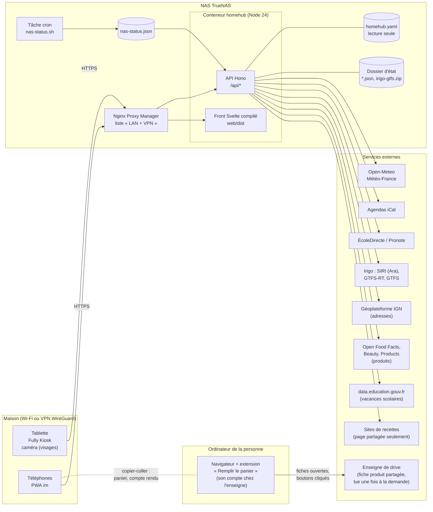

## Couches du serveur

Les routes restent fines : une garde d'accès, `readBody` pour le corps, un appel au service, du JSON. Un refus se
lève (`fail`, `HttpError`) et `server/http.ts` le traduit en `{error, identify?}` sur chaque routeur. Le service ne
connaît ni HTTP ni la façon dont une source obtient ses données. `server/app.ts` monte un routeur par groupe
(`*-api.ts`) ; `server/index.ts` assemble le tout (injection de dépendances). Les fichiers d'état passent tous par
`sources/json-file.ts` (écriture atomique, mémoire remplacée seulement une fois le fichier écrit).

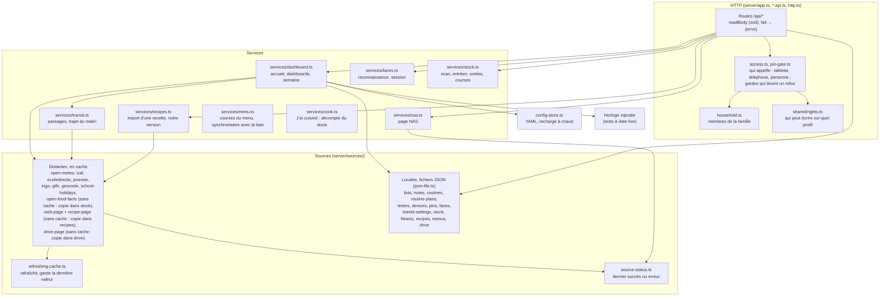

## Front

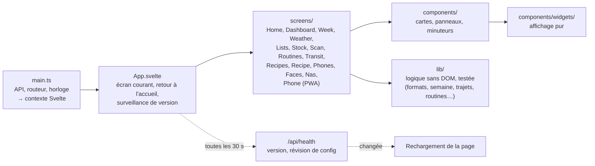

## Modèle de données

Les principaux types de `shared/types.ts` (et `shared/recipes.ts` pour le carnet), partagés par le serveur et le front, et le fichier d'état qui les garde.

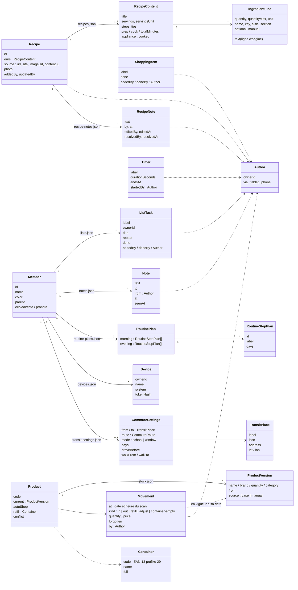

| Fichier d'état | Contenu |
|---|---|
| `lists.json` | courses et tâches |
| `notes.json` | mots (effacés une fois vus, ou au bout de 7 jours) |
| `routines.json` | étapes cochées du jour, jours de suite |
| `routine-plans.json` | étapes et heures des routines |
| `timers.json` | minuteurs en cours |
| `stock.json` | produits (copie de la base et versions corrigées), quantités, mouvements, contenants |
| `recipes.json`, `recipes/` | carnet de recettes : notre version, la version lue et son adresse ; photos (une par recette) |
| `recipe-notes.json` | notes de la famille sur les recettes (texte, auteur, date ; modifiée, résolue par qui et quand) ; à part du carnet pour qu'une note ne touche pas notre version, retirées avec leur recette |
| `menus.json` | menus par semaine (recettes, personnes, jour ; 12 semaines gardées), « j'en ai déjà », décisions « à vérifier au placard », frais avancés (`now`, « Acheter maintenant »), placards, produits du stock reliés aux ingrédients (et s'ils s'utilisent en plusieurs fois) |
| `drive.json` | drive : enseigne et magasin de retrait ; par article (clé) et par enseigne, le produit retenu et ses secours (identifiant, lien de la fiche, nom, contenance, code-barres, pièces par paquet, dernier prix vu par l'extension) ; le panier en cours (articles de la liste cochés, produit et paquets mis au panier) |

| `devices.json` | téléphones reliés (empreinte du jeton seulement) |
| `pins.json` | codes PIN et code parent (empreintes) |
| `faces.json` | empreintes de visage (aucune image) |
| `transit-settings.json` | lieux, trajets, arrêts de l'accueil |
| `pronote.json` | jeton Pronote, renouvelé à chaque connexion |
| `irigo-gtfs.zip` | horaires théoriques Irigo, une fois par semaine |

## Qui écrit

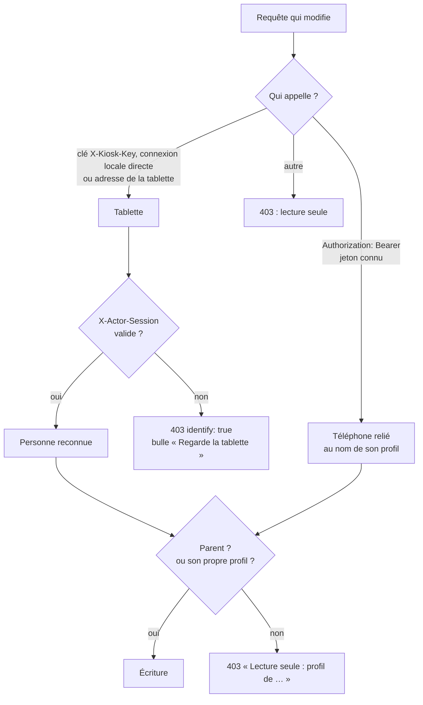

Exception : le **stock** (scanner, page Stock) n'attend pas de visage reconnu, puisque la caméra de la tablette sert
alors à lire les codes-barres. La tablette ou un téléphone relié suffit ; le mouvement est noté au nom de la personne
reconnue s'il y en a une (ou du profil du téléphone). Même garde pour la base de produits (`scan`, `recheck`), qui
appelle Open Food Facts.

Les **recettes** : le carnet est familial. Ajouter (importer un lien, saisir à la main) : quelqu'un de reconnu sur la
tablette ou un téléphone relié, vérifié avant toute lecture du site ; modifier notre version : un parent ou qui l'a
ajoutée ; retirer : un parent. Les **notes** sur une recette : tout le monde les lit ; tout membre identifié en
laisse (enfants compris) ; les modifier, les résoudre, les rouvrir ou les retirer : leur auteur ou un parent
(`access.authorOrParent`, même règle que l'écriture sur un profil, qui sert aussi pour modifier notre version) ; un
appareil non appairé ne fait que lire. 1 000 caractères par note, 100 notes par recette. La lecture d'une page (`sources/web-page.ts`) n'accepte que `http`/`https` vers une
adresse publique (vérifiée après résolution DNS, et de nouveau à chaque redirection, quatre au plus), 3 Mo et 10 s au
plus ; `recipes.allowedHosts` autorise nommément un site de la maison. Limite connue : un nom qui change d'adresse
entre la vérification et la connexion (rebinding DNS) n'est pas couvert.

Le **menu de la semaine** : tout le monde le lit, seul un parent le modifie (recettes, « j'en ai déjà », placards,
produits reliés), sur la tablette (parent reconnu) ou depuis son téléphone. Ses courses rejoignent `lists.json` par
une règle de synchronisation (`shared/menu.ts`) appliquée après chaque changement du menu, du stock ou du carnet, et
au premier affichage d'un nouveau jour (`refreshIfNewDay`) : une ligne ouverte marquée `menu` suit le calcul (mise à jour ou
retirée) ; une ligne cochée, ou vidée (gardée dans `cleared` pour sa semaine), compte comme achetée et n'est jamais
touchée, seul le complément revient sur une nouvelle ligne ; une ligne ajoutée à la main pour le même ingrédient
l'emporte ; retirer une ligne du menu vaut « j'en ai déjà » pour sa semaine. Ce qu'il faut est déduit dans cet ordre :
placards, « j'en ai déjà », ligne à la main, déjà acheté, puis stock (partagé entre les semaines, la plus proche
d'abord). Le stock n'est jamais décompté d'office : « J'ai cuisiné » (`services/cook.ts`, règles dans
`shared/cook.ts`, toute la famille) propose ingrédient par ingrédient ; les réponses deviennent des mouvements du stock
groupés sous un même décompte (`cook`), annulables d'un coup, et le repas est noté `cooked` dans `menus.json` (qui,
quand, « j'en ai déjà » et « J'en ai assez » retirés par un paquet fini, gardés pour l'annulation). Un repas noté
cuisiné ne compte plus dans les besoins que pour ses ingrédients restés sans réponse ; la part restante d'un paquet
entamé (`opened`, ¼ ½ ¾) compte sûre dans le stock.

**Frais à acheter plus tard** : chaque besoin garde ses parts jour de repas par jour de repas (`parts`). Une part
fraîche (`isFresh` : rayon deviné ou choisi parmi Fruits et légumes, Boucherie, Poissonnerie, Crèmerie, Boulangerie,
moins une courte liste de produits qui se gardent) dont le jour d'achat (`FRESH.days` = 3 jours avant le repas) est
après aujourd'hui attend : elle n'entre pas dans les lignes voulues (`desiredLines`), donc ni sur la liste ni au drive.
Les déductions (acheté, stock) s'appliquent au besoin entier et couvrent d'abord les premiers repas : ce qui reste à
acheter revient aux parts les plus tardives. La synchronisation tournant à chaque nouveau jour, une part rejoint la
liste d'elle-même le jour venu, sur la ligne ouverte de son ingrédient (ou une nouvelle, si celle-ci est cochée).
« Acheter maintenant » range la clé dans `menus.json` (`now`, par semaine ; `PUT /api/menu/now`, un parent) : plus
rien n'attend pour cet ingrédient cette semaine. `GET /api/lists` renvoie les parts qui attendent (`later`) à côté de
la liste.

Le stock sait qu'un paquet est entré et pas encore sorti, pas combien il en reste. D'où la règle du **paquet
peut-être entamé** : un produit relié qui s'utilise en plusieurs fois (attribut `partial` du lien ; absent, valeur
devinée : un paquet couvre plus que le plus grand besoin d'une recette du carnet pour cet ingrédient) n'a que
(nombre − 1) paquets sûrs, le dernier pouvant être entamé ; un produit utilisé en une fois compte en entier.

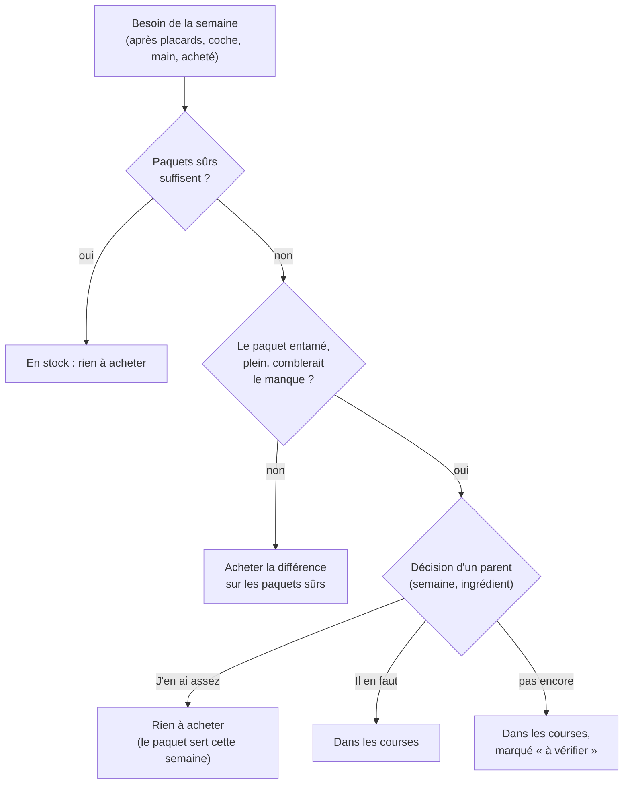

Les décisions sont rangées par semaine et par ingrédient dans `menus.json` (`checks`) ; seul un parent les prend
(`PUT /api/menu/check`, `access.parent`). Une décision ne compte que si la vérification a lieu d'être : si le stock
change et que les paquets sûrs suffisent, ou qu'un paquet plein ne suffirait plus, elle est ignorée. Un paquet jeté
sans être scanné est rattrapé par la même vérification. Quand un produit est relié à l'ingrédient et que les unités se
comparent, la ligne porte les paquets à acheter (`packs`, « 250 g (2 × 200 g) »), sur la marque `menu` de la liste de
courses comme dans le menu.

Le **drive** (étape 1, voir [l'étude](etude-drive.md)) : aucune enseigne n'ouvre d'API ; HomeHub ne fait que retenir,
pour chaque article de la liste (clé de l'ingrédient, ou du libellé pour un produit hors recettes), un produit de
l'enseigne choisie. Le produit vient du lien de sa fiche, collé ou partagé (`/partager` le reconnaît et propose
« Relier à un article de la liste ») ; l'identifiant est tiré de l'URL (`shared/drive.ts`, un adaptateur par
enseigne : domaine et forme des liens). La fiche est lue une fois, quand la personne le demande, par le même lecteur
de pages que les recettes (`sources/drive-page.ts` : seulement une fiche produit de l'enseigne, redirection hors
fiche refusée, JSON-LD `Product`, ni prix ni image) ; un refus du site (anti-robots, 403) est rapporté tel quel et la
personne saisit le produit, ou reprend le nom, la contenance et le code-barres d'un produit du stock. Jamais de
recherche dans le catalogue de l'enseigne. Tout le monde lit `GET /api/drive` ; régler l'enseigne et le magasin : un
parent (`access.parent`) ; lire une fiche et retenir un produit : le droit d'écrire sur la liste de courses
(`access.writer` sur la famille), vérifié avant toute lecture. Un secours n'est jamais pris d'office, même quand le
produit retenu est retiré. Le nombre de paquets reprend l'arrondi de la liste (`packsFor`).

Étape 2, **remplir le panier** : toujours sans rien automatiser chez l'enseigne. `shared/drive.ts` calcule pour chaque
article à acheter ce qu'on met au panier (`driveCount`) : l'arrondi au paquet ; pour une ligne comptée en pièces (ou
gousses, bottes…) contre une contenance d'une autre grandeur ou inconnue, les pièces par paquet demandées une fois et
retenues sur le produit (`pieces`) ; sinon 1 paquet, signalé (contenance inconnue, au poids ou autre grandeur). Un
seul panier en cours dans `drive.json`, dont chaque ligne est liée à un article de la liste par son identifiant : la
ligne marque l'article « au drive » sans toucher à la liste (cocher comme acheté reste un geste de la personne), et
s'efface dès que l'article quitte la liste (retiré, ou vidé du panier une fois acheté) ; `GET /api/drive` ne montre
que les lignes encore liées. Cocher (`PUT /api/drive/basket/:itemId`) : le serveur relit l'article et son produit
retenu et calcule lui-même la ligne (rien n'est repris du front) ; une ligne dont l'article ou le produit a changé
depuis est signalée à l'écran (« Mettre à jour »). Mêmes droits que les choix : `access.writer` sur la famille.

Étape 3, **l'extension « Remplir le panier »** (`extension/`, Manifest V3, Courses U) : elle tourne dans le
navigateur de la personne, sur le site de l'enseigne ouvert et connecté à son compte ; ni le NAS ni HomeHub ne
touchent au site. Aucun réseau entre l'extension et HomeHub : la personne copie le panier (`cartFor`, format
`homehub-drive-cart` de `shared/drive-cart.ts` : article, identifiant, lien de la fiche, paquets) et le colle dans
l'extension, qui le relit (`parseCart` : refus en entier d'un lien qui n'est pas une fiche de l'enseigne) et le garde
dans son stockage local. Le déroulé est une logique pure (`extension/src/run.ts` : décider sur la page ouverte,
passer à la ligne suivante, s'arrêter) ; seul l'adaptateur (`extension/src/coursesu.ts`) connaît la page : JSON-LD
`Product`, boutons « Ajouter » et « + », compteur du panier, prix, défis anti-robots (sélecteurs à confirmer lors de
l'essai réel). Le script de page n'agit que dans l'onglet qui a reçu le remplissage (marque dans l'adresse, retenue
pour l'onglet) et s'arrête au premier captcha, refus, page inattendue ou ajout non confirmé. Le compte rendu
(`homehub-drive-report`), recollé dans HomeHub, part vers `POST /api/drive/report` : le serveur relit chaque ligne
contre la liste (article encore à acheter, lien de fiche de l'enseigne), met au panier en cours le produit et les
paquets que l'extension a vus, et note sur le produit du choix le prix (`price`, dernier vu) et l'EAN s'il manquait ;
même droit que la liste de courses. Le récapitulatif en tire un total indicatif.

**Adresse de la tablette** : c'est l'adresse de la connexion. `X-Real-IP` / `X-Forwarded-For` ne la remplacent que
si la connexion vient d'un proxy de confiance (`trustedProxies`, aucun par défaut). Une connexion locale directe
compte comme la tablette (développement, vérification de santé) ; une adresse locale annoncée par un en-tête, jamais.

## Séquences

### Reconnaissance du visage, puis cocher une tâche

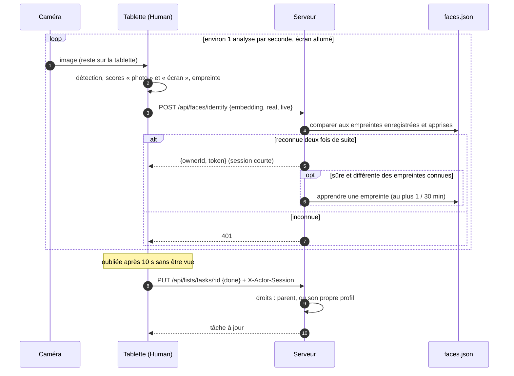

### Relier un téléphone

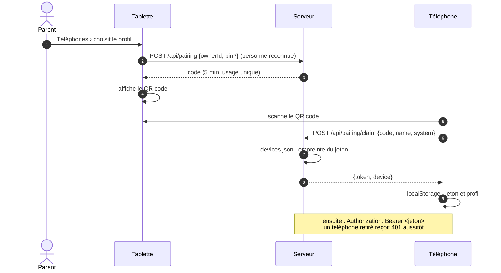

### Trajet du matin selon l'emploi du temps

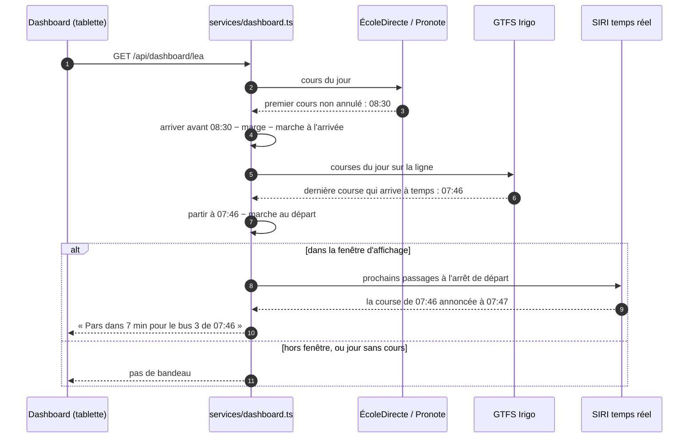

### Version et déploiement

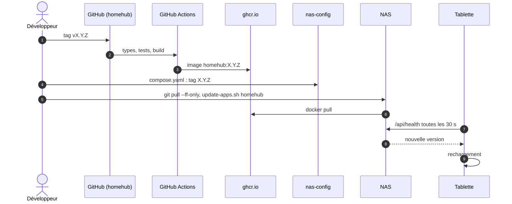

## États

### Bandeau du trajet

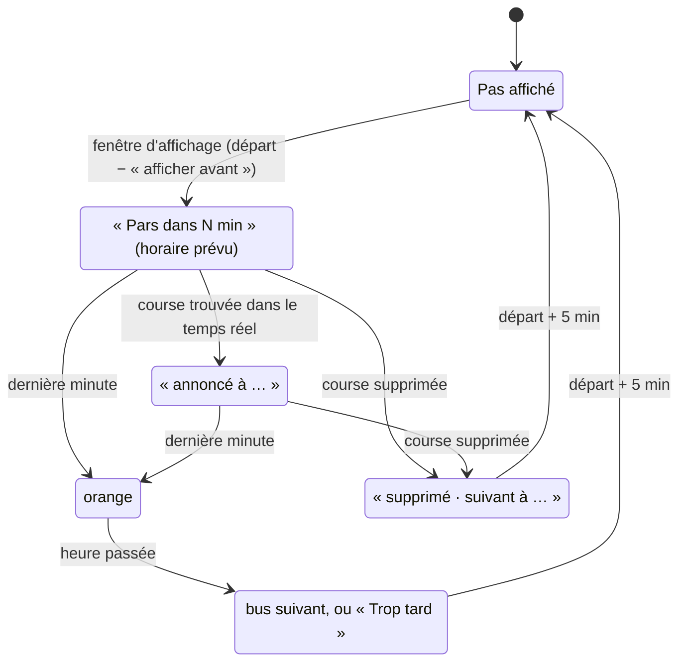

### Minuteur

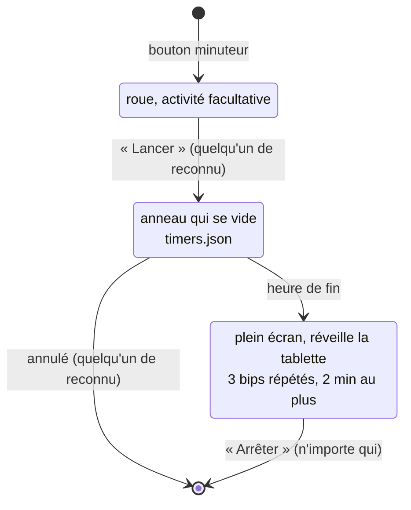
