# Architecture

Diagrammes en [Mermaid](https://mermaid.js.org) : GitHub les affiche directement. Le détail des fichiers et des
routes reste dans le [README](../README.md#architecture).

## Déploiement

Tout tourne sur le NAS, dans un seul conteneur. Les appareils de la maison passent par Nginx Proxy Manager, ouvert au
réseau local et au VPN seulement.

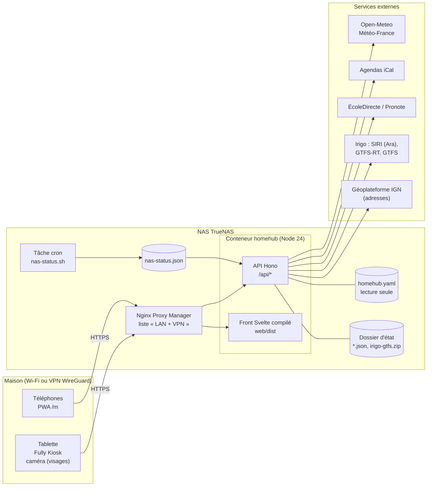

## Couches du serveur

Les routes restent fines : elles valident, appellent le service, renvoient du JSON. Le service ne connaît ni HTTP ni
la façon dont une source obtient ses données. `server/index.ts` assemble le tout (injection de dépendances).

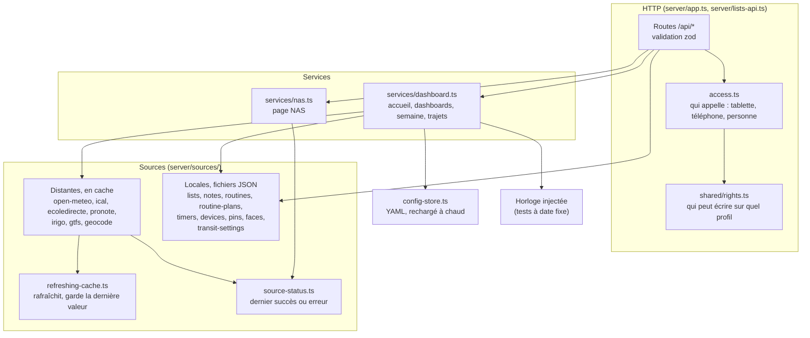

## Front

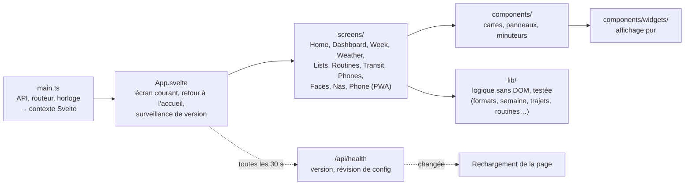

## Modèle de données

Les principaux types de `shared/types.ts`, partagés par le serveur et le front, et le fichier d'état qui les garde.

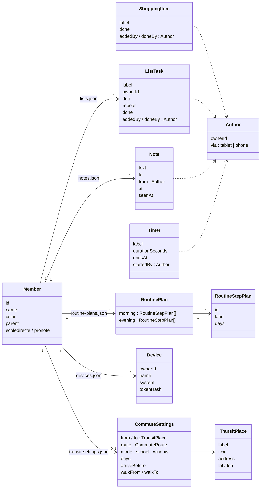

| Fichier d'état | Contenu |
|---|---|
| `lists.json` | courses et tâches |
| `notes.json` | mots (effacés une fois vus, ou au bout de 7 jours) |
| `routines.json` | étapes cochées du jour, jours de suite |
| `routine-plans.json` | étapes et heures des routines |
| `timers.json` | minuteurs en cours |
| `devices.json` | téléphones reliés (empreinte du jeton seulement) |
| `pins.json` | codes PIN et code parent (empreintes) |
| `faces.json` | empreintes de visage (aucune image) |
| `transit-settings.json` | lieux, trajets, arrêts de l'accueil |
| `pronote.json` | jeton Pronote, renouvelé à chaque connexion |
| `irigo-gtfs.zip` | horaires théoriques Irigo, une fois par semaine |

## Qui écrit

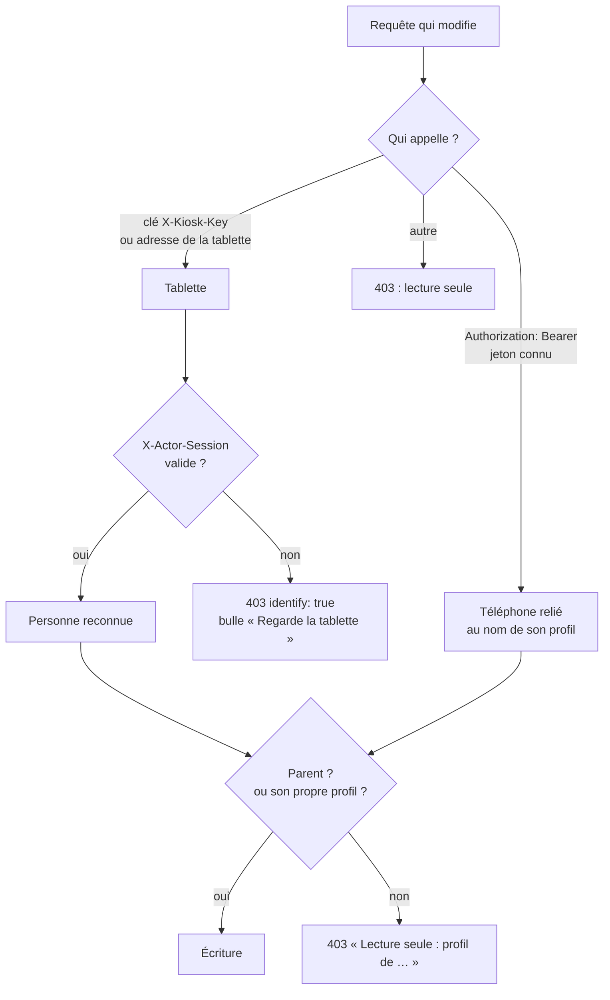

## Séquences

### Reconnaissance du visage, puis cocher une tâche

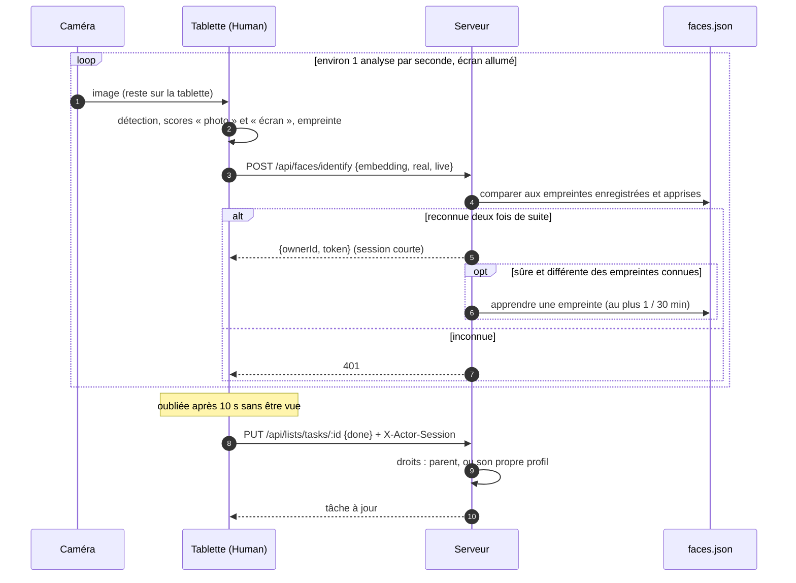

### Relier un téléphone

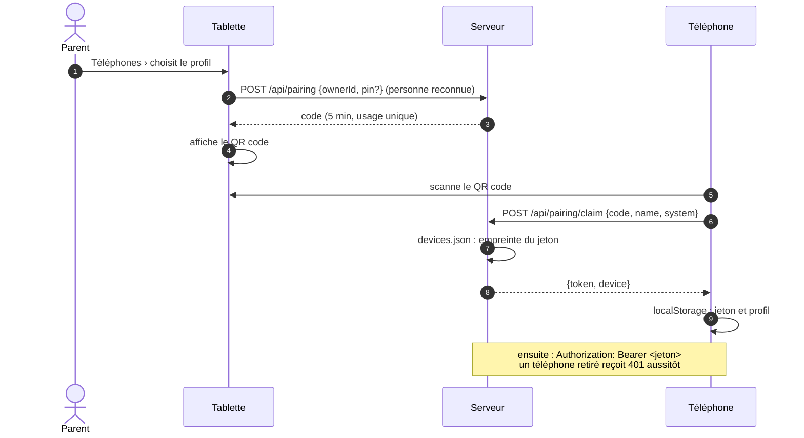

### Trajet du matin selon l'emploi du temps

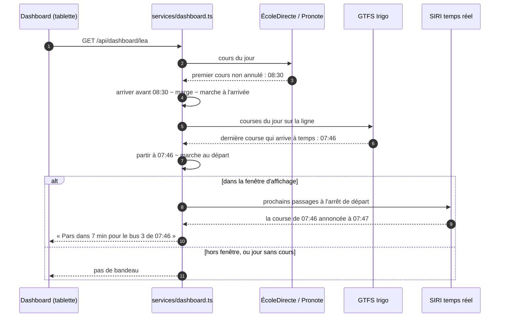

### Version et déploiement

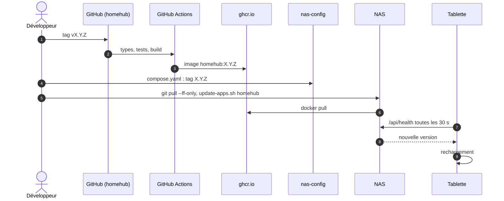

## États

### Bandeau du trajet

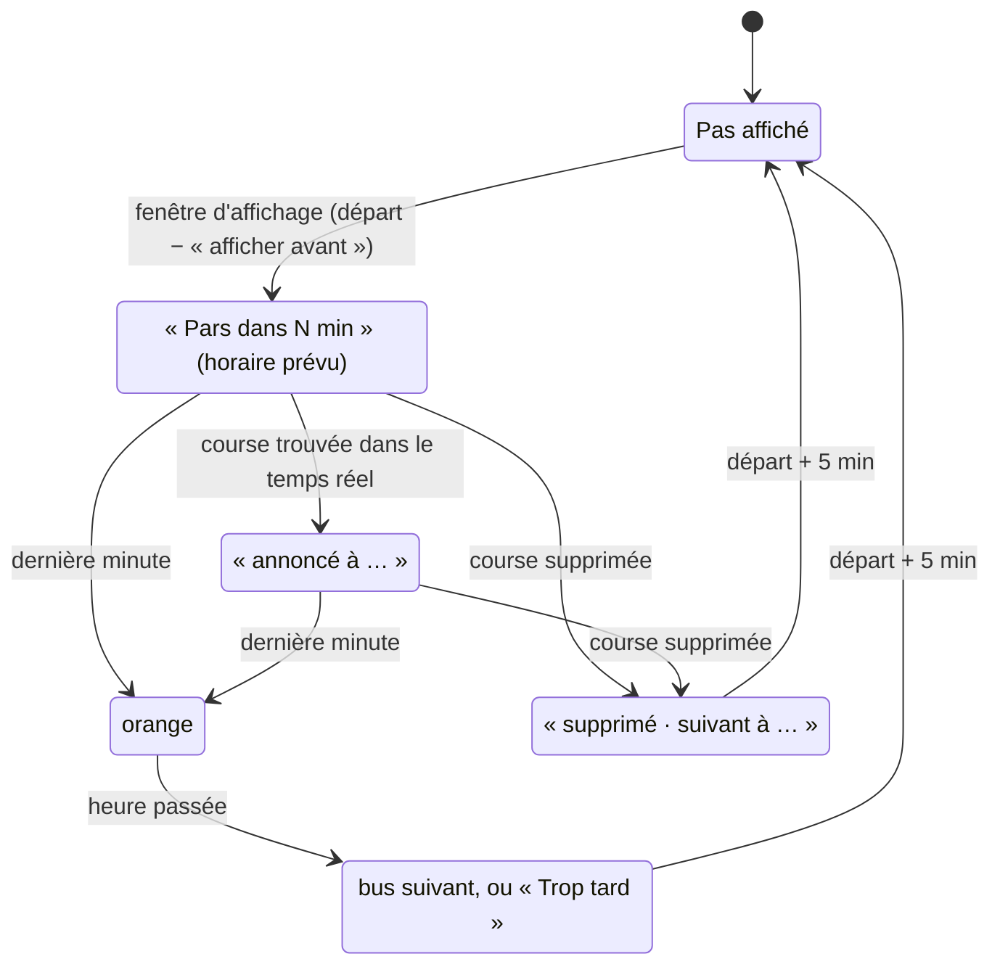

### Minuteur

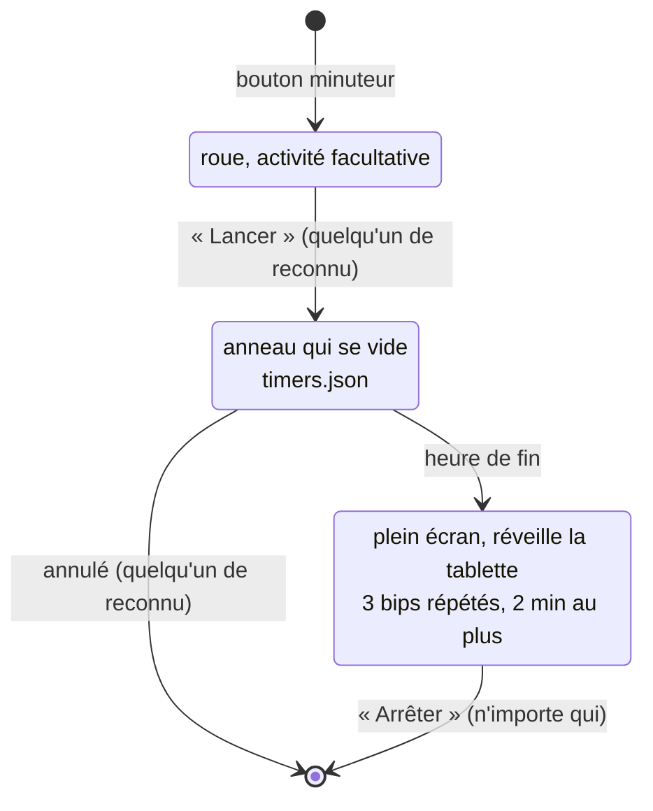
