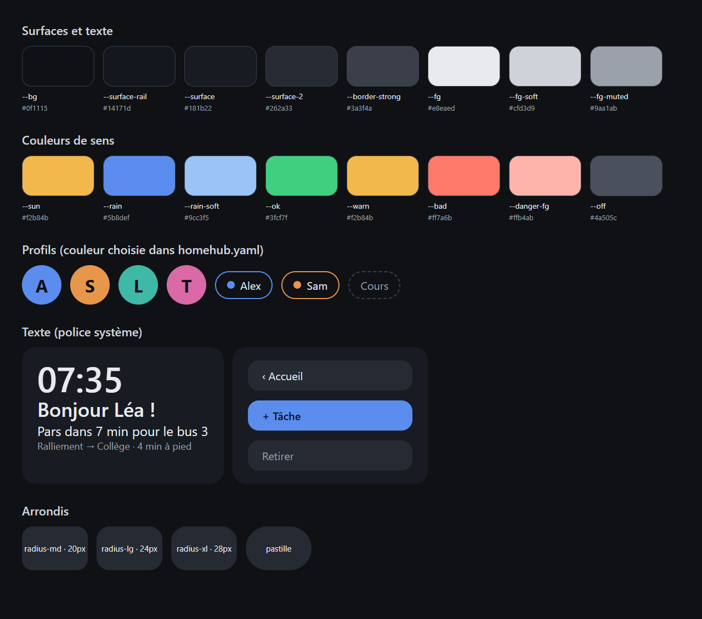

# Design

Refonte en cours (depuis 0.32.0) : **piste A, « affinée »**, retenue parmi trois maquettes. Le thème et les couleurs
restent ; les espacements, les tailles de texte et les cartes deviennent des règles communes, appliquées page par page
(accueil et dashboards d'abord, le reste ensuite, voir le [TODO](../TODO.md)).

## Principes

- **Thème sombre unique** (`color-scheme: dark`) : la tablette reste allumée dans la pièce de vie.
- **Lisible de loin, touché au doigt** : très grands chiffres (horloge, météo), cibles larges, pas de survol.
- **Une couleur par profil**, choisie dans `homehub.yaml` : avatar, pastilles, agenda dans la semaine, bordure des
  tuiles du dashboard focus.
- **Couleurs de sens réservées** : jaune pour le soleil et les avertissements, bleu pour la pluie et l'action
  principale, vert / orange / rouge / gris pour les états (page NAS, temps réel).
- **Cartes arrondies** sur fond presque noir ; pastilles entièrement arrondies pour les filtres et les boutons.
- **Police du système** (`system-ui`, Segoe UI, Roboto) : rien à télécharger.

## Variables CSS (`web/src/app.css`)

| Variable | Valeur | Usage |
|---|---|---|
| `--bg` | `#0f1115` | fond de page |
| `--surface-rail` | `#14171d` | rail des profils |
| `--surface` | `#181b22` | cartes |
| `--surface-2` | `#262a33` | boutons, éléments dans une carte |
| `--border-strong` | `#3a3f4a` | bordures appuyées |
| `--fg` | `#e8eaed` | texte |
| `--fg-soft` | `#cfd3d9` | texte secondaire |
| `--fg-muted` | `#9aa1ab` | légendes, heures |
| `--sun` | `#f2b84b` | soleil |
| `--rain` | `#5b8def` | pluie, bouton principal |
| `--rain-soft`, `--rain-bg` | `#9cc3f5`, `#1e2a3a` | pluie (courbe, fond) |
| `--danger-bg`, `--danger-fg` | `#4a1f1d`, `#ffb4ab` | erreurs, retard |
| `--ok`, `--ok-bg`, `--ok-fg` | `#3fcf7f`, `#173b2c`, `#bfeccf` | état normal |
| `--warn`, `--warn-bg` | `#f2b84b`, `#3d3018` | à surveiller |
| `--bad` | `#ff7a6b` | critique |
| `--off` | `#4a505c` | arrêté, inconnu |
| `--radius-sm`, `--radius-md`, `--radius-lg`, `--radius-xl` | 12, 20, 24, 28 px | arrondis (pastille d'alerte, bouton, carte, bloc) |
| `--space-1` … `--space-6` | 8, 16, 24, 32, 48 px | espacements (`--space-6` : marges de l'accueil) |
| `--text-label`, `--text-small`, `--text-body` | 1, 1,1, 1,25 rem | étiquette de carte, légende, texte courant |
| `--text-title`, `--text-heading`, `--text-display` | 1,5, 2,25, 3 rem | titre dans une carte, titre de page, salutation |

## Règles de la piste A

- **Une seule facture de carte** : fond `--surface`, arrondi `--radius-lg`, marge intérieure `--space-3`, écart
  `--space-2` entre les éléments (`Card.svelte`, ou la classe `.tile` de l'accueil pour une carte faite main).
- **Étiquette de carte** en petites capitales discrètes (classe globale `.card-label`) : le contenu prime, l'étiquette
  ne fait que nommer. Quand elle ouvre une page (« Mes tâches › »), elle garde ce style.
- **Hauteur fixe** : sur la tablette, une carte ne pousse jamais ses voisines ; elle fait défiler sa liste ou masque
  ce qui ne tient pas (pastilles des bus).
- **Actions rapides en bas à droite** sur l'accueil (Minuteur · Scanner · Réglages), en bas du rail ailleurs ; le
  Scanner ressort en bleu.
- **Bus sur l'accueil** : une ligne par arrêt, une pastille par ligne et destination avec le prochain passage et un
  point vert pour le temps réel.
- **Dashboard élève** : trois colonnes de même largeur (frise du jour, puis de demain à partir de 18 h ; routine et
  tâches ; devoirs et mots).

## Écrans

Captures de chaque page : [ecrans.md](ecrans.md).

## Points relevés pour la refonte

- ~~**Dashboard élève, colonne de droite (1280 × 800)** : la carte « Routine du matin » est coupée sous son titre et
  la carte « Mes tâches » chevauche le haut de la suivante.~~ Réglé en 0.32.0 (colonnes de hauteur fixe).
- ~~**Accueil** : le bloc des bus grandit avec chaque arrêt suivi et pousse le reste de la colonne.~~ Réglé en 0.32.0
  (une ligne par arrêt).
- **Noms des matières** : en capitales sans accents dans ÉcoleDirecte, remis en minuscules mais toujours sans accent
  (« Mathematiques », « Francais »).
- **Pages de réglages** (Routines, Transports) : le bouton « Enregistré » reste en bas à droite, loin des
  modifications.
- ~~Variables CSS limitées aux couleurs et aux arrondis.~~ Espacements et tailles de texte ajoutés en 0.32.0 ; les
  pages autres que l'accueil et les dashboards les reprendront au fil de la refonte.
