# Écrans

Captures de HomeHub 0.68.2, avec des **données fictives** : famille de test (Alex, Sam, Léa, Tom), agenda d'exemple,
faux ÉcoleDirecte, faux temps réel Irigo, produits et marques inventés à la place d'Open Food Facts, recettes inventées sur un faux site de cuisine, fiches produit inventées d'une fausse enseigne de drive, calendrier
scolaire d'exemple (zone B), horloge arrêtée le jeudi 5 novembre 2026 à 07:35 (le 11 novembre et en décembre pour les fériés et les vacances). La météo est réelle,
celle du jour de la capture.

Tablette : 1280 × 800 (Fully Kiosk). Téléphone : 390 × 844 (PWA).

Pour les refaire (après une modification du design, par exemple) : `npm run docs:captures`. Le script
[`scripts/docs-captures.ts`](../scripts/docs-captures.ts) compile le front, lance HomeHub dans le monde fictif de
[`scripts/docs-captures/`](../scripts/docs-captures/) (configuration, horloge, fausses sources), le remplit par l'API,
photographie chaque page avec Chrome sans fenêtre, puis la [planche du design](design.md) d'après `web/src/app.css`.
Chrome est cherché aux emplacements habituels ; sinon `CHROME=<chemin>`. Pour essayer à la main ce monde fictif
(scanner compris, codes tapés à la main) : `DOCS_SERVE=1 node scripts/docs-captures.ts`, puis `http://localhost:3190`.

## Tablette

### Accueil

Horloge, météo, prochains passages aux arrêts suivis, prochain événement de la famille ; à droite, « Qui est là ? »
avec le prochain rendez-vous et les mots non lus de chacun. Carte **« À consommer »** : le pot de crème fraîche
passé d'hier et le jambon à finir aujourd'hui (DLC passées ou urgentes seulement) ; touchée, elle ouvre le stock sur
« À consommer ». En bas, un minuteur en cours.

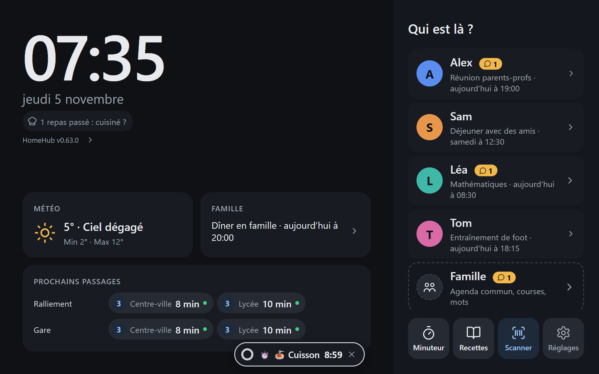

### Dashboard d'un élève

Bandeau du trajet du matin, frise du jour avec la bascule « Aujourd'hui | Demain » (cours, agenda), la carte du
moment en grand (ici la routine du matin) et le reste en tuiles : devoirs, tâches, mots, prochain rendez-vous.

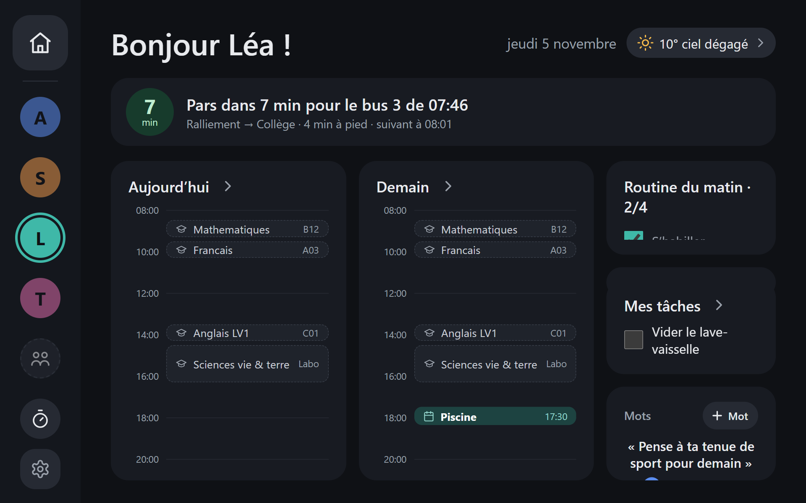

### Vacances scolaires

Trois semaines avant les vacances, une puce dans l'en-tête des dashboards (et sous l'horloge de l'accueil) les
annonce ; ici le lundi 7 décembre :

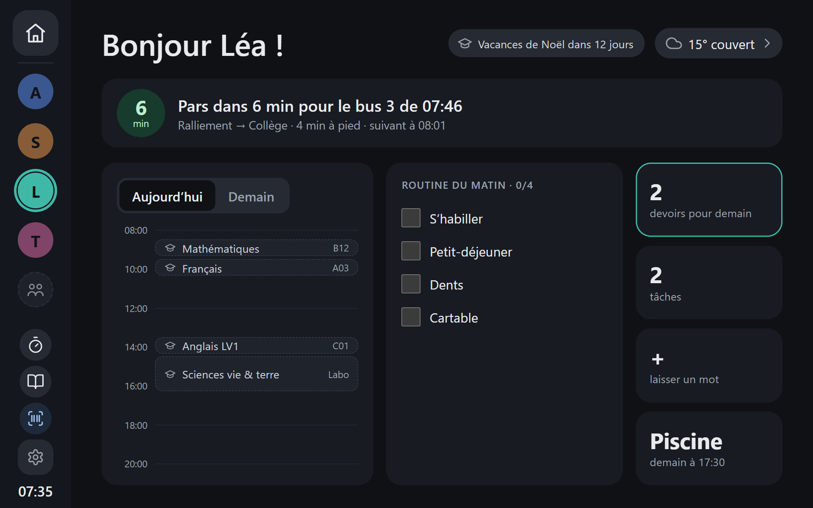

Pendant les vacances (lundi 21 décembre), la puce passe au soleil et donne le jour de la reprise. Sur le dashboard de
Léa : plus de bandeau du bus ni de cours, et la routine du matin sans « Cartable » (étape des jours d'école).

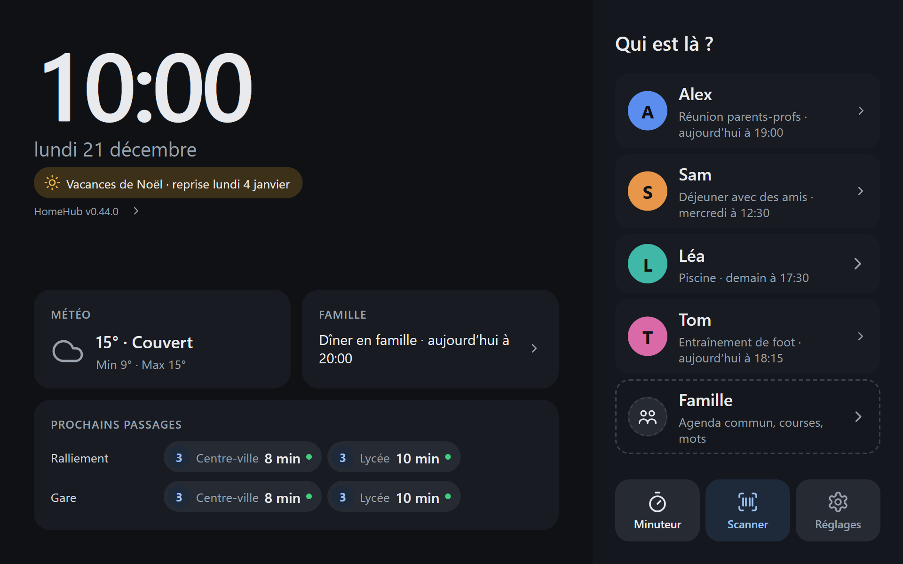

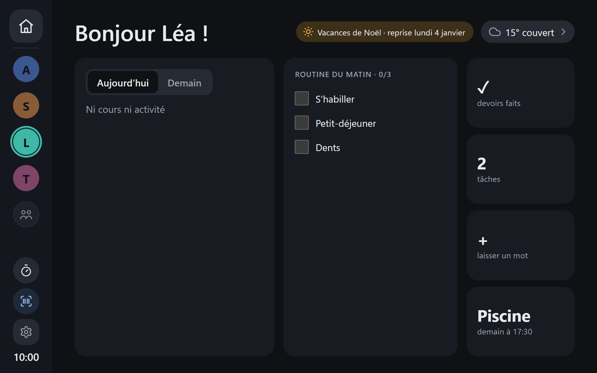

Sur le téléphone, la même puce en tête de l'agenda :

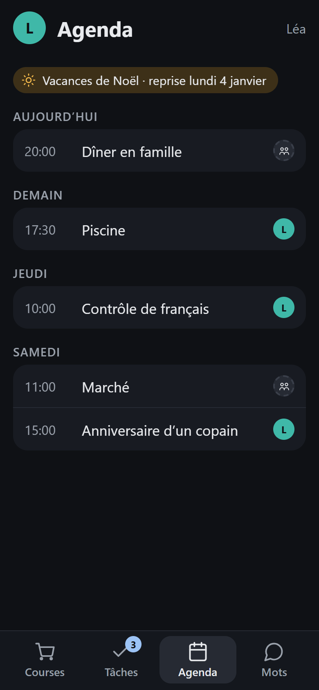

Un jour férié compte comme un jour de vacances pour l'école. Mercredi 11 novembre, la puce dit « Férié · 11 novembre »
(la veille : « Demain férié · 11 novembre ») ; ni bus ni cours ce jour-là, routine du matin sans « Cartable ».

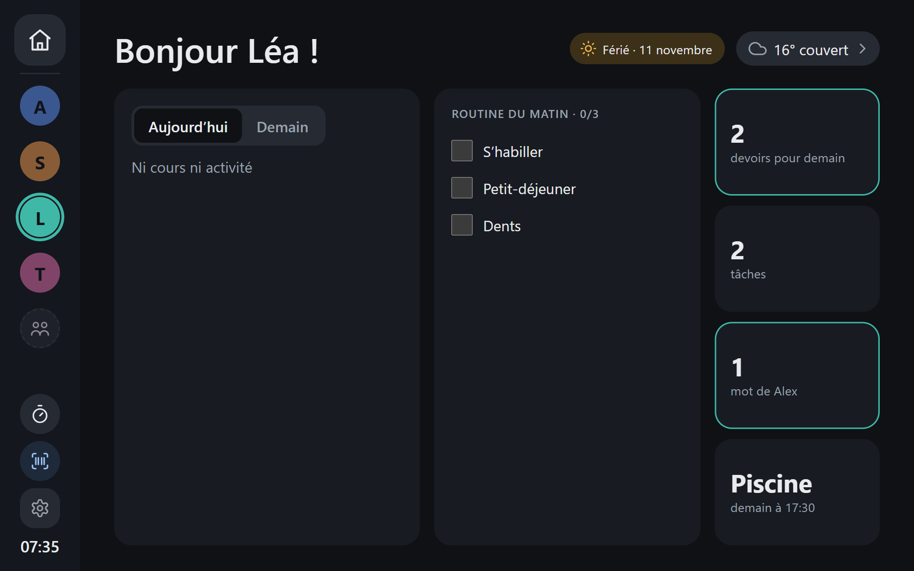

### Dashboard d'un parent : vie scolaire

Alex reconnu devant la tablette : en tête de la colonne du milieu, la vie scolaire de Léa (dernière note, un retard
à justifier, une absence) et les messages non lus de l'établissement. Rien de tout cela sur l'accueil, sur le
dashboard d'un enfant, ni quand personne n'est reconnu. Au-dessus, la carte « À consommer », comme sur l'accueil
(sur le dashboard d'un parent seulement).

Le bloc touché : notes récentes, absences et retards, messages reçus (l'objet seulement, à lire dans ÉcoleDirecte).

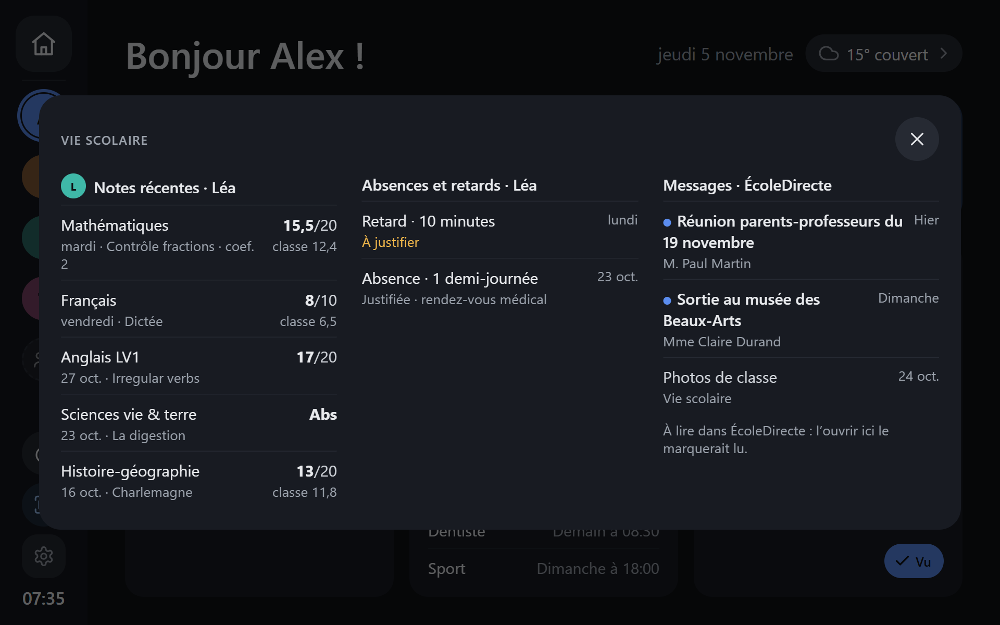

### Dashboard de la famille

Prochaine activité commune, liste de courses, semaine, mots à toute la famille.

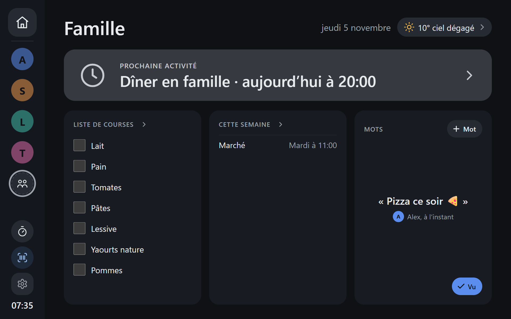

### Semaine

Les 7 jours, chaque agenda à la couleur de son profil ; filtres par personne et pour les cours. Une carte de la
piste A, de hauteur fixe : deux bandeaux « journée entière » au plus par jour, puis « +N ».

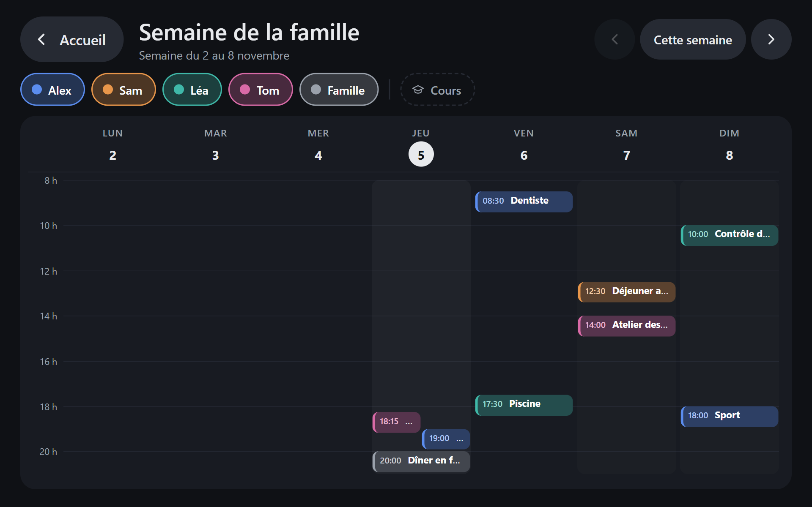

### Météo

Conditions actuelles en grand (seule carte sans étiquette), vent, humidité, soleil et pluie, courbe des 24 heures,
4 jours : cartes et étiquettes de la piste A, colonnes de hauteur fixe.

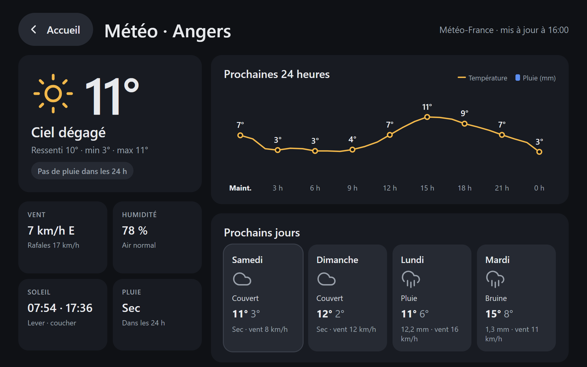

### Listes

Courses et tâches de la famille ; tâches en retard en rouge, tâches qui reviennent. Les courses à acheter sont rangées
par rayon ; une ligne du menu de la semaine porte un livre et ses recettes d'origine. Avec une enseigne de drive
choisie (bouton « Drive »), chaque article a un chariot pour choisir son produit chez l'enseigne, et
le produit retenu s'affiche sous l'article (ici les oignons). « Remplir le panier » ouvre la liste à cocher du drive.

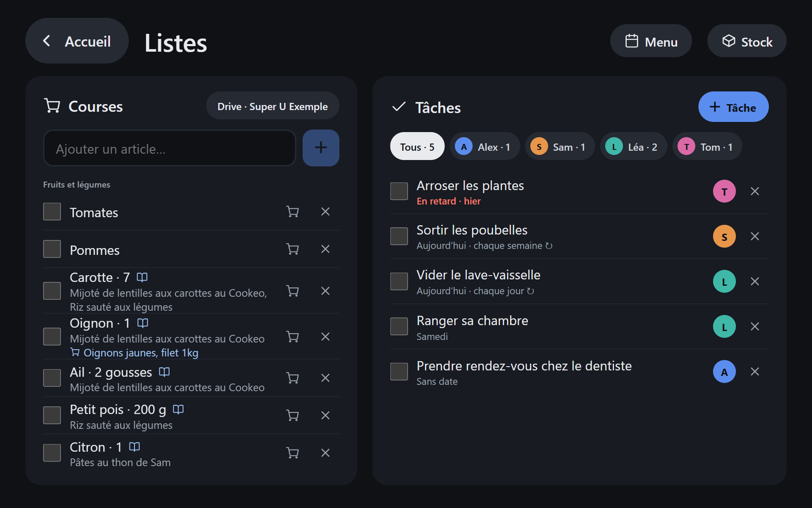

« Remplir le panier » sur la tablette : les articles par rayon, le produit retenu, les paquets et le bouton « Fiche »
qui ouvre le produit chez l'enseigne ; pour les oignons (filet de 1 kg contre « 1 oignon »), la question « Combien de
pièces dans ce paquet ? ».

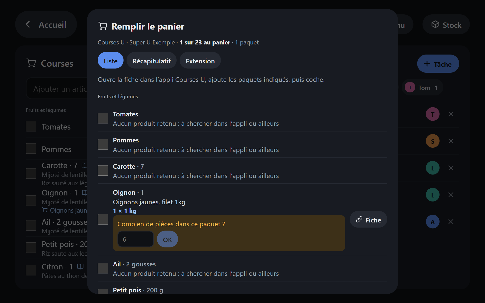

### Menu de la semaine

Depuis Recettes ou Listes. À gauche les recettes de la semaine, jour par jour puis « dans la semaine », le nombre de
personnes se règle d'un geste et la croix retire le repas (« Annuler » quelques secondes) ; à droite les **courses du
menu**, rangées par rayon : quantités mises à l'échelle et regroupées entre recettes, recettes d'origine sous chaque
ligne. Ce qui n'est pas à acheter est dit : placards (sel, huile…), « j'en ai déjà » coché, « en stock (500 g) » d'après
un produit relié, ou seulement la différence. En tête, **« À vérifier au placard »** : un seul paquet de gruyère râpé,
qui s'utilise en plusieurs fois, est peut-être entamé ; tant qu'un parent n'a pas répondu « J'en ai assez » ou « Il en
faut », le gruyère reste dans les courses, arrondi au paquet (« 160 g (1 × 200 g) »). Le bouton « … à relier » ouvre
les produits du stock à relier aux ingrédients.

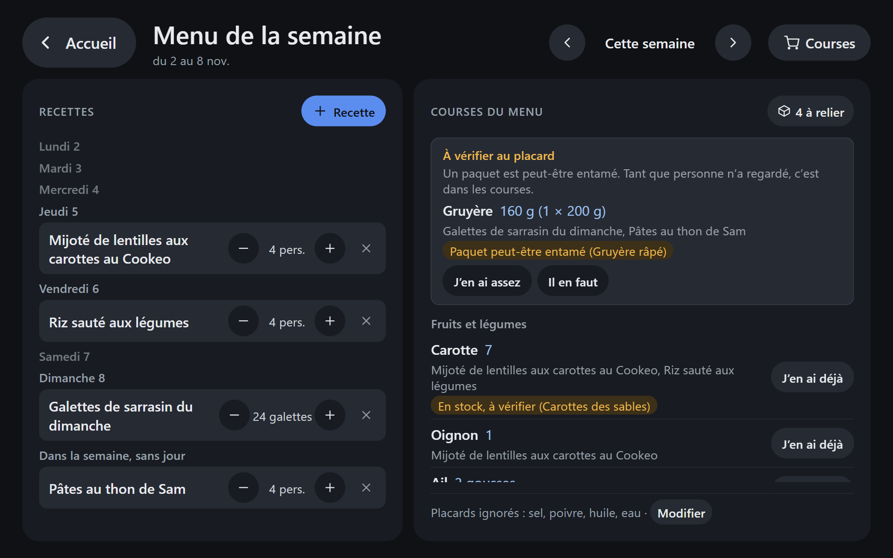

La semaine prochaine : riz sauté lundi, poulet aux courgettes mercredi. Leurs produits frais ne sont pas encore sur la
liste : ils attendent dans **« À acheter plus tard »**, rangés par jour d'achat (trois jours avant le repas : petits pois
vendredi, poulet, courgettes, crème et persil dimanche) ; « Acheter maintenant » les met tout de suite sur la liste. Le
riz, l'oignon et la carotte, qui se gardent, y sont déjà.

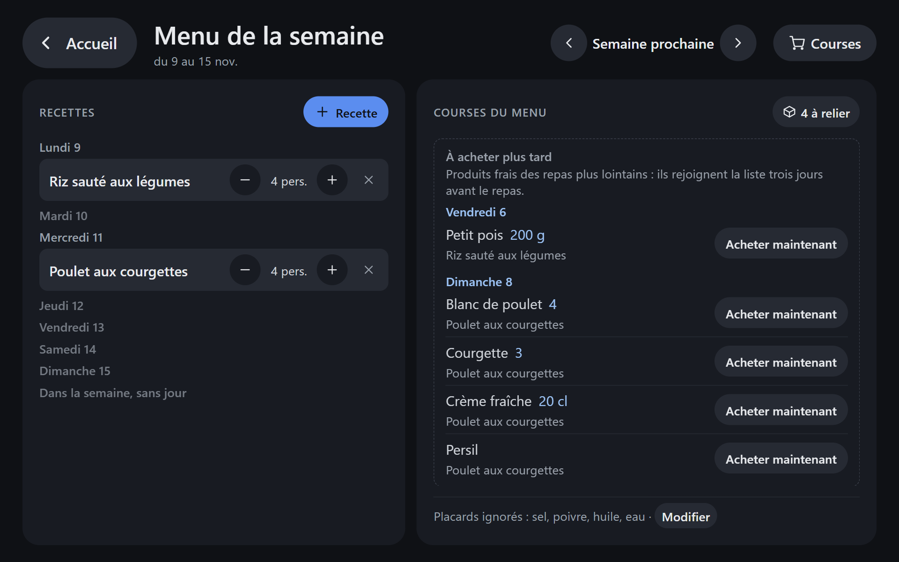

Les pâtes au thon de mardi sont passées sans être notées : l'accueil le rappelle d'une ligne discrète (« 1 repas passé :
cuisiné ? », un nombre, rien de personnel) qui ouvre le menu, où chaque repas passé ou du jour porte « Cuisiné ? ».
Noté depuis le menu (« Tout comme proposé », puis « Retirer du stock ») : le repas est marqué « Cuisiné · Alex, 7 h 35 »
avec « Annuler », et un bandeau résume ce qui est parti (« coquillettes (il en reste ¼) ») avec « Annuler » pendant
quelques secondes ; le thon et la pâte, déjà là, ne sont plus dans les courses.

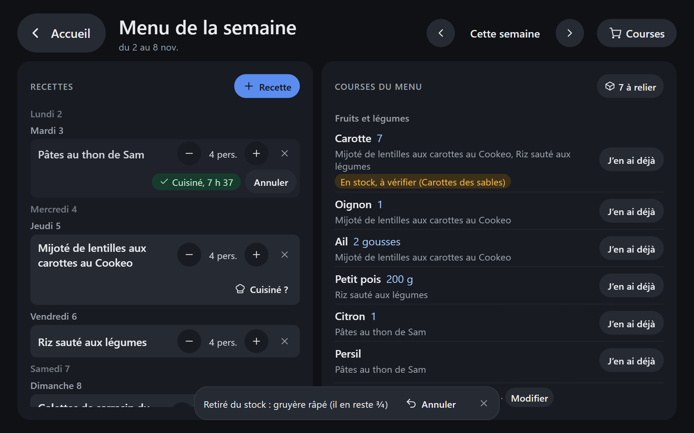
**Dates de péremption** : en tête des recettes, **« À cuisiner d'abord »** propose les recettes du carnet qui ne sont
pas au menu et utilisent un produit dont la date arrive (la quiche pour le jambon d'aujourd'hui et le gruyère, le
gâteau pour les yaourts de lundi), avec « Ce soir », « Demain » ou « Ajouter ». Le gruyère finit samedi (DLC) alors
que les galettes sont dimanche : « Le stock finit samedi (DLC) » et « Avancer le repas à samedi » ; il n'est pas
racheté pour autant.

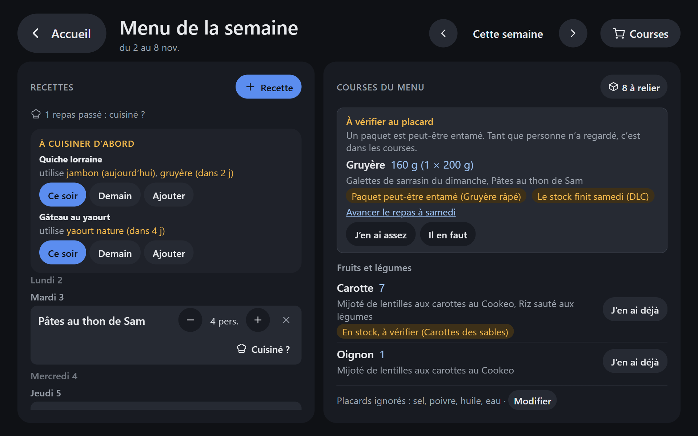

### Stock

Produits en stock (± 1, « Épuisé » sur chacun, même s'il n'en reste qu'un), avec sous chacun la dernière entrée et la dernière sortie (quand, et qui :
Alex et Léa par leur téléphone, « anonyme » pour un scan sur la tablette sans personne de reconnu ; un produit épuisé ne dit que quand et par qui il l'a été), contenants de la maison (bocal rechargé, étiquette à imprimer), réglage de la
liste de courses pour un produit épuisé.

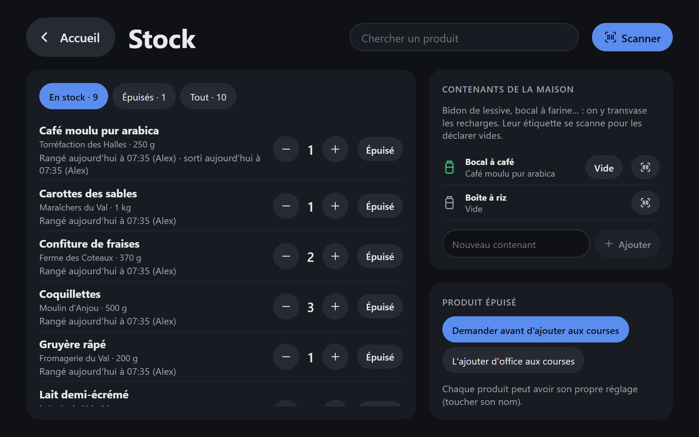

**Sans code-barres** : un produit du marché, en vrac ou fait maison s'ajoute par son nom, sa quantité et son unité
(ici 6 œufs de la ferme, rayon Frais). Ce qui se compte entre pièce par pièce ; ce qui se pèse entre en une fois.

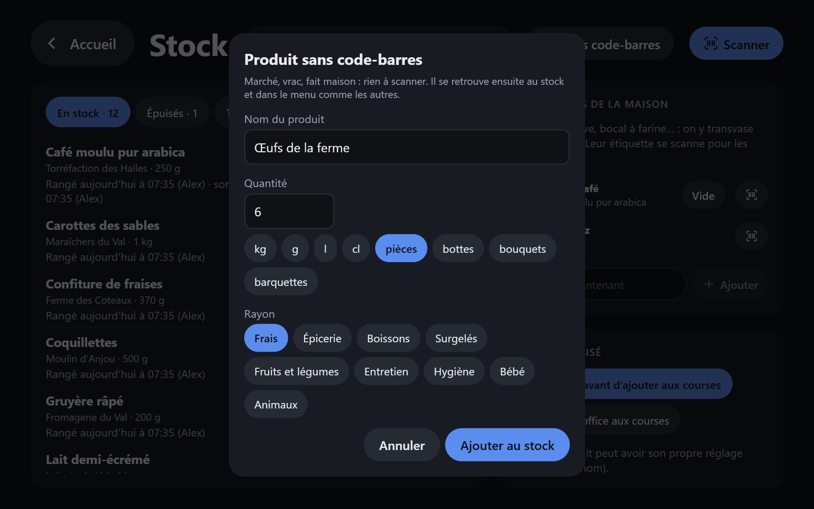

**Dates de péremption** : chaque produit daté porte la pastille de sa date la plus proche. Le filtre **« À
consommer »** montre une ligne par lot qui arrive à date, la plus proche d'abord : la crème passée d'hier (1 pot sur
2, l'autre est bon jusqu'au 20) avec « Jeté » et « Encore bon », le jambon d'aujourd'hui, les yaourts de lundi, les
biscottes à consommer de préférence avant le 30 (DDM) ; en bas, le pot de crème déjà jeté périmé ce mois-ci.

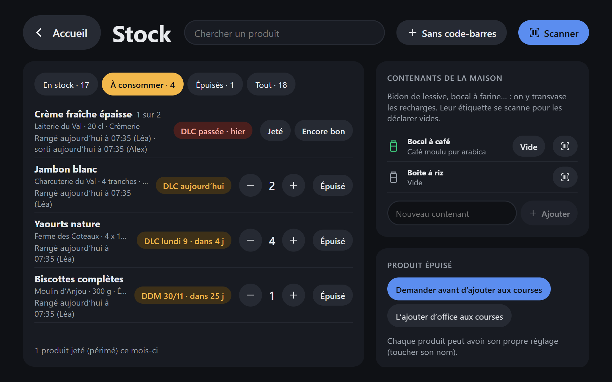

« Régler », dans la carte « Dates de péremption » : seuils (DLC urgente, bientôt, DDM bientôt) et durées par rayon
pour les produits sans date imprimée (date estimée, montrée « ≈ »). Chaque changement s'enregistre aussitôt ; un
parent seulement (cadenas sinon).

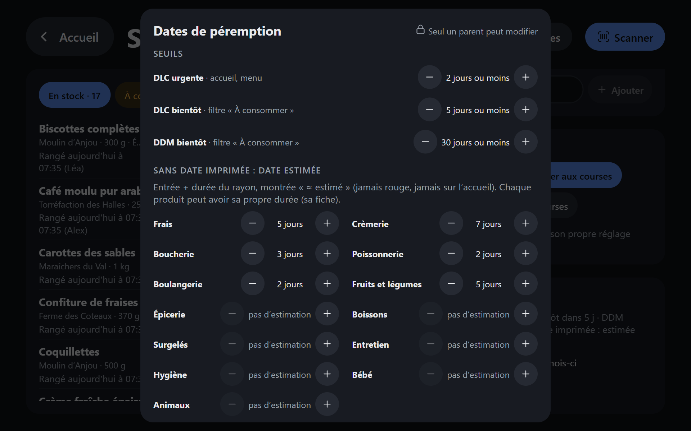

### Scanner

Mode « Jeté / épuisé » : le paquet de café scanné est d'habitude transvasé dans le bocal, d'où la question ; le
bandeau orange reste tant que le produit est devant la caméra. À droite, au nom de qui sont les scans (ici personne de reconnu : anonymes), puis les passages avec leur heure et
leur auteur, chacun annulable. (Sans caméra
dans Chrome sans fenêtre : codes saisis à la main.)

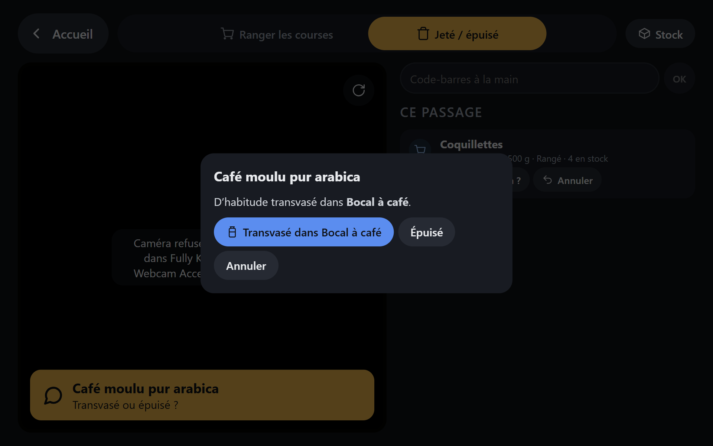

**Dates de péremption** : des yaourts rangés, déjà datés une fois, portent la pastille « Date ? » ; le scan continue
sans elle. Touchée, elle ouvre le pavé : DLC ou DDM, jour puis mois (ici 09/11, « lundi 9 novembre 2026 · dans 4
jours »), une partie à une autre date, « Ne plus demander » pour ce produit.

| Pastille « Date ? » | Pavé de date |
|---|---|
| 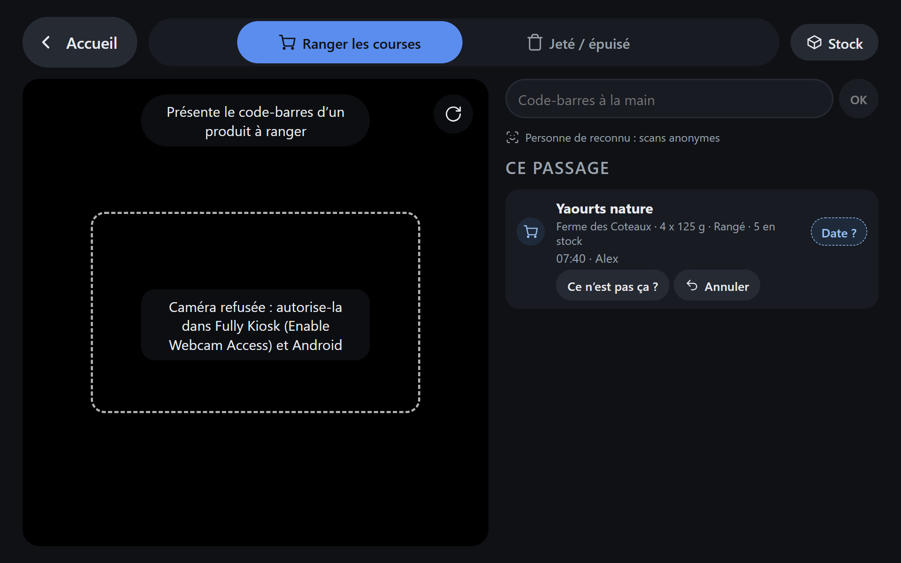 | 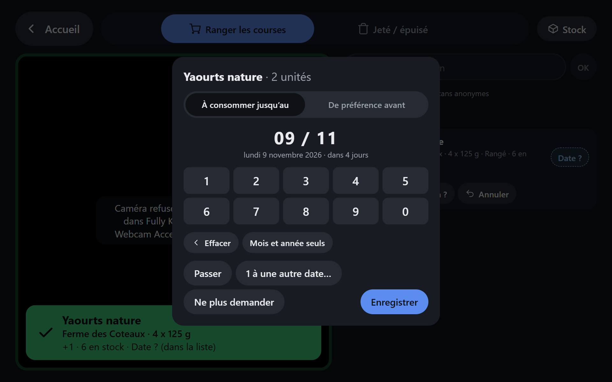 |

### Sport

Depuis le bouton « Sport » du dashboard d'Alex (affiché seulement quand Alex est reconnu devant la tablette) : sa séance du jour (sans rien de
personnel) et le catalogue des exercices. Puis la séance guidée, échauffement passé : premier effort, compte à
rebours, animation. Pour un exercice d'un côté puis de l'autre (montées genou levé), juste après la moitié de
l'effort : bip distinct et « Change de côté ! ». (Sans caméra dans Chrome sans fenêtre : la session d'un visage fictif
est présentée avec chaque requête.)

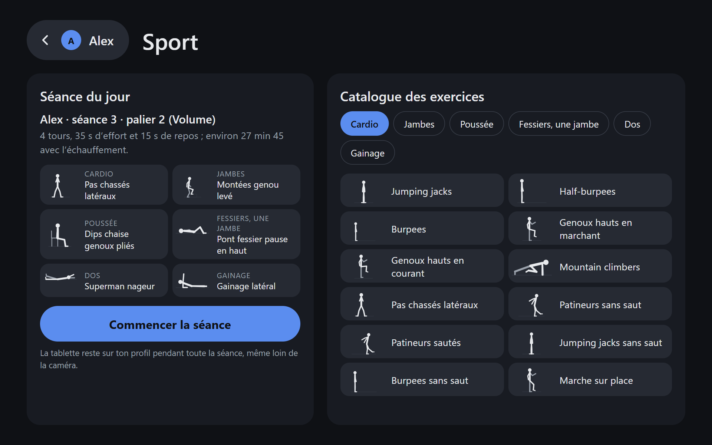

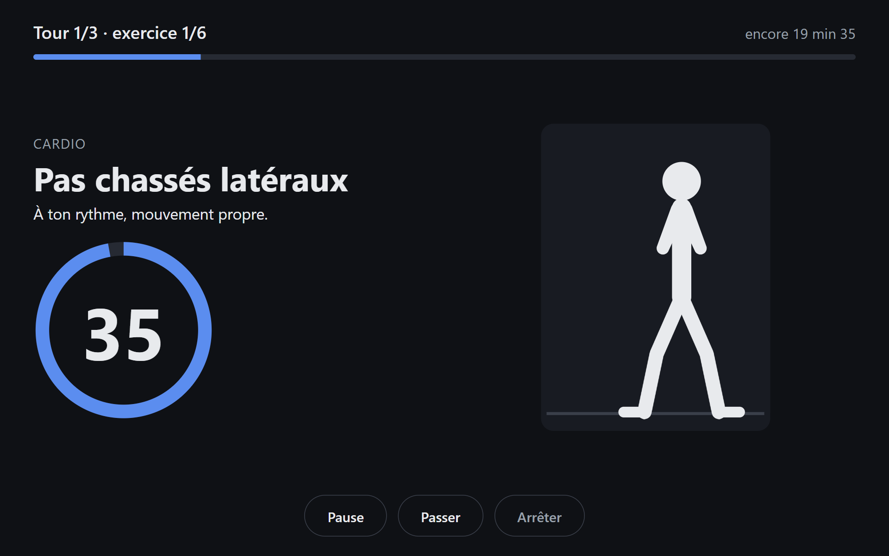

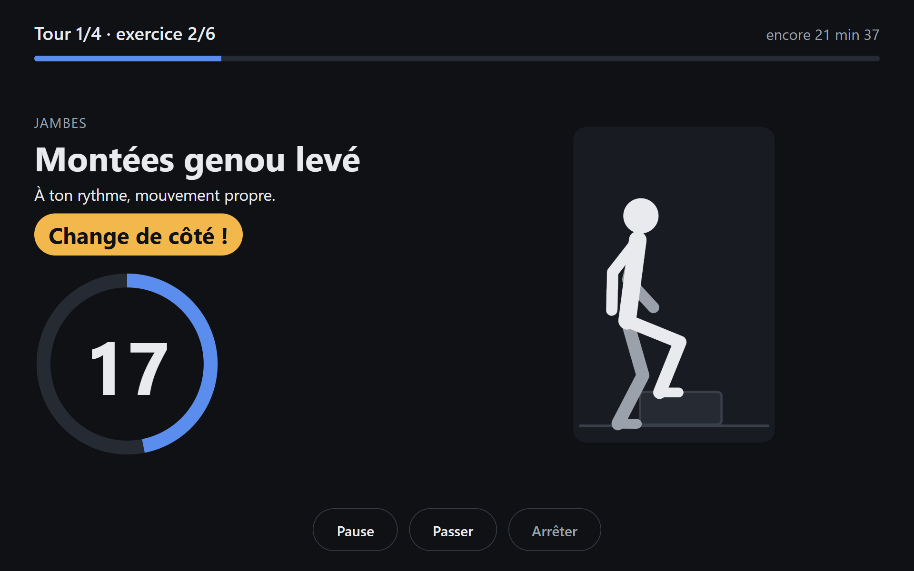

### Routines (réglages)

Étapes du matin et du soir de chaque membre, jours de chaque étape, heures d'affichage. Plus de bouton « Enregistrer » :
chaque modification s'enregistre d'elle-même, et son état (« Enregistrement… », « Enregistré », ou le refus avec
« Annuler ») s'affiche dans le titre de la carte modifiée. Comme sur les pages Transports et Vacances scolaires.

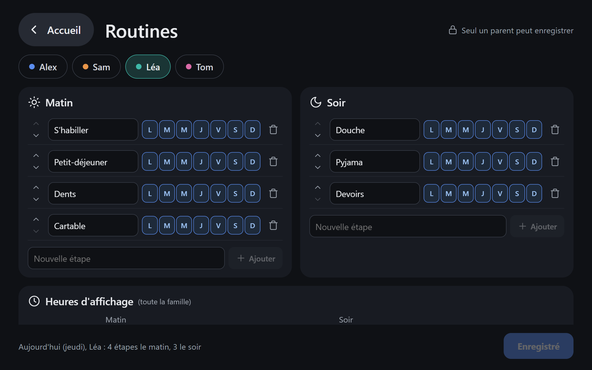

Pyjama retiré le samedi : « Enregistré » dans la carte Soir.

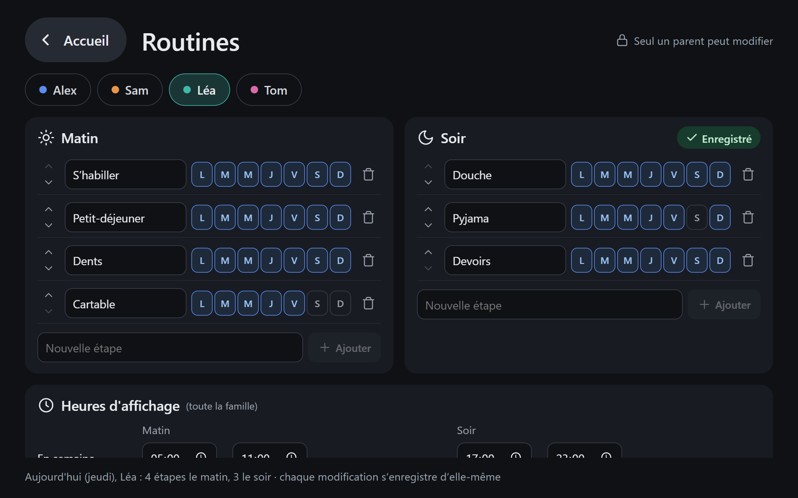

### Transports (réglages)

Lieux de la famille, trajet de chacun, arrêts de l'accueil. Ici, avant le premier enregistrement.

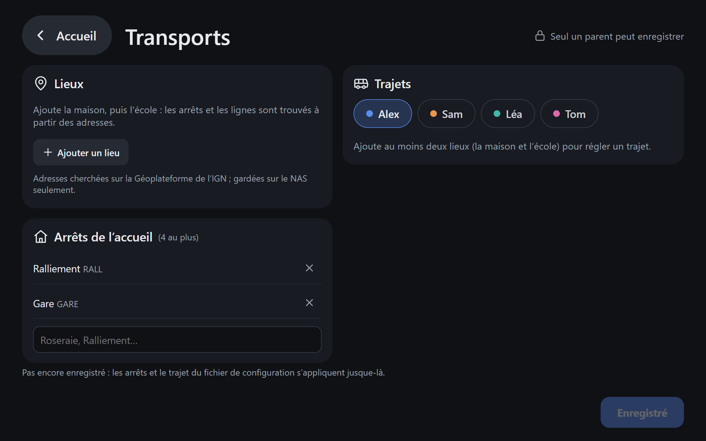

### Vacances scolaires (réglages)

Calendrier de l'académie (liste regroupée par zone, filtrée par la saisie), d'une zone entière, ou aucun ; à droite,
l'aperçu des prochaines vacances du choix, enregistré de lui-même. Ici, l'académie de Nantes, venue du fichier de configuration ;
sans section `holidays` ni rien d'enregistré, la page s'ouvre sur « Aucune ».

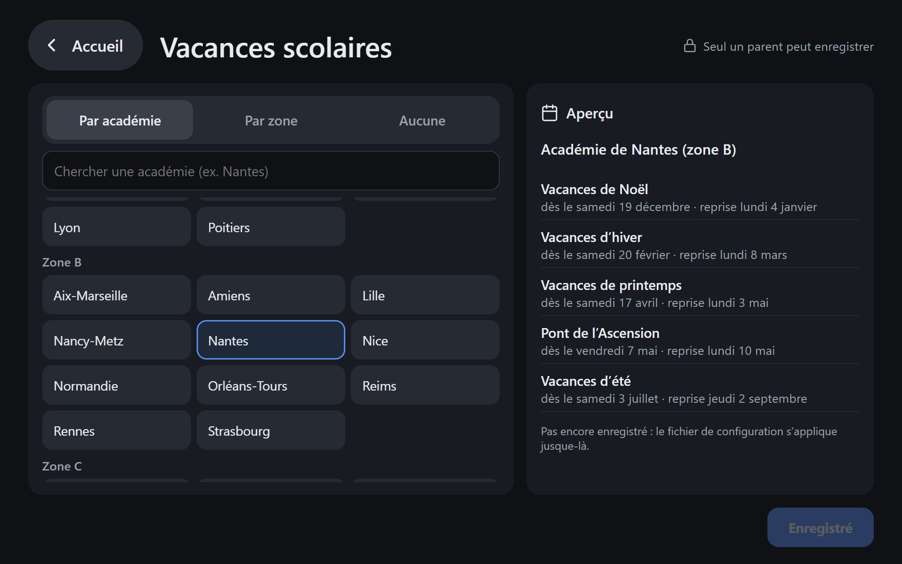

### Téléphones

Relier un téléphone à un profil (QR code), voir et retirer les téléphones reliés.

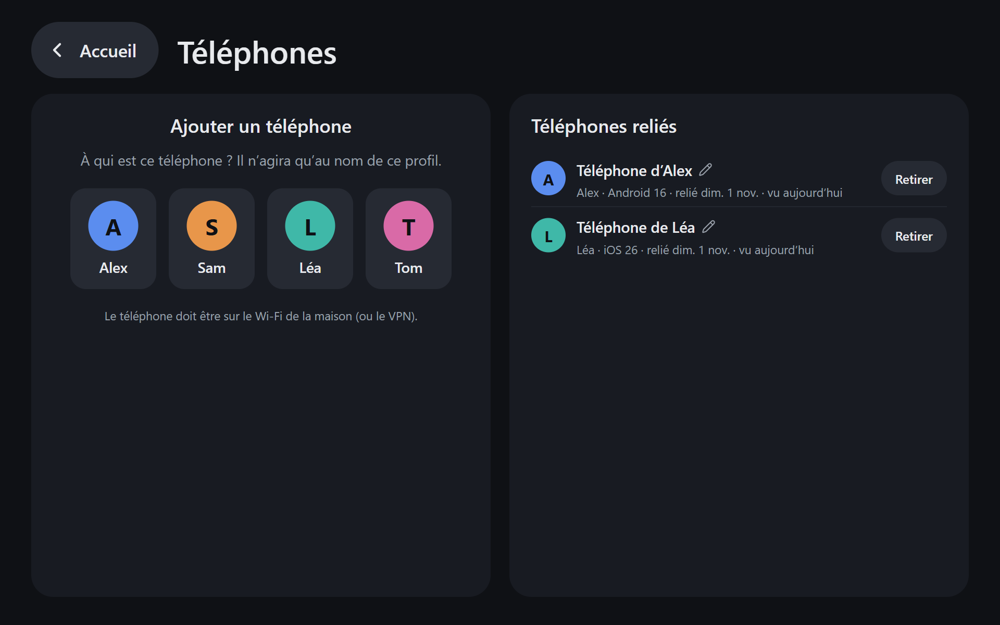

### Le NAS

État général, jauges, points à surveiller, services, événements récents (relevé d'exemple).

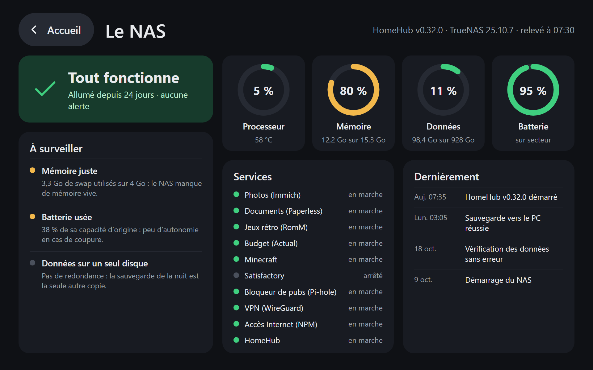

### Recettes

Le carnet de la famille : trois recettes importées d'un faux site de cuisine (photo, temps, portions, site d'origine,
pastille Cookeo), une saisie à la main. Recherche sans accents, filtre Cookeo ; « Ajouter » (quelqu'un de reconnu)
importe un lien, le texte collé d'une page ou une page enregistrée (`.mhtml`), ou ouvre la saisie.

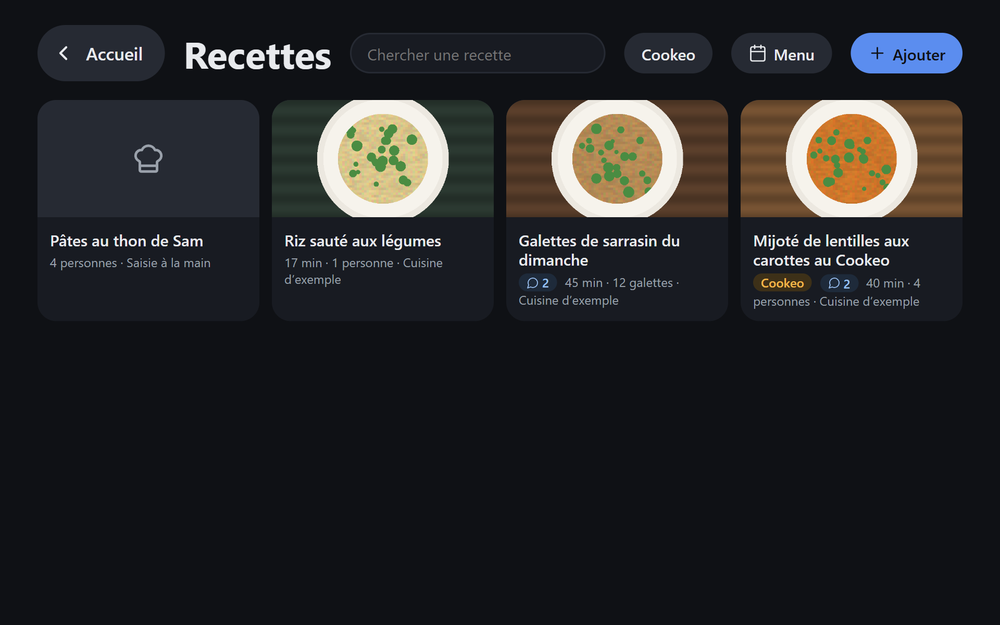

Fiche des galettes, importées par Léa : notre version, avec son astuce, une ligne corrigée à la main (le beurre,
plus bas) et ses ingrédients et étapes rangés en groupes (« Pour la pâte », « Cuisson »). Portions ± (les quantités
suivent), étapes numérotées, minuteur en un geste pour chaque durée trouvée dans
le texte ; « Voir la source » montre la recette telle que lue, et là « Relire la page » reprend ce que la page donne de
nouveau (des étapes manquées à l'import) sans écraser notre version ; la fiche le propose aussi quand il lui manque
ses étapes ou ses ingrédients. Sous les ingrédients, les **notes de la famille** : chacune signée (bordure à la
couleur de son auteur) et datée, « Résolu » la replie avec les notes résolues, toujours consultables et qui se
rouvrent ; la pastille « 2 notes » en tête de fiche y mène, et une pastille pareille marque la carte dans le carnet.

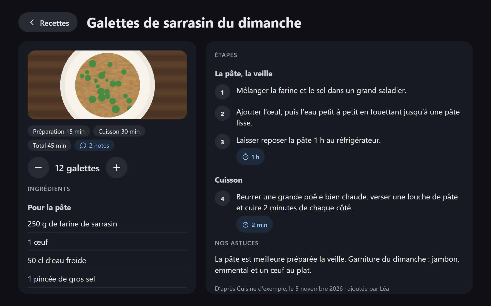

Mode cuisine du mijoté au Cookeo : une étape à la fois en grand, le mode Cookeo de l'étape, le minuteur de sa durée ;
l'écran reste allumé et la tablette ne revient pas à l'accueil. Les notes ouvertes de la famille s'ouvrent d'elles-mêmes
sur le côté (« Moins de cumin… »), pour ne pas les oublier ; « Ingrédients » prend leur place.

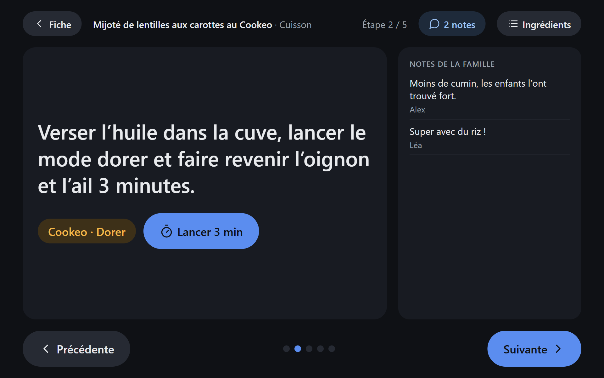

« Terminé », à la dernière étape du mode cuisine des pâtes au thon, ouvre **« J'ai cuisiné »** : le repas de mardi est
retrouvé seul (« Repas de mardi 3 », changeable, ou « Hors menu »), le nombre de personnes se règle. Chaque ingrédient
relié à un produit du stock propose sa réponse (contour bleu) : les coquillettes et le gruyère râpé, qui s'utilisent en
plusieurs fois, « Il en reste » à peu près ¼ et ¾ ; le thon, en boîtes contre des grammes, un compteur (« Retirer 1 »).
Rien ne part sans réponse : ici « Tout comme proposé » les a toutes choisies (en plein), et « Retirer du stock (3) »
décompte d'un coup. « Ne rien retirer » note seulement le repas cuisiné ; les ingrédients pas suivis dans le stock se
relient depuis le menu.

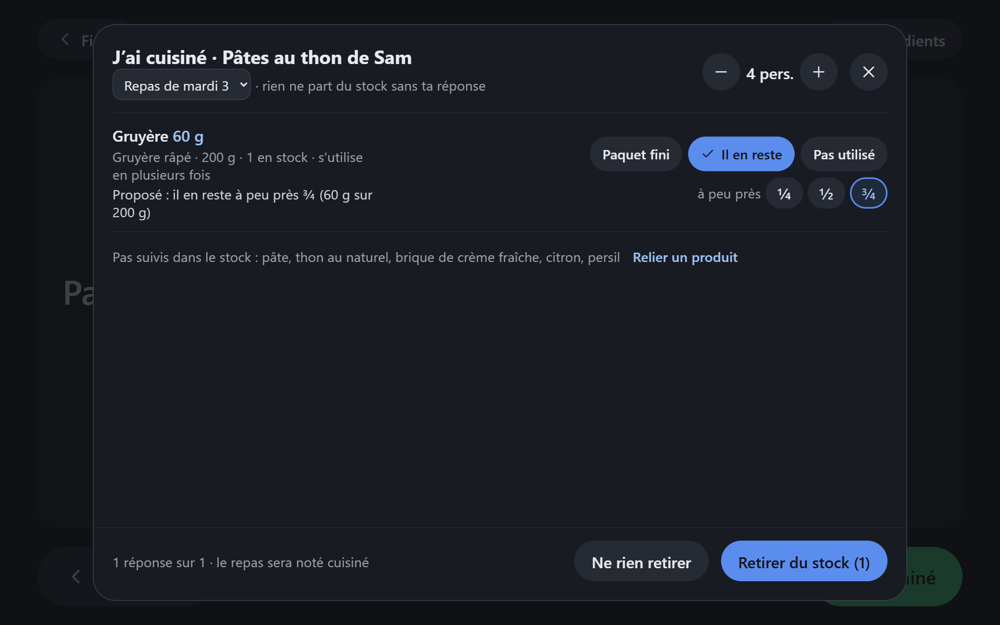

## Téléphone (PWA)

| Courses | Tâches et devoirs | Agenda | Mots |
|---|---|---|---|
| 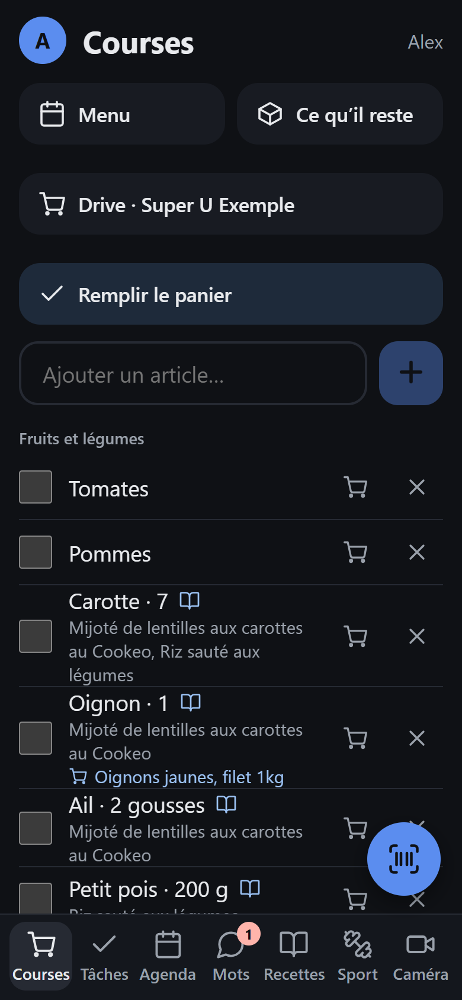 | 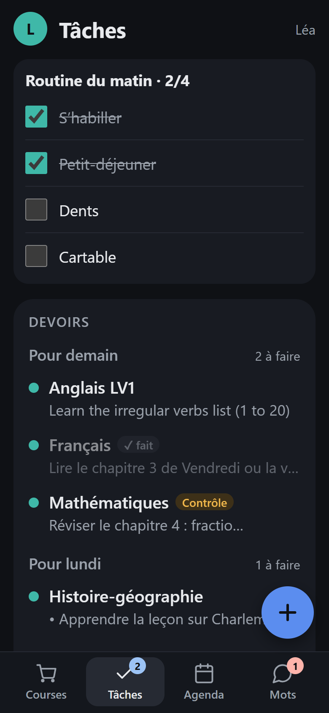 | 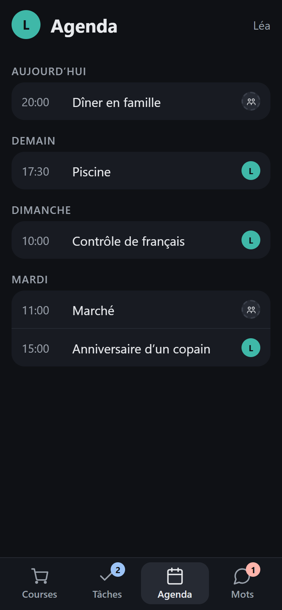 | 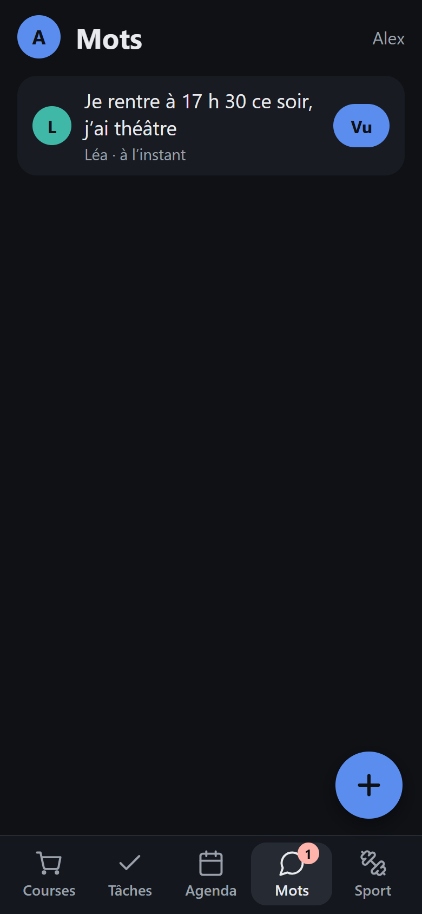 |

Les tâches s'ouvrent filtrées sur la personne du téléphone (ici Léa) ; si elle n'a rien à faire, sur « Tous ». Son
bouton reste affiché après « Tous », même à 0, pour revenir à ses tâches ; les autres n'ont un bouton que s'ils ont
une tâche. Même règle sur la tablette pour le profil d'où l'on ouvre les listes.

### Caméra en direct (téléphone d'un parent)

Onglet Caméra, pour les parents : la caméra de face de la tablette en direct (ici la fausse caméra de Chrome). Le son
demande souvent un premier geste : « Activer le son ». La diffusion s'arrête en quittant l'onglet ou quand la page est
masquée. Pendant ce temps, la tablette affiche le bandeau « Caméra en direct · Alex » en haut de tous ses écrans.

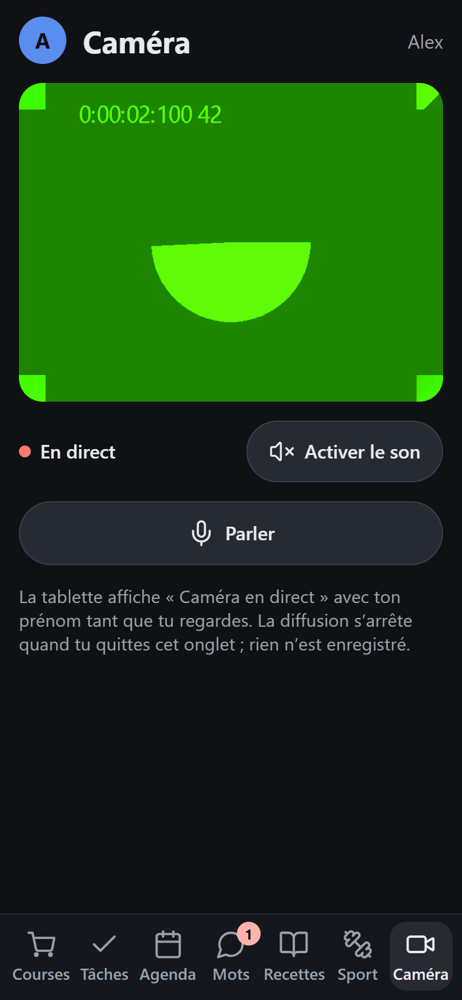

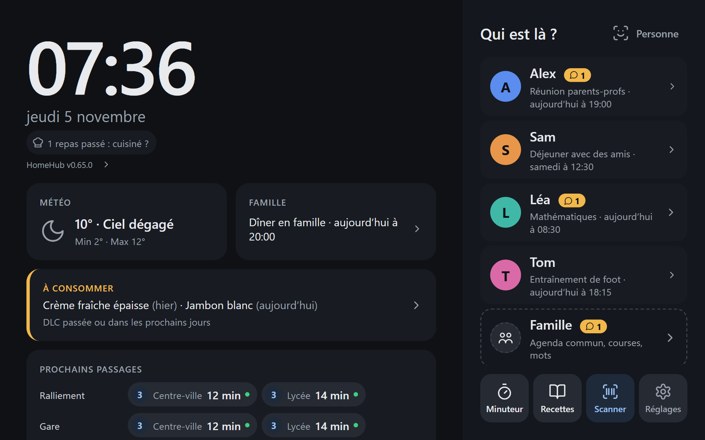

Alex appuie sur « Parler » (ici le faux micro de Chrome) : la tablette sonne un court carillon, puis joue sa voix et
affiche « Alex parle », même si le bandeau de la caméra est désactivé. Sur le téléphone, le son de la tablette est
coupé tant qu'Alex parle (pas d'écho) ; « Arrêter de parler » le rétablit.

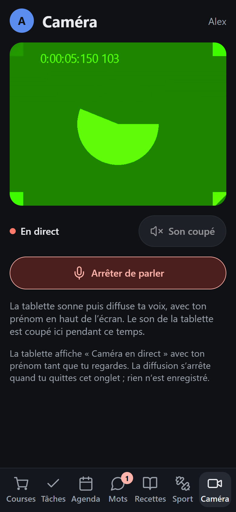

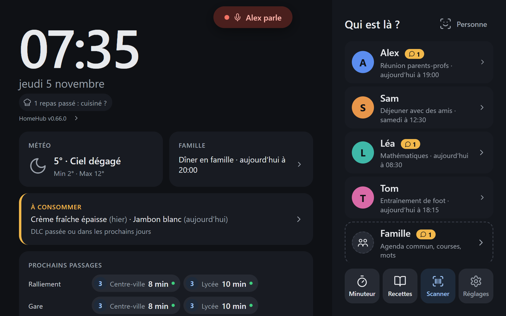

Plus bas, « Message à la télé » (si une télé est configurée) : Alex écrit un court message, avec le compteur des 140
caractères permis, puis l'envoie ; le téléphone confirme le texte parti et sa durée d'affichage.

| Écrire | Envoyé |
|---|---|
| 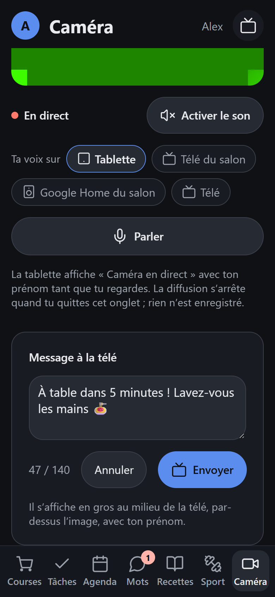 | 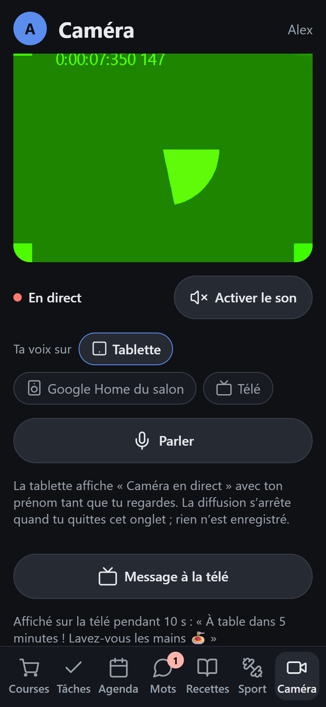 |

Sur la télé (ici une **maquette** : la fausse télé du monde fictif reçoit la requête, et l'image de programme est
inventée), le message s'affiche au centre, en gros, sur fond noir, par-dessus l'image, pendant 10 s. L'allure exacte
est celle de l'appli *Notifications for Android TV* : à confirmer sur la vraie télé.

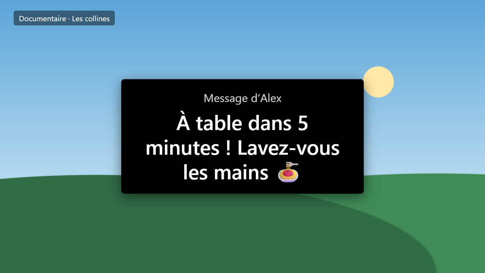
Avec des appareils Cast déclarés (`cast` dans homehub.yaml ; ici deux faux appareils du monde fictif), **Ta voix sur**
choisit la destination du micro : la tablette, en direct (« Parler »), ou le Google Home du salon, la télé : message
enregistré. Alex choisit le Google Home, appuie sur « Enregistrer un message », parle, puis « Envoyer » : l'enceinte
le lit une ou deux secondes plus tard, et le téléphone confirme « Message lu sur Google Home du salon ».

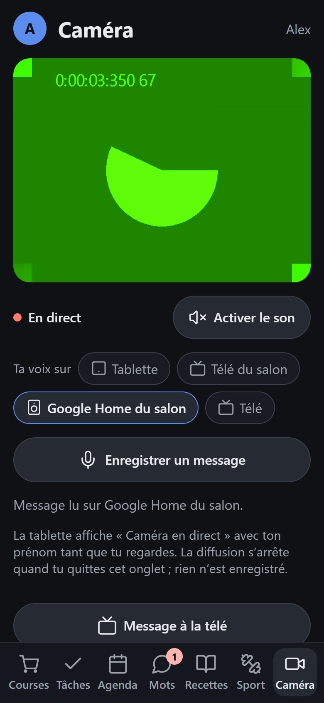

### Vie scolaire sur le téléphone d'un parent

En tête de l'onglet Agenda ; la toucher ouvre le détail.

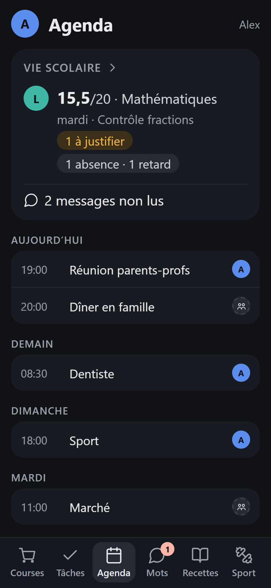

### Stock du téléphone

« Ce qu'il reste à la maison », en haut de l'onglet Courses : pour le voir au magasin. Recherche, produits en stock
ou épuisés, ± 1 et « Épuisé » sur chaque produit ; ni heure ni auteur dans la liste, ils restent dans la fiche du produit ; plus bas, les
contenants en lecture seule. Les dates de péremption s'y voient (pastille courte, filtre « À consommer »).

| Stock | À consommer | Produit sans code-barres |
|---|---|---|
|  |  |  |

Le bouton + ajoute un produit sans code-barres, comme sur la tablette. Sa fiche (ici des pommes du marché, 1,2 kg)
dit d'où il vient, se met à jour avec **Modifier la quantité** (« il reste 800 g », racheté) et garde l'historique.

### Sport

Onglet Sport, pour un adulte qui a un programme (Alex) : la prochaine séance (palier, rythme, durée, les six
exercices, avec leur vignette), un changement d'exercice proposé, la semaine (cardio, tour de taille et sa courbe),
l'historique ; la fiche d'un exercice (animation, consignes, muscles sur la silhouette, erreurs fréquentes, autres
versions) ; la fin de séance (ressenti global,
puis difficulté, gêne, répétitions et note par exercice).

| Prochaine séance | Fiche d'un exercice | Fin de séance |
|---|---|---|
|  |  |  |

Prochaine séance ci-dessus : palier 2 choisi lundi, en deux temps ; dans la séance 3, pas encore faite, jambes, dos et gainage sont « nouveau au
palier 2 » (avec l'exercice d'avant), cardio, poussée et une jambe passent « après la prochaine bonne semaine ».
Réglages du programme cochés (élastique de tirage, sans sauts) : la séance 1 avec le rowing à l'élastique et les
jumping jacks sans saut « à la place de » Jumping jacks ; la carte des réglages, en bas de l'onglet.

| Avec les réglages | Réglages du programme |
|---|---|
|  |  |

Statistiques (lien sous l'historique), sur six semaines de séances fictives : le résumé et les séances par semaine
(toucher une barre ou un point affiche sa valeur dessous), le temps d'effort et le ressenti moyen, chaque exercice
avec la courbe de ses répétitions.

| Résumé | Progression | Par exercice |
|---|---|---|
|  |  |  |

### Scanner du téléphone

Bouton code-barres de l'onglet Courses. Un paquet vient d'être lu et reste devant la caméra : le bandeau donne le
nom, la marque et la contenance, ce qui a été fait, et demande de retirer le produit (il n'est compté qu'une fois).
Les scans sont au nom du profil du téléphone (Alex), chaque passage avec son heure.
Capture faite avec la fausse caméra de Chrome et un faux lecteur de codes-barres.

### Recettes du téléphone

Onglet Recettes : le carnet en liste, la fiche en une colonne, notre version à modifier (ici par Léa, qui a ajouté
les galettes : chaque ligne d'ingrédient analysée, « Ajuster » pour corriger quantité, unité ou nom, « corrigé » quand
c'est fait). Les groupes se gèrent sur place : le titre d'un groupe se renomme (le nom d'un autre groupe les
réunit), ↑ le monte, × le retire (ses lignes rejoignent le groupe d'avant) ; chaque ligne choisit son groupe, une ligne
qui monte au-delà du premier rang de son groupe passe dans celui d'avant, et « Groupe » en crée un nouveau, où vont
aussi les lignes ajoutées. Une page partagée sans recette lisible (un billet de blog) propose la saisie à la main,
lien gardé ; un
lien partagé peut aussi aller sur une liste. Les notes des galettes vues par Léa : la sienne se résout, se modifie ou
se retire ; celle d'Alex se lit seulement ; la note résolue, dépliée, se rouvre.

 

| Carnet | Fiche | Notre version | Lien partagé |
|---|---|---|---|
|  |  |  |  |

Quand le site refuse la lecture par HomeHub, l'import le dit et propose de passer par le navigateur : **Coller le
texte** de la page, ou envoyer la **page enregistrée** (`.mhtml`). Ici, le texte copié d'une page entière (menu, notes,
publicité, « Vous aimerez aussi », commentaires) partagé vers HomeHub : l'aperçu dit ce qui a été compris (titre,
4 personnes, temps, 8 ingrédients, 4 étapes, lien de la page) et tout se corrige avant « Enregistrer ».

| Site qui refuse | Aperçu d'un texte collé |
|---|---|
|  |  |

### Menu du téléphone

Depuis les onglets Courses et Recettes : le menu en une colonne, puis ses courses. Un parent ajoute une recette (nombre
de personnes, jour), la règle ou la retire d'un geste (croix, « Annuler » quelques secondes) ; un enfant le voit sans le
modifier : « À vérifier au placard » s'affiche, sans les boutons. « Stock » propose de relier un produit à un
ingrédient : deviné d'après le nom, les catégories Open Food Facts et la contenance, confirmé une fois, puis retenu (la
boîte « Miettes au naturel » est proposée pour le thon « d'après sa catégorie Open Food Facts », jamais reliée
d'office) ; « S'utilise en plusieurs fois »
est deviné (« deviné ») et se change d'une case. Sur la liste de courses, la ligne du gruyère dit « À vérifier : paquet
peut-être entamé ». Les frais d'un repas tardif attendent « À acheter plus tard », dans le menu comme en bas de la
liste de courses, par jour d'achat (« Demain », « Dimanche 8 »), avec « Acheter maintenant » pour un parent.

| Menu | Ajouter une recette | Stock et ingrédients |
|---|---|---|
|  |  |  |

| Proposition d'après la catégorie |
|---|
|  |

 

 

« J'ai cuisiné », en bas de la fiche d'une recette, ouvre le même panneau en plein écran (réponses proposées en
contour, rien de choisi) ; dans le menu, le repas noté cuisiné porte sa marque et « Annuler ».

 

### Drive du téléphone

Bouton « Drive » de l'onglet Courses : un parent choisit l'enseigne (Courses U) et le magasin de retrait. Le chariot
d'un article ouvre « Produit chez Courses U » : le produit retenu pour le gruyère (contenance, code-barres, « 1 ×
200 g pour 160 g »), un secours (le grand paquet) qu'on peut prendre à sa place mais jamais pris d'office, et le lien
d'une autre fiche à coller. Partager une fiche depuis l'appli de l'enseigne propose « Relier à un article de la liste »
; l'article choisi, la fiche est lue une fois (nom, contenance, code-barres) et se corrige avant d'être retenue. Quand
le site refuse la lecture, rien n'est contourné : on saisit le produit, ou on le reprend du stock (« Au stock : Lait
demi-écrémé · 1 L »).

| Réglages | Produit retenu | Fiche partagée |
|---|---|---|
|  |  |  |

| Fiche lue | Site qui refuse la lecture |
|---|---|
|  |  |

**Remplir le panier** (bouton des courses) : les articles dans l'ordre des rayons, chacun avec son produit retenu, le
nombre de paquets et « Fiche » ; on coche à mesure qu'on remplit le panier dans l'appli de l'enseigne. Les oignons se
comptent en pièces et le filet pèse 1 kg : HomeHub demande une fois combien de pièces il contient. Le
récapitulatif dit ce qui part au drive (la lessive, déjà cochée), ce qui reste à mettre au panier et ce qui s'achète
ailleurs, avec le prix vu par l'extension sur la fiche de la lessive et le total indicatif. Dans la liste, la lessive
est passée dans « Au drive », pas encore cochée comme achetée. L'onglet « Extension » copie le panier pour
l'extension « Remplir le panier » (les articles qui ont un produit retenu et ne sont pas encore cochés) et reçoit son
compte rendu.

| Remplir le panier | Récapitulatif | Au drive dans la liste |
|---|---|---|
|  |  |  |

**Introuvable ou en rupture** : le compte rendu de l'extension a dit le gruyère indisponible au magasin. Dans
« Remplir le panier », il ne part plus au panier : HomeHub propose son secours (« Remplacer par… » le paquet de
500 g, pour ce panier seulement), un autre produit par sa fiche, ou « De retour en rayon » ; rien n'est choisi
d'office. Un produit à mettre au panier peut aussi être signalé à la main (« Introuvable ? »). Sa fiche produit le
dit aussi (« Remplacer pour ce panier », « Le retenir à la place », et la trace « Introuvable ou en rupture le… »,
capture « Produit retenu et secours » plus haut). Dans la liste classique, le gruyère reste dans son rayon, signalé
« à remplacer ».

| Rupture dans Remplir le panier | Signalé dans la liste |
|---|---|
|  |  |

### Extension « Remplir le panier » (ordinateur)

Sur une fausse fiche du monde fictif (allure neutre « Drive d'exemple », servie à l'adresse des fiches Courses U sans
jamais appeler le vrai site, `npm run extension:check`). Pendant le remplissage, un bandeau en bas de la page dit
où on en est (ici le gruyère vient d'être ajouté en deux paquets, la lessive suit), avec « Arrêter ». À la fin, le
panier du site contient les produits et le bandeau résume (un produit indisponible a été passé, le thon était déjà
au panier ; HomeHub le signalera « à remplacer »). Au premier captcha, l'extension s'arrête et le dit ; la personne finit à la main. Le panneau de
l'extension liste ce qui est parti et propose le compte rendu à recoller dans HomeHub.

| Panier rempli | Arrêt au captcha |
|---|---|
|  |  |

## Non capturés

- **Visages** : demande la caméra de la tablette. Un profil aux prises anormalement semblables y est signalé
  « prises anormales » (à effacer et refaire) ; le diagnostic indique le moteur de calcul (`faces.backend`).
- **Veille**, **minuteur qui sonne**, **sélecteur de durée**, **QR code d'appairage** : écrans passagers, à ajouter
  si besoin.
