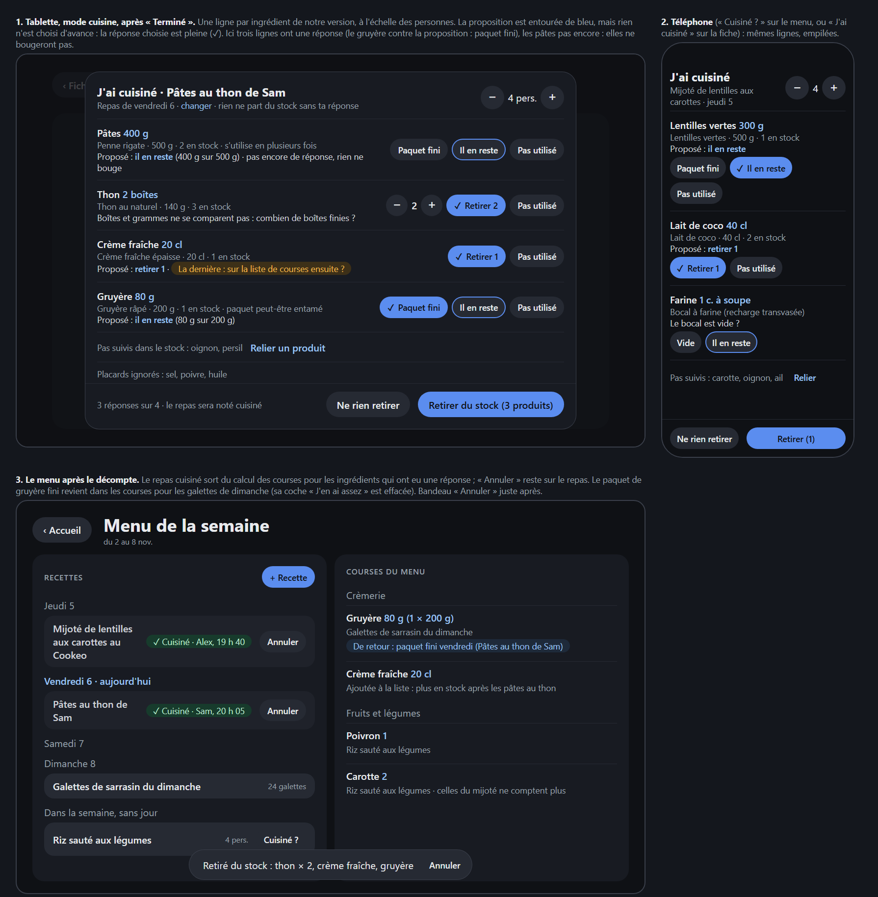

# Proposition : retirer du stock ce qu'on cuisine

Proposition du 12 novembre 2026, faite sur `main` en 0.57.0, **avant tout code**. Elle répond à la case du
[TODO](../TODO.md) « Peut-être plus tard : décompter le stock quand on cuisine une recette du menu » : à proposer,
ingrédient par ingrédient, annulable, **jamais d'office**. Rien n'est décidé tant que les [questions](#9-questions-à-trancher)
ne sont pas tranchées.

Maquette statique (thème de `web/src/app.css`, monde fictif) : [maquette-decompte-cuisine.html](maquette-decompte-cuisine.html).

## 1. Ce qu'on a aujourd'hui, et le piège

- Le stock compte des **paquets entiers** (`stock.json`, quantité entière par code-barres). Il ne sait pas combien il
  reste dans un paquet ouvert ; il sait seulement qu'un paquet est entré et pas encore sorti.
- Les sorties se font au scan d'un paquet vide, ou par « Épuisé » / − 1 sur la page Stock ; un produit épuisé déclenche
  la proposition de liste de courses (Oui / Oui, et toujours d'office / Non). On n'annule que le **dernier** mouvement
  d'un produit.
- Le menu (`shared/menu.ts`) **consomme le stock dans le calcul**, semaine après semaine, pour **tous** les repas de la
  semaine en cours, déjà cuisinés ou non. Un produit relié qui s'utilise en plusieurs fois (gruyère, farine) a
  peut-être un paquet entamé : seuls (nombre − 1) paquets sont sûrs, d'où « À vérifier au placard ».

**Le piège** : si l'on retire les pâtes du stock après le repas de lundi sans rien changer d'autre, le calcul de la
semaine compte encore les pâtes de lundi, ne les trouve plus dans le stock… et les remet sur la liste de courses.
Décompter le stock impose donc de dire au menu qu'un repas est **cuisiné** (voir § 5). C'est le cœur de la proposition.

## 2. Quand et où on déclenche « J'ai cuisiné »

Toujours un geste de la personne ; aucune fenêtre qui s'ouvre seule, rien sur l'accueil.

| Où | Geste | Remarques |
|---|---|---|
| **Tablette, mode cuisine** | « Terminé » à la dernière étape ouvre « Retirer du stock ? » (on peut fermer : rien ne change) | Le cas le plus naturel : on vient de cuisiner, les paquets sont sur le plan de travail. Le repas du menu est retrouvé seul (voir § 6, recette deux fois). |
| **Menu, tablette et téléphone** | Bouton « Cuisiné ? » sur un repas d'aujourd'hui ou d'un jour passé de la semaine (et sur les repas sans jour) | Pour noter après coup (« on l'a fait hier soir »). Un repas cuisiné porte « Cuisiné · Alex, 19 h 40 » et « Annuler ». |
| **Téléphone, fiche recette** | « J'ai cuisiné » en bas de la fiche, quand la recette est au menu de la semaine | Le téléphone n'a pas de mode cuisine (il renvoie à la fiche). |
| **Hors menu** | Même panneau depuis le mode cuisine ou la fiche d'une recette qui n'est pas au menu | Personnes : celles choisies dans la fiche ; aucun effet sur le menu (§ 6). |

Rappel des repas passés non notés : **rien** en première étape. Plus tard, peut-être une ligne discrète dans la carte
« Recettes » du menu (« 2 repas passés : cuisinés ? »), jamais une alerte (question 5).

## 3. Ce qui est proposé de retirer

Le serveur calcule la proposition à partir de **notre version** de la recette, mise à l'échelle du nombre de personnes
du repas (`scaleFactor`, comme les courses ; une plage compte pour sa borne haute). Le nombre de personnes se corrige
en tête du panneau (« On était 3 ») et la proposition suit. Chaque ingrédient donne **une ligne**, rangée dans un de
ces cas :

| Cas | Exemple (monde fictif) | Proposé | Réponses |
|---|---|---|---|
| Produit relié, **utilisé en une fois** (boîte, brique), unités qui se comparent | Crème fraîche 20 cl → « Crème fraîche épaisse · 20 cl », 1 en stock | **− 1** (arrondi au paquet, `packsFor`) | « Retirer 1 » · « Pas utilisé » |
| Produit relié, **utilisé en plusieurs fois** (`partial`) | Gruyère 80 g → « Gruyère râpé · 200 g » | « Il en reste » (80 g < 200 g) | « Paquet fini » (− 1) · « Il en reste » · « Pas utilisé » |
| Idem, besoin plus grand qu'un paquet | Pâtes 600 g → « Penne · 500 g », 2 en stock | « 1 paquet fini, le 2ᵉ entamé » | « Paquet fini » · « 2 finis » · « Il en reste » · « Pas utilisé » |
| Produit relié, **unités qui ne se comparent pas**, ou contenance inconnue | Thon « 2 boîtes » → « Thon au naturel · 140 g » | Combien de paquets finis ? (compteur, à 2 quand la recette compte en boîtes) | Compteur · « Pas utilisé » |
| **Contenant de la maison** (recharge transvasée) | Farine → « Bocal à farine » | « Le bocal est vide ? » | « Vide » (même chemin que le bouton « Vide » du contenant) · « Il en reste » |
| Ingrédient **à goût** (« persil »), ou **facultatif** | Persil → « Persil plat » | rien | « Utilisé, fini » · « Il en reste » · « Pas utilisé » |
| Plusieurs produits reliés au même ingrédient | Deux gruyères en stock | le produit déjà en stock | choix du produit dans la ligne |
| Produit relié **pas en stock** d'après HomeHub | Lardons, 0 en stock | rien (jamais de stock négatif) | aucune ; « pas en stock d'après HomeHub » |
| **Sans produit relié** | Oignon, ail | rien | aucune ; regroupés en bas (« Pas suivis dans le stock : oignon, ail ») avec « Relier un produit » (fenêtre des liens du menu) |
| Placards toujours ignorés | Sel, poivre, huile | rien | une ligne grise, sans réponse |

**Toujours confirmé ligne par ligne.** La proposition est écrite sur la ligne et son bouton est entouré de bleu
(`--rain`), mais **aucune réponse n'est choisie d'avance**. Une ligne sans réponse ne retire rien. Le bouton du bas dit
ce qui va partir : « Retirer du stock (3) » ; « Ne rien retirer » note seulement le repas cuisiné. Rien n'est retiré
avant ce bouton.

Ensuite, un bandeau « Retiré du stock : penne, thon × 2, crème fraîche · **Annuler** » (comme pour un repas retiré du
menu, 0.51.1), puis, s'il y a lieu, la proposition de liste de courses habituelle, **regroupée** pour les produits
épuisés (« Plus de crème fraîche ni de thon : sur la liste ? »), avec les réglages « toujours d'office » de chaque
produit.

## 4. Annuler

- **Tout de suite** : « Annuler » du bandeau.
- **Plus tard** : « Annuler » sur le repas cuisiné dans le menu, ou dans l'historique du produit (page Stock).
- Les mouvements d'un même décompte portent un identifiant commun (`cook`). Annuler le décompte annule chacun de ses
  mouvements **s'il est encore le dernier de son produit** (règle actuelle du stock, qui protège la suite) ; sinon la
  ligne reste et le bandeau le dit (« Penne : rescanné depuis, à corriger sur la page Stock »). Le repas redevient
  « pas cuisiné », les décisions effacées au § 5 reviennent, l'article de courses ajouté d'office est retiré.
- Les mouvements gardent l'auteur (profil du téléphone, personne reconnue, sinon anonyme) et la raison « Cuisiné :
  Pâtes au thon de Sam » dans l'historique du produit.

## 5. Effets sur le menu, les courses et le placard

**Repas cuisiné.** L'entrée du menu reçoit `cooked: { at, by, cook, keys }`, où `keys` sont les ingrédients **qui ont
eu une réponse**. Pour ces ingrédients-là, le repas ne compte plus dans le calcul des courses (c'est mangé) :

- besoin restant = besoins des repas **non cuisinés** ;
- acheté restant = ce qui est coché ou vidé du panier pour la semaine **moins** la part des repas cuisinés (on l'avait
  acheté pour eux) ;
- stock = le stock réel, déjà décompté.

Un ingrédient **sans réponse** (ou « Ne rien retirer ») continue de compter le repas, comme aujourd'hui : en cas de
doute, on achète (même règle que « À vérifier au placard »). Les sorties ne changent rien d'autre que le stock :
la synchronisation de la liste de courses tourne ensuite, comme après tout changement du stock.

| Ce qui existe | Effet d'un décompte |
|---|---|
| « J'en ai déjà » (semaine, ingrédient) | Gardé. Mais si la réponse est « Paquet fini » et qu'un autre repas de la semaine en a encore besoin, la coche est **retirée** et le résumé le dit (« Gruyère : plus de paquet, de retour dans les courses pour les galettes de dimanche »). |
| « À vérifier au placard » | « Paquet fini » efface la décision « J'en ai assez » de la semaine (le paquet qui suffisait est parti) : la ligne redevient à vérifier ou à acheter. « Il en reste » la garde. |
| Paquet peut-être entamé (placard) | « Il en reste » **apprend** que le paquet est entamé ; « Paquet fini » qu'il ne l'est plus. Étape 3 : le stock garde `opened` par produit, et un produit dont on sait qu'aucun paquet n'est entamé compte tous ses paquets comme sûrs (moins de « À vérifier au placard »). |
| Placards toujours ignorés | Rien : jamais proposés, jamais touchés. |
| Frais à acheter plus tard | Les parts d'un repas cuisiné disparaissent avec lui (cuisiné plus tôt que prévu : ses frais n'attendent plus). |
| Liste de courses | Produit épuisé : proposition habituelle (ligne ajoutée à la main, qui l'emporte sur la ligne du menu du même ingrédient, comme aujourd'hui). |
| Semaines suivantes | Le stock réel, plus bas, ne les couvre plus : c'est voulu. |

## 6. Cas difficiles

- **Unités incompatibles** (« 2 boîtes » contre 140 g, « 1 gousse » contre un filet de 250 g) : pas de calcul, la
  ligne demande combien de paquets sont finis (compteur de 0 au stock connu). Quand la recette compte en « boîte »,
  « sachet », « brique », le compteur part de ce nombre, sans être choisi.
- **Recette deux fois au menu** : chaque repas se note à part. Depuis le mode cuisine, le panneau prend le repas
  d'aujourd'hui, sinon le plus récent pas encore cuisiné, et l'écrit en tête (« Repas de jeudi · changer »).
- **Même repas noté deux fois** (tablette et téléphone, double appui) : le serveur refuse le second (repas déjà
  cuisiné) et le panneau montre « Déjà noté par Alex à 19 h 40 · Annuler ».
- **Hors menu** : mêmes lignes, personnes de la fiche, mouvements groupés et annulables ; aucun repas marqué, aucune
  coche touchée.
- **Personnes changées au dernier moment** : compteur en tête du panneau ; la proposition se recalcule, les réponses
  déjà données restent.
- **Semaine passée** : aujourd'hui en lecture seule. Proposé : la semaine précédente accepte encore « Cuisiné ? »
  pendant 2 jours (le dimanche soir oublié), sans effet sur ses courses, déjà passées (question 3).
- **Recette retirée du carnet** : le menu garde son titre mais plus ses ingrédients ; « Cuisiné ? » note seulement le
  repas.
- **Notre version modifiée entre-temps** : la proposition suit la version du moment.
- **Paquet scanné vide entre-temps** (quelqu'un a déjà jeté la brique) : le stock est à 0, la ligne dit « pas en stock
  d'après HomeHub » et ne propose rien.

## 7. Droits

- Cuisiner est une affaire de toute la famille (Léa fait des pâtes) : « Cuisiné ? » et le décompte suivent les
  **droits du stock** (`access.appliance` : la tablette, avec ou sans personne reconnue, et tout téléphone appairé),
  pas ceux du menu, réservé aux parents pour sa préparation (question 2).
- Annuler : la personne qui a noté, un parent, ou la tablette pendant le bandeau.
- Rien de personnel : ni sport ni visage ; la tablette montre l'auteur comme ailleurs dans le stock.
- Le serveur refait tout le calcul et vérifie chaque ligne (produit relié, quantité au plus le stock connu) ; le front
  ne fait qu'afficher la proposition.

## 8. Découpage en étapes

1. **Repas cuisiné et décompte depuis le menu** : `shared/cook.ts` (proposition par ingrédient, fonction pure et
   testée), `cooked` sur l'entrée du menu et la règle du § 5 dans `planNeeds` ; `POST /menu/entries/:id/cook`
   (réponses ligne par ligne), `DELETE` pour annuler ; sortie de N paquets d'un coup dans le stock, mouvements groupés
   (`cook`) ; « Cuisiné ? » sur la tablette et le téléphone, panneau, bandeau « Annuler », proposition de courses
   regroupée. Cas : une fois, plusieurs fois (fini / il en reste), unités incompatibles, sans produit relié.
2. **Mode cuisine et hors menu** : « Terminé » ouvre le panneau ; fiche du téléphone ; recette hors menu
   (`POST /recipes/:id/cook`) ; contenants de la maison ; historique du produit (« Cuisiné : … »).
3. **Paquet entamé connu** : `opened` par produit, appris par « Il en reste » / « Paquet fini » (et le scan d'un paquet
   vide) ; « À vérifier au placard » ne s'affiche plus quand on sait.
4. **Peut-être** : rappel discret des repas passés non notés ; « il en reste à peu près ¼ · ½ · ¾ » (question 4).

Chaque étape est une version, avec tests, README, `docs/ecrans.md` et captures du monde fictif.

## 9. Questions à trancher

1. **Lignes sans réponse** : rien retiré (proposé). Faut-il un bouton « Tout comme proposé », qui choisit d'un geste
   la réponse proposée de chaque ligne (plus rapide, mais proche du « d'office ») ?
2. **Qui peut noter un repas cuisiné** : toute la famille, comme le stock (proposé), ou les parents seulement, comme
   le menu ?
3. **Semaine précédente** : « Cuisiné ? » encore 2 jours après la fin de la semaine (proposé), ou semaine en cours
   seulement ?
4. **« Il en reste »** : seulement « entamé » (proposé, étape 3), ou une estimation (¼, ½, ¾) qui servirait au calcul
   du menu ?
5. **Rappel des repas passés non notés** : rien (proposé pour commencer), une ligne dans le menu, ou sur l'accueil ?
6. **« Ne rien retirer »** : le repas est noté cuisiné mais compte encore dans les courses pour ses ingrédients
   (proposé : en cas de doute, on achète) ; ou bien il sort entièrement du calcul ?
7. **Annuler plus tard** : jusqu'à quand ? Proposé : tant que la semaine du repas est la semaine en cours.
