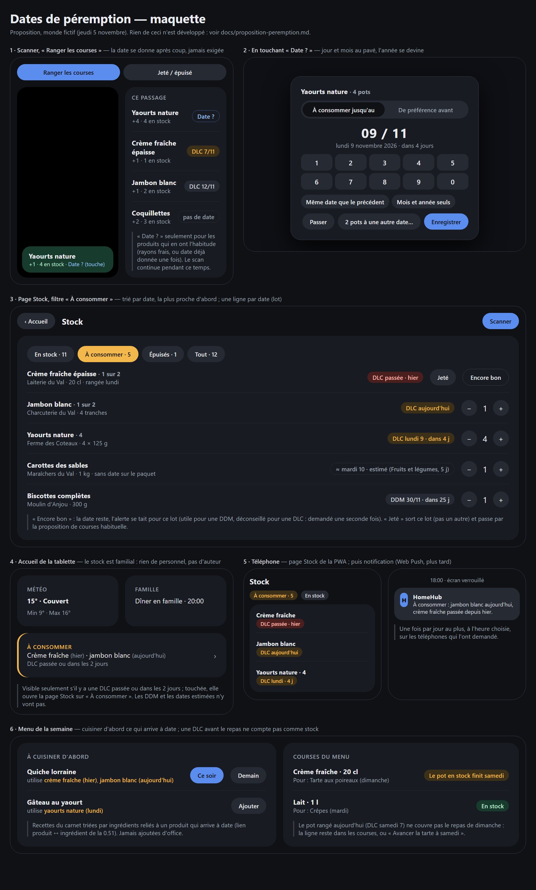

# Proposition : dates de péremption du stock

Proposition seulement (12/11/2026), rien n'est développé. But : noter les dates des produits rangés sans ralentir
le scan, puis repérer ce qui arrive à date ou l'a dépassée, et aider à le cuisiner avant de le jeter.

Maquette statique (thème de `web/src/app.css`, monde fictif, jeudi 5 novembre) : [maquette-peremption.html](maquette-peremption.html).



## 1. Ce que le stock sait aujourd'hui

- `stock.json` garde **une quantité par code-barres** (`stock[code].quantity`) et un journal de mouvements
  (`in`, `out`, `refill`, `container-empty`), chacun annulable s'il est le dernier de son produit.
- Une sortie retire « une unité » sans savoir laquelle. Deux pots de crème achetés à une semaine d'écart sont
  indiscernables.

Une date par entrée oblige donc à introduire des **lots** : chaque entrée (ou chaque date différente au sein d'une
entrée) devient un lot avec son nombre d'unités et sa date. La quantité du produit reste la somme des lots, et tout
le reste (menu, « paquet peut-être entamé », drive) continue de lire la quantité.

## 2. Saisir la date sans freiner le scan

Principe : **le scan ne s'arrête jamais pour une date.** La date est facultative, se donne après coup, et ne se
demande que là où elle sert.

### Au scan (« Ranger les courses »)

- Chaque code lu fait toujours son bip et son « +1 » tout de suite (rien ne change dans `lib/scan-gate.ts`).
- Dans « Ce passage », la ligne du produit porte une pastille **« Date ? »** (maquette, panneau 1) quand le produit
  « a l'habitude » d'en avoir une :
  - rayon frais (`isFresh` de la 0.57 : Crèmerie, Boucherie, Poissonnerie, Fruits et légumes, Boulangerie) ;
  - ou produit pour lequel une date a déjà été donnée une fois (retenu sur le produit, `askDate`) ;
  - jamais pour un produit marqué « sans date » (sel, lessive, conserves si on le choisit) : un appui long sur la
    pastille → « Ne plus demander ».
- Toucher la pastille ouvre un petit pavé (panneau 2), pendant que la caméra reste en pause comme pour les autres
  fenêtres du scanner :
  - **DLC / DDM** en deux boutons, retenu par produit (`dateKind`) : une fois le yaourt réglé en DLC, on n'y pense
    plus ;
  - **jour et mois** au pavé (4 chiffres), l'année se devine : la prochaine occurrence de cette date, sauf si elle
    est à plus de 10 mois (alors l'année en cours : c'est une date déjà passée) ;
  - « Mois et année seuls » pour une DDM imprimée « 03/2027 » (rangée au dernier jour du mois) ;
  - « Même date que le précédent » (6 yaourts du même pack, deux paquets du même lot) ;
  - « N à une autre date… » quand une entrée de plusieurs unités a deux dates (découpe le lot) ;
  - « Passer » : rien n'est exigé.
- Plusieurs scans du même produit pendant un passage et sans date se regroupent dans le même lot ; la date donnée
  s'applique à tout le lot.

Option à trancher : un réglage « Demander la date à chaque produit frais » qui ouvre le pavé d'office (un parent qui
range seul et veut tout dater). Par défaut : non, pastille seulement.

### Après coup

- Page Stock et fiche du produit : chaque lot montre sa date ou « Ajouter une date ». Utile le lendemain, ou pour
  le stock déjà présent.
- Téléphone : même chose sur `/m/stock` (le téléphone sert souvent au rangement).

### DLC contre DDM

| | DLC « à consommer jusqu'au » | DDM « de préférence avant » |
|---|---|---|
| Produits | frais, viande, poisson, laitages | épicerie, conserves, biscuits |
| Après la date | à ne plus manger | encore consommable, qualité moindre |
| Affichage passé | rouge (`--bad` sur `--danger-bg`) | gris neutre, « DDM passée » |
| Accueil, notifications | oui | non |
| Menu | ne compte plus comme stock pour un repas après la date | compte toujours |

Valeur par défaut de `dateKind` d'un produit jamais daté : DLC si rayon frais, DDM sinon. Piste : les catégories
Open Food Facts (déjà prévues pour le menu, voir `TODO.md`) affineraient ce choix.

### Lecture automatique (pistes, pas pour la première étape)

- **Codes GS1 avec date** : les codes 2D (DataMatrix, QR « GS1 Digital Link ») et GS1 DataBar étendu portent parfois
  la date (identifiant d'application 17, « date limite ») et le lot (10). Le programme « Sunrise 2027 » pousse ces
  codes en caisse ; certains rayons frais les ont déjà. `BarcodeDetector` lit déjà `data_matrix` et `qr_code` : si
  le code lu contient `(17)AAMMJJ`, la date est remplie seule, sans rien demander. Peu coûteux à ajouter dès que
  les vrais paquets en ont ; à vérifier en conditions réelles.
- **Photo de la date (OCR)** : dates souvent imprimées à jet d'encre en points, sur fond courbe ou brillant. Tesseract
  en local s'y prend mal ; un modèle de vision serait bien plus fiable mais l'image sort de la maison. C'est le même
  choix que pour la **lecture des tickets de caisse** et des captures de recettes (`TODO.md`, « Prix » et
  « Recettes ») : un seul moteur, choisi une fois, servira aux trois. Pas avant que ce choix soit fait.
- Les commandes drive ne donnent pas de date ; rien à en tirer.

## 3. Durées par défaut pour les frais sans date

Fruits et légumes en vrac, pain, produits sans code-barres (session parallèle « stock sans code ») : aucune date
imprimée. Proposition : une **date estimée** = date d'entrée + durée du rayon, affichée « ≈ mardi 10 · estimé »
(pastille en pointillés, panneau 3), modifiable comme une vraie date.

| Rayon | Durée proposée |
|---|---|
| Boulangerie | 2 jours |
| Poissonnerie | 2 jours |
| Boucherie (sans date) | 3 jours |
| Fruits et légumes | 5 jours |
| Crèmerie (sans date) | 7 jours |
| Autres rayons | pas d'estimation |

- Réglables dans `stock.json` (`settings.expiry.defaults`), éventuellement par produit (« les pommes tiennent
  3 semaines » : on corrige une fois, c'est retenu).
- Une date estimée n'est **jamais rouge** et ne va ni sur l'accueil ni en notification : « à vérifier » seulement,
  dans la page Stock.

## 4. Seuils

| Niveau | DLC | DDM | Estimée | Où |
|---|---|---|---|---|
| Passée | date < aujourd'hui | date < aujourd'hui | date < aujourd'hui | page Stock (DLC en rouge, autres en gris) ; accueil et téléphone pour la DLC |
| Urgent | aujourd'hui ou dans 2 jours | — | — | accueil, notification, menu |
| Bientôt | dans 5 jours ou moins | dans 30 jours ou moins | dans 2 jours ou moins | filtre « À consommer » de la page Stock, menu |

Réglables (`settings.expiry.soonDlcDays`, `urgentDlcDays`, `soonDdmDays`). Le jour change à minuit heure locale
(mêmes fonctions que `shared/dates.ts`) ; tests en local et en UTC.

## 5. Où ça se voit

- **Page Stock** (panneau 3) : nouveau filtre **« À consommer · N »** (jaune, `--warn-bg`), trié par date, la plus
  proche d'abord ; une ligne par lot quand les dates diffèrent (« 1 sur 2 »). Sur une DLC passée : **« Jeté »**
  (sort ce lot-là, puis la proposition de courses habituelle) et **« Encore bon »** (la date reste, l'alerte se tait
  pour ce lot ; demandé une seconde fois pour une DLC). Les autres filtres affichent la pastille de date à côté de
  la quantité.
- **Accueil de la tablette** (panneau 4) : une carte **« À consommer »** seulement s'il y a une DLC passée ou urgente,
  avec deux noms au plus et la date relative ; touchée, elle ouvre la page Stock sur ce filtre. Le stock est
  familial : aucun auteur, aucun profil, conforme à la règle 4 du projet. Place : sous Météo et Famille, à la
  hauteur fixe d'une tuile (elle remplace un vide, elle ne pousse rien) ; à valider sur la vraie tablette.
- **Dashboard d'un parent** : la même carte, en compact, à côté des courses (à décider : peut-être inutile si
  l'accueil l'a déjà).
- **Téléphone** (panneau 5) : `/m/stock` reçoit le même filtre ; puis, quand les **notifications Web Push** existeront
  (`TODO.md`, « Téléphone »), un message par jour au plus, à l'heure choisie (18 h par défaut, avant le dîner), sur
  les téléphones qui l'ont demandé, seulement pour les DLC urgentes ou passées. Pas de notification par produit.
- **Scanner, mode « Jeté / épuisé »** : un produit scanné qui a plusieurs lots sort le lot **à la date la plus
  proche** (premier périmé, premier sorti) ; le bandeau le dit (« sorti : celui du 4/11 »). Une fenêtre « Lequel ? »
  seulement si deux lots ont des dates très différentes et que l'un est passé (on jette sans doute le périmé).

## 6. Lien avec le menu et avec « épuisé »

### Cuisiner d'abord ce qui arrive à date (panneau 6)

- Le lien produit ↔ ingrédient existe déjà (0.51, `shared/stock-link.ts`). Une carte **« À cuisiner d'abord »** dans
  le menu de la semaine liste les recettes du carnet qui utilisent un ingrédient relié à un lot urgent ou bientôt,
  triées par nombre de ces ingrédients puis par date ; boutons « Ce soir », « Demain », « Ajouter ». Rien n'est
  ajouté d'office.
- Logique pure dans `shared/` (`expiry.ts` : niveau d'un lot, lots d'un ingrédient, classement des recettes), testée.

### Une DLC avant le repas ne compte pas comme stock

- Dans la déduction du stock (`shared/menu.ts`), un lot en **DLC** dont la date est **avant le jour du repas** ne
  couvre pas ce repas : la ligne reste dans les courses avec la mention « Le pot en stock finit samedi » et l'offre
  « Avancer la tarte à samedi ». Les DDM et les dates estimées comptent toujours (une estimée prudente ferait
  racheter à tort).
- Les déductions couvrent déjà d'abord les premiers repas : les lots les plus proches s'attribuent aux premiers
  repas, ce qui tombe bien.
- Les **frais à acheter plus tard** (0.57) restent tels quels ; la date réelle d'un lot pourrait plus tard remplacer
  les « 3 jours avant le repas », hors de cette proposition.

### « Épuisé »

- Inchangé : le produit est épuisé quand son dernier lot sort (quantité 0), même proposition de courses.
- Nouveau motif de sortie facultatif **« Jeté (périmé) »** sur un lot passé : comptera plus tard (« 3 produits jetés
  ce mois-ci », coût avec les prix). À décider : à garder ou non dès la première étape.
- Une DLC passée **n'épuise pas** d'office le produit : seul un geste (« Jeté ») sort le lot.
- La session parallèle « stock épuisé » touche à la même zone : à rebaser selon l'ordre des fusions.

## 7. Modèle de données

Dans `stock.json` (même fichier, même verrou ; champs facultatifs lus avec une valeur par défaut, donc pas de
changement de `version`) :

```ts
// stock[code]
{
  quantity: number;          // gardée = somme des lots (le menu, le drive et l'API la lisent)
  updatedAt: string;
  lots?: Lot[];              // absent : un seul lot sans date de `quantity` unités (ancien fichier)
}

type Lot = {
  id: string;
  count: number;             // > 0 ; un lot vide disparaît
  in: string;                // date d'entrée (ISO), pour l'estimation et l'ordre à date égale
  date: string | null;       // 'AAAA-MM-JJ' ; null : pas de date
  kind: 'dlc' | 'ddm' | null;
  estimated: boolean;        // date calculée d'après le rayon
  dismissed: boolean;        // « Encore bon » : plus d'alerte pour ce lot
};

// products[code]
{ ..., dateKind?: 'dlc' | 'ddm' | null; askDate?: boolean | null; keepDays?: number | null }

// settings
{ autoShop, expiry?: { soonDlcDays: 5, urgentDlcDays: 2, soonDdmDays: 30, defaults: Record<rayon, jours> } }

// movements[] : `lotId` pour une entrée ou une sortie ; `before.lots` (copie) pour annuler
// kind : + 'date' (date ajoutée ou changée, annulable) ; reason?: 'expired' pour « Jeté (périmé) »
```

- **Sortie** : retire une unité du lot à la date la plus proche (sans date : en dernier ; à égalité : le plus ancien
  entré). `remove(all)` vide tous les lots.
- **Annuler** : on remet `before.lots` ; la règle « seulement le dernier mouvement du produit » reste.
- **Entrée oubliée** (sortie d'un produit absent) : le reste entre comme un lot sans date.
- **Transvasé** : le lot sort comme aujourd'hui ; le contenant n'a pas de date (piste : garder celle du paquet).
- API : `POST /api/stock/in` accepte `date`, `kind` ; `PUT /api/stock/lots/:id` (date, type, partage
  `{ count, date }`, « Encore bon ») ; `GET /api/stock/expiring` résumé pour l'accueil (noms, niveau, date, sans
  auteur). Mêmes droits que le stock (`access.ts` : tablette ou téléphone relié).
- `StockEntry` reçoit `lots` et `expiry` (niveau le plus grave, date la plus proche), calculés par le serveur avec la
  même fonction pure que le front.

## 8. Découpage en étapes (une version chacune)

1. **Lots et date facultative** : modèle et lecture des anciens fichiers, sortie du lot le plus proche, annulation ;
   pastille « Date ? » et pavé au scanner ; date sur la fiche et la page Stock ; filtre « À consommer » trié ;
   « Jeté » / « Encore bon » ; téléphone `/m/stock`. Tests, README, `docs/ecrans.md`, captures (scanner, stock).
2. **Seuils et accueil** : niveaux réglables, carte « À consommer » de l'accueil (et peut-être du dashboard parent),
   durées par défaut par rayon et dates estimées.
3. **Menu** : « À cuisiner d'abord », DLC avant le repas qui ne couvre pas, « Avancer le repas ».
4. **Notifications** : message du soir sur les téléphones volontaires (après le chantier Web Push).
5. **Pistes** : date lue dans les codes GS1 (dès qu'on a des paquets réels qui en portent) ; OCR ou vision, avec le
   moteur des tickets ; « Jeté (périmé) » compté et chiffré avec les prix.

## 9. Questions à trancher

1. **Pastille ou pavé d'office** pour les produits frais au scan ? (proposé : pastille, réglage pour le pavé)
2. **Seuils** : DLC bientôt 5 j, urgent 2 j, DDM 30 j, notification à 18 h : ça convient ?
3. **Accueil** : carte « À consommer » visible de tous sur la tablette (pas d'auteur ni de profil) : d'accord ? Et sur
   le dashboard d'un parent en plus, ou non ?
4. **Durées par rayon** : faut-il des dates estimées, avec ces valeurs, ou seulement des dates saisies ?
5. **Sortie** : prendre d'office le lot à la date la plus proche (FEFO), sans demander, sauf lot passé ?
6. **DDM passée** : la montrer (gris) ou la taire complètement ?
7. **« Jeté (périmé) »** compté dès l'étape 1, ou plus tard avec les prix ?
8. **Menu** : une DLC avant le repas remet l'ingrédient dans les courses (proposé), ou seulement un avertissement ?
9. **Lecture automatique** : regarder tout de suite si vos produits frais ont des codes 2D avec date (essai réel au
   scanner), ou attendre le choix du moteur OCR des tickets ?
